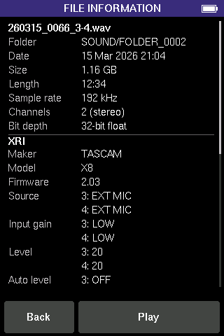
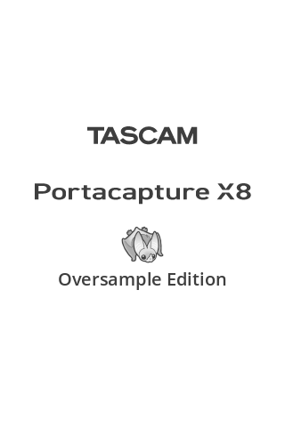

# Homebrew firmware: findings and plan

Notes from reading the V2.01 and V2.03 update files (`#PortaX8_0215.201`,
`#PortaX8_0217.203`), started 2 November 2026. The notes are in the order the
work was done, so earlier sections can describe plans and figures that later
steps changed.

**Status, 9 November 2026.** Test builds from B218 to B254 were installed and run
on the owner's X8. Not every build in that range was installed: a step's heading
says "installed" if its build ran on the unit, and "never installed" if a later
build replaced it first. B250 hung as soon as a bat screen opened (Step 28 says
why). The last build installed is B254 (Step 31), whose BAT PLAYBACK plays files
from the card. GUANO metadata, setting the clock from phone chimes and the location
log have not been checked on a unit yet. The current build is B258 (Step 35, file information in
BAT PLAYBACK), which has not been installed, nor have B255 to B257.

**Hardware tested.** One X8. Its Information screen (GENERAL SETTINGS > SYSTEM >
Information) shows `F/W: Version 2.03 Build 217` and `H/W: Version 1.00 Build 010`.
Units with other hardware versions have not been tested. See "Hardware version" in
the [firmware map](#firmware-map-v203-in-progress).

**Bluetooth.** The owner does not have TASCAM's optional AK-BT1 Bluetooth adapter,
and nothing has been tested with it. The stock firmware's Bluetooth remote code
(`FUN_80d96f68`) reads the transport state and the recorded time. This suggests
that TASCAM's app could start and stop takes while the bat screen is open, as an
alternative to the phone remote in Step 21. This has not been tested.

**Files in `work/`.** Paths that start with `work/`, such as the update files
built for each step and `work/notes/`, are in the author's local `work/` folder,
which git ignores. These update files are not published. To make an update file,
use the patcher page (see the [README](../README.md)) or `tools/x8patch.py`.

Two names are used throughout:

- **Update file:** the file Tascam publishes, which the X8 reads from the SD card.
- **Flash image:** the update file without its 32-byte header, descrambled. It is
  the data the updater writes to the 32 MiB flash, starting at the first byte. It is
  the output of `tools/x8fw.py unpack`.

In the layout tables, addresses and flash image offsets are hexadecimal, and the
offset into the flash image equals the offset from the start of flash. Offsets and
sizes in the header table are decimal bytes. Terms are explained at the end.

For the hardware, see [HARDWARE.md](HARDWARE.md). For an overview of the firmware
and how the patch fits into it, see [FIRMWARE.md](FIRMWARE.md). The original
feasibility study is [FEASIBILITY.md](FEASIBILITY.md).

## Summary

- **The update file format is understood.** `tools/x8fw.py` unpacks both releases
  and repacks them byte for byte.
- **No signature was found.** The boot header has no HAB signature, and the
  updater's error messages cover the product, the version, the checksum and flash
  writing, with no signature error. This comes from strings and headers, not from
  reading the updater code, so it is strong evidence but not proof.
- **Firmware update mode is in the main application, but it is chosen early.** The
  bootloader has no SD card driver. The main application's `main()` checks the boot
  button combinations and chooses update mode before the RTOS, the user interface or
  audio start. So a bug in audio or screen code cannot stop update mode from
  starting, provided the patch leaves the start-up and update code alone. See
  [Keeping the bricking risk low](#keeping-the-bricking-risk-low).
- **An interrupted update still bricks the unit.** The updater erases and rewrites
  the flash from the first sector, which holds the bootloader. That is equally true
  of official updates. The recovery for that case is SWD or the processor's USB
  serial download mode, which needs the unit opened.
- **The stock firmware uses NXP MCUXpresso SDK drivers, a μITRON-style RTOS, and a
  Qt for MCUs user interface.** Patching the audio code looks practical. Adding a
  screen inside the Qt UI is the hardest part, so the plan draws the bat app's
  screen directly into the framebuffer.

## Update file format

| Offset in update file | Size | Field | V2.03 value |
|---|---|---|---|
| 0 | 8 | Magic: Tascam's internal project name | `DR-TURBO` |
| 8 | 2 | Version | 203 (V2.03) |
| 10 | 2 | Build | 217 |
| 12 | 2 | Year | 2025 |
| 14 | 1 | Month | 8 |
| 15 | 1 | Day | 19 |
| 16 | 4 | sum32: the sum of the flash image bytes, except the last 4, modulo 2^32 | 0x7B86741B |
| 20 | 4 | Total length of the update file, header included | 25,493,536 |
| 24 | 8 | Zero | |
| 32 | 25,493,504 | The flash image, scrambled | |

All header fields are big-endian. The last 4 bytes of the flash image repeat sum32,
big-endian.

The scrambling replaces each byte with another through a fixed 256-entry table,
with no key. The DR-05 homebrew project worked the table out in 2016 for an older
TASCAM recorder (<https://github.com/dr05-homebrew/dr05-homebrew>,
`fwupdate/lut_decode.bin`). Analysis in the qubero hex editor project
(`crates/core/src/codec/tascam.rs` in its repository) found that the X8 uses the
same table. The header sum and the trailer sum both match the descrambled flash
image for both releases.

The updater's error messages, from the main application's strings:

| Code | Message |
|---|---|
| ERROR 93 | Product Error |
| ERROR 94 | Old Version |
| ERROR 95 | Checksum Error |
| ERROR 96 | Flash Erase Error |
| ERROR 97 | Flash Blank Error |
| ERROR 98 | Flash Write Error |
| ERROR 99 | Flash Verify Error |
| ERROR 100 | Update File Error |

**The version check (found in V2.03).** The function at 0x80e23dd0 checks an
update file's 32-byte header. It accepts two names: `DR-TURBO`, the main
firmware, and `TURBOCPL`, another part not yet identified. It checks that the
total length field matches the file's size. For `DR-TURBO` it then compares the
header's version (bytes 8 and 9, big-endian) with the version compiled into the
running firmware (a RAM structure returned by 0x80de7ec4; all 15 uses of it only
read it), and refuses the file if its version is lower (code at 0x80e23e60). The
three refusals return -9 (unknown name), -7 (wrong length) and -8 (lower
version); -8 is almost certainly ERROR 94 Old Version. **The build number is never
compared;** it is only shown on the update screen (`B%03d`, code at
0x80dfc4f8). The checksum is checked elsewhere.

What this means:

- An update file with the same version as the installed firmware is always
  accepted, whatever its build. The official V2.03 file can be installed again
  over any patched V2.03.
- A patched file that keeps the image's own version (203) leaves the official file
  installable afterwards, because the version check reads the running image, not
  the last file's header.
- An older release, such as V2.01 over V2.03, is refused, unless it is repacked
  with a header version of 203 or more. After that, the unit reports V2.01 and
  takes V2.03 again normally. This has not been tried.
- If Tascam releases V2.04 and a unit has it, a patch built on V2.03 needs a header
  version of 204 or more to install. The image would still report V2.03, so V2.04
  would install over it again.

### Tool

```bash
python3 tools/x8fw.py selftest "Tascam_X8_official/extracted/#PortaX8_0217.203"
```

```bash
python3 tools/x8fw.py unpack "Tascam_X8_official/extracted/#PortaX8_0217.203" work/v203.bin
```

```bash
python3 tools/x8fw.py diff "Tascam_X8_official/extracted/#PortaX8_0217.203" work/v203-patched.bin
```

```bash
python3 tools/x8fw.py pack work/v203-patched.bin "work/#PortaX8_0218.203" --base "Tascam_X8_official/extracted/#PortaX8_0217.203" --build 218
```

`replace` changes text at given offsets of a flash image, keeping its length, and
refuses if the old text is not there:

```bash
python3 tools/x8fw.py replace work/v203.bin work/v203-patched.bin --at 0x13814f4:TUNER:SONAR
```

`pack` recomputes sum32 in the header and in the flash image's last 4 bytes. With
`--base`, it lists every changed byte range, refuses changes to the boot header and
bootloader, and refuses changes to the start-up and update-mode code listed in
[Keeping the bricking risk low](#keeping-the-bricking-risk-low) unless
`--allow-boot-path` is given. Files in `work/` are ignored by git.

## Step 2 test files (installed 2026-11-02: the X8 accepts a repacked file)

**Result.** On 2026-11-02 the build 218 test file installed on the test unit
through the normal update procedure (the update screen showed B218), the unit
started normally, and SONAR showed both as the app's name on the LAUNCHER screen
and as the tuner app's title, in the stock font. So the updater accepts a
repacked file with recomputed sums, and no signature or other check stopped it.
Still to do: install the official `#PortaX8_0217.203` again, to prove going back
to stock from the SD card.

Two update files for step 2 of the [plan](#plan): one to test that the X8 accepts
a repacked update file, and one to put the stock firmware back.

| File | What it is | SHA-256 |
|---|---|---|
| `work/test-update/#PortaX8_0218.203` | V2.03 with "TUNER" changed to "SONAR" in two places, build 218 | `2f8c67fa…ed96ae25` |
| `work/recovery/#PortaX8_0219.203` | V2.03 unchanged, build 219. Not needed: the official file `#PortaX8_0217.203` does the same job, since only the version is compared | `af92b2f9…a65826ba` |

The two changed strings, 5 bytes each, no code:

| Flash image offset | Where the string is | Expected on screen |
|---|---|---|
| 0x13814f4 | The launcher's list of app names, beside MANUAL, FIELD, PODCAST, METRONOME and LAUNCHER | The TUNER app's name on the LAUNCHER screen |
| 0x149bc0c | The tuner app's own strings, beside CALIBRATOR and OSCILLATOR | The tuner app's title |

Either change showing on the unit proves the patched image is running. A label
drawn as an image would not change, which is why there are two. The letters S, O,
N, A and R all appear in other text on both screens, so the fonts probably have
them even if they hold only the characters the stock text uses; a name drawn
blank or partly is still a visible change. A third "TUNER", in the POCKET STUDIO
tuner screen (offset 0x13d259c), is left as it is.

**The INFORMATION screen should still show V2.03.** The image holds its own
version and build as numbers (203 and 217, big-endian, at offset 0x20400), and
the test file leaves them alone; only the update file's header says 218. So
SONAR, not the version shown, is the sign that the test worked. Because the
updater compares only versions, the official V2.03 file installs over the test
firmware afterwards.

Checked before installing: unpacking the test file gives the official flash image
with only those letters and the last byte of the trailer sum changed, and the
header differs only in the build number and sum32. The recovery file's flash image
is the official one byte for byte. `pack --base` found no change to the
bootloader or the known start-up and update-mode code.

To build them again:

```bash
python3 tools/x8fw.py replace work/v203.bin work/v203-sonar.bin --at 0x13814f4:TUNER:SONAR --at 0x149bc0c:TUNER:SONAR
```

```bash
python3 tools/x8fw.py pack work/v203-sonar.bin "work/test-update/#PortaX8_0218.203" --base "Tascam_X8_official/extracted/#PortaX8_0217.203" --build 218
```

```bash
python3 tools/x8fw.py pack work/v203.bin "work/recovery/#PortaX8_0219.203" --base "Tascam_X8_official/extracted/#PortaX8_0217.203" --build 219
```

To install one, following Tascam's update procedure:

1. Power the unit from USB or the AC adapter, not batteries.
2. Turn on SD CARD READER (GENERAL SETTINGS, OTHER SETTINGS) and copy one update
   file into the `UTILITY` folder on the card. Only one update file at a time.
3. Eject the card on the computer, press DISCONNECT, and turn the unit off.
4. Hold HOME and REC while turning the unit on, until UPDATE MODE shows.
5. Press MARK. The screen shows the installed version and build and the file's
   version and build. Check that it shows build 0218 (or 0219 for the recovery
   file) before going on.
   If it shows ERROR 94 (Old Version), ERROR 95 (Checksum Error) or ERROR 100
   (Update File Error) instead, turn the unit off: nothing has been written yet.
   ERROR 94 would mean the version check found in the code is not the whole
   rule; ERROR 95 or 100 would mean the updater checks more than sum32 and the
   length. Either is worth reporting here before trying anything else.
6. Press MARK again to install. Don't touch the power or the card until the unit
   turns itself off. Errors 96 to 99 (flash erase, blank, write and verify) come
   during writing; after one of those the unit may need hardware recovery.
7. Delete the file from the `UTILITY` folder afterwards.

Then install the official file, `#PortaX8_0217.203`, the same way. If the tuner's
name goes back to TUNER, going back to stock from the SD card is proven on that
unit.


| Flash image offset | Address when running | Contents |
|---|---|---|
| 0x0000000 | 0x60000000 | FlexSPI NOR configuration block (tag `FCFB`) |
| 0x0001000 | 0x60001000 | Image vector table (IVT). Entry point 0x60002000. Boot data at 0x60001020: image start 0x60000000, size 32 MiB. No DCD. CSF pointer 0, so no HAB signature. |
| 0x0002000 to 0x000A83D | 0x60002000 | Bootloader ("BOOT" in Tascam's source paths), about 34 KB. Runs directly from flash (XIP). Initial stack pointer 0x20080000, reset handler 0x6000A0D5. |
| 0x000A83E to 0x000FFFF | | Unused (0xFF) |
| 0x0010000 to 0x001FFFF | | Erased (0xFF) |
| 0x0020000 to 0x184FFFB | 0x80000000 to 0x8182FFFB (SDRAM) | Main application, about 25.4 MB. Flash image offset 0x20000 is address 0x80000000. |
| 0x184FFFC to 0x184FFFF | | sum32 trailer |
| 0x1850000 to 0x1F9FFFF | 0x81830000 onwards | Outside the stock flash image, about 7.3 MiB. The bootloader copies it into SDRAM anyway (it copies 0x1fc0000 bytes, flash 0x20000 to 0x1fdffff). No stock code refers to SDRAM 0x81830000 to 0x818fffff (IAR's init table starts filling at 0x81900000), so patch code goes at flash 0x1850000 to 0x191ffff. |
| 0x1FA0000 to 0x1FFFFFF | | Saved settings: records tagged `DR-TURBO` and `X8USET`, each with a checksum, in 64 KiB sectors 0x1FA, 0x1FB, 0x1FE and 0x1FF. A patch must not write here. |

**Bootloader.** It uses SDK drivers for clocks, SEMC (the SDRAM controller), LPSPI,
LPUART, GPIO and eLCDIF. Its only messages are display errors ("Display
initialization failed", "Error: LCD INIT ERR SPI ERR"). It sets up the SDRAM and the
display, then starts the main application. It has no SD card driver. It copies
everything from flash image offset 0x20000 onwards into SDRAM at 0x80000000 and
jumps to it without checking anything (found by the qubero hex editor project,
`crates/core/src/formats/tascamfw.rs` in its repository).

**Main application.** Its vector table is at flash image offset 0x20000: initial
stack pointer 0x20011CC8 (DTCM), reset handler 0x8173206D (flash image offset
0x175206C, which starts with `cpsid i` and sets the stack pointer). Most interrupt
vectors point to two-instruction stubs that jump to low addresses such as
0x0002834F. Those addresses are in ITCM, so the startup code copies time-critical
code into ITCM. The audio interrupt handlers are probably among them.

**SDRAM is large.** The updater loads the whole 25.5 MB update file into SDRAM at
0x822F3AD8, so at least about 60 MB of SDRAM is real. A teardown video shows two
SDRAM chips, so the total is probably 64 MB or 128 MB. The reset handler sets its
first stack pointer to 0x86600000, which suggests 128 MB, but it is not proof: if
the SDRAM controller's address window is larger than the chips, a high address
also works. A 10 s stereo 32-bit float look-back buffer (15.4 MB) should fit if the
stock firmware leaves that much free, which is likely even at 64 MB.

## Start-up and update mode (V2.03)

From disassembly of the main application. Addresses are the running addresses.

1. The reset handler (0x8173206C) sets up the stack, the FlexRAM split between ITCM
   and DTCM, and the vector table, then runs the C library start-up, which calls
   `main()` at 0x80DF0F78. Both programs were built with IAR Embedded Workbench for
   Arm. The application's start-up follows IAR's init table: it zeroes seven
   ranges, unpacks three LZ77-packed runs into SDRAM, the ITCM and the DTCM, then
   runs the C++ constructors. (The init table and both of IAR's packing formats
   were worked out by the qubero project; see `crates/core/src/codec/iar.rs` in
   its repository.)
2. `main()` initialises the hardware, turns the unit off if the battery is too low,
   and sets up DMA. Then it checks four boot button combinations with the function
   at 0x80DAD730 and stores the result as the **system mode** (a byte at
   0x81969DD9):

   | Button combination (table index) | System mode | Meaning |
   |---|---|---|
   | 1 (HOME and REC, per the update instructions) | 3 | Firmware update from the SD card |
   | 2 | 6 | Probably the FPGA update (see below) |
   | 0 (MARK and HOME) | 8 | Factory test mode, with a "Debug Key Scan" screen |
   | 3 | 5 | Not yet identified |
   | none, and the function at 0x80DA9582 returns true (probably external power) | 1 | Normal start |
   | none | 0 | Normal start |

3. `main()` then starts the RTOS. A system task runs a state machine (0x80DC7A3C)
   that calls the update code in mode 3.
4. **The update procedure** (0x80DFC57E, flash writer at 0x80E23ED4) reads the whole
   update file into SDRAM at 0x822f3ad8 (refusing files over 32 MiB),
   descrambles it, checks sum32, turns off the data cache, then erases and writes
   64 KiB sectors in order from sector 0 (the boot header and bootloader): (file
   length >> 16) + 1 sectors, so a longer file is written in full. `x8fw.py pack`
   refuses an image that would reach the settings sectors. It retries a sector up
   to 4 times.
5. **The FPGA is not touched by a normal firmware update.** In mode 3 the update
   procedure calls only the main flash writer. In other modes it descrambles the
   file, checks it, and calls the FPGA programming routine (0x80E24334) up to 3
   times. That path is probably what boot combination 2 (mode 6) is for, with a
   separate FPGA update file that Tascam has not published.

The version check ("Old Version") is described under [Update file
format](#update-file-format).

**Changes from V2.01 to V2.03**, compared in 64 KiB blocks:

| Flash image offset | Contents | Status |
|---|---|---|
| 0x000000 to 0x01FFFF | Boot header, bootloader, erased block | identical |
| 0x020000 to 0x02FFFF | Start of the main application | changed |
| 0x030000 to 0xD2FFFF | Main application | identical |
| 0xD30000 to the end | Main application | changed |

The boot header and bootloader are the same in both releases. A patch must keep
those bytes identical to the official release, because the updater probably
rewrites them.

## Software in the image

| Component | Evidence |
|---|---|
| NXP MCUXpresso SDK drivers | `fsl_*.c` source paths: SAI, eDMA and DMAMUX, LPI2C, LPSPI, LPUART, USDHC and SD, USB, eLCDIF, PXP, FlexSPI, GPT, QTMR, TRNG, ADC. ENET and FlexCAN also appear, probably unused SDK code. |
| RTOS | μITRON-style kernel. The USB stack's OS adapter is `usb_osa_uitron.c`. Which kernel is unknown. |
| UI | Qt for MCUs (Qt Quick Ultralite): about 11,000 assertion strings with `qul/` header paths |
| MP3 | Fraunhofer-licensed MP3 encoder and decoder (Tascam's "CDK" library, from the DR-20 project) |
| Bluetooth | "TCS" control stack for the AK-BT1: `TCSBleManager.c`, `TCSBlePeripheral.c`, `TCSDataTransfer.c` and others |
| FPGA programming | Lattice's MachXO3 configuration flash routines (`MachXO3CFMAccessEnable`, `MachXO3CFMErase`, `MachXO3CFMInitializeAddress`, `MachXO3CFMProgramDone`, `MachXO3CFMBypass`) and the message `Write PLD : 0x%08lX`, at flash image offset 0xE44754. Just before them is a table of programming opcodes (0x26, 0x0E, 0xF0, 0x3C, 0x46, 0x70, 0x5E, 0xFF) and a page count of 2,164. The chip itself is a MachXO2 (LCMXO2-1200ZE, from a teardown video); MachXO2 and MachXO3 use the same programming commands, and 2,164 pages fits the MachXO2-1200. |
| Debug log | `fsl_debug_console.c` and the log format `[%s (%d)] ...`, so a debug UART probably exists |
| Source tree | `C:\Perforce\projects\SSR\DR-TURBO\firmware\work\BOOT\...` and `...\work\main\...` |

The FPGA configuration data has not been located. The standard Lattice bitstream
preamble (0xFFFFBDB3) does not appear in the flash image, so the data is probably
stored as raw configuration flash pages.

## Step 3 test file: patch code runs on a key press (installed 2026-11-02: works)

**Result.** Installed on the test unit on 2026-11-02. The bar appeared and
flickered from the end of the boot screen onwards, over the main menu and in
the apps, with no key pressed; everything kept working (apps open, buttons
work) and nothing crashed. Opening the HOLD dialog paused it. So the stock
"key handler" is called by task 1 for every message it handles, not only key
presses, many times a second, and it is the launcher's handler as well as the
apps'; the HOLD dialog installs its own handler while it is up. Patch code at
0x81830000 runs, and the hook is a regular call in task 1 that a patch can use
for its own screen updates.

The first file with patch code in it: `work/patch/#PortaX8_0219.203`, built by
`tools/x8patch.py` from the `crates/x8-patch` crate (SHA-256 `3efd237c…ede5ffec`).

- The patch (716 bytes of Rust, `no_std`) is linked at SDRAM 0x81830000 and
  stored at flash 0x1850000, after the stock image. The file is 720 bytes
  longer than the official one, and the updater writes the same sectors as for
  the official file (0 to 0x185), so installing it is no riskier than step 2.
- The MPU maps the patch region as executable, cached memory (region 5), so
  the code can run there. The framebuffers are uncached (only region 4 covers
  them), so the patch writes pixels without any cache maintenance.
- One stock word changes: 0x80da9a20, which held the app screens' key handler
  (0x80dac0d5), now holds the patch's `key_hook` (0x81830011). That address
  occurs nowhere else in the firmware, and only 0x80da98e0 reads the word.
  Update mode installs its own key handler, so the patch never runs there.
- `key_hook` checks the system mode, then, in a normal start, draws a 16-pixel
  bar across the middle of both framebuffers in the next of six colours, and
  jumps to the stock handler with the original arguments. Its press counter is
  a plain load and store: exclusive access (`ldrex`/`strex`) is avoided because
  the hook runs on one task only.
- Checked before installing: the packed file passes all checks and the safety
  checks of `pack --base`; the patch was disassembled from the packed file (mode
  check, framebuffer addresses 0x87e24400 and 0x87e6f400, no exclusive access,
  tail call to 0x80dac0d5 with r0 to r3 untouched and r4 to r8 restored).

To build it again:

```bash
cargo build -p x8-patch --release --target thumbv7em-none-eabihf
```

```bash
python3 tools/x8patch.py "Tascam_X8_official/extracted/#PortaX8_0217.203" target/thumbv7em-none-eabihf/release/x8-patch "work/patch/#PortaX8_0219.203" --build 219
```

See the README for current build instructions.

**What to expect.** Install it like the step 2 file (the update screen shows
B219). In a recording app such as MANUAL, each press of MARK, PLAY or REC, or
each wheel turn, should draw a coloured bar across the middle of the screen, a
new colour each time, until the app redraws that part of the screen. The
buttons should still do what they always did. Turning the wheel is the best
test, since it sends many events. No bar at all is not a failure in itself: the
app may redraw that strip at once. Only a freeze or a restart means the hook
misbehaved.

**If it goes wrong.** If the unit freezes or restarts when a button is pressed
in an app, turn it off, hold HOME and REC while turning it on, and install the
official `#PortaX8_0217.203` from the `UTILITY` folder. Update mode does not run
the patch. The power button is read by the same task as the other buttons, so
if that task hangs the unit may not turn off: then remove the batteries and USB
power, and do the HOME and REC recovery.

## Step 4 test file: live heterodyne (built 2026-11-02, never installed: superseded by B221)

`work/patch2/#PortaX8_0220.203` (B220, SHA-256 `7e06ff40…c2b00b0b`), built the
same way from `crates/x8-patch` (header version 2, 43.7 KB including fonts). The
updater writes the same sectors as for the official file.

- `key_hook` (still the key handler word) checks the system mode, then on its
  first call after the stock audio setup replaces the audio DMA callback (the
  word at 0x2001024c, checked to hold 0x2adfd first) with `audio_hook`.
- `audio_hook` reads the ring index, calls the stock callback, then, at 192 kHz
  with the heterodyne on, mixes inputs 3 and 4 (words 12k and 12k + 6) for the
  4 frames, heterodynes them (45 kHz to start, bat-dsp's `Heterodyne`), gains
  them by 8 with a ceiling of -6 dBFS, multiplies by the stock headphone gain
  (0x29ed8, so the volume setting and mute still apply) and writes both output
  words of each frame.
- Three MARK presses within 1.5 s toggle the heterodyne. While it is on, the
  wheel tunes it in 1 kHz steps (15 to 95 kHz) and those turns are swallowed.
- A 13-pixel status strip across the top shows: heterodyne state and
  frequency, whether the audio callback was replaced, the rate class (2 is
  176.4/192 kHz), how many times a second the key hook runs, and the last
  input event (kind and code: kind 0 code 2b is MARK, kind 2 is the wheel).

**What to expect.** The status strip from the end of the boot screen on,
flickering, saying "audio hooked". In MANUAL set to 192 kHz with microphones on
inputs 3 and 4: "rate 2"; three quick MARK presses turn "HET ON" and the
headphones play the heterodyned inputs; the wheel changes the kHz shown and the
pitch; three more MARK presses turn it off and the stock monitoring returns.
Start with the headphone volume low.

**If it goes wrong.** As for step 3. The audio callback runs about 48,000 times
a second, so a fault there would show as a freeze as soon as the patch installs
it (about when the launcher appears).

## Step 5 test file: the bat app on the X8 (installed 2026-11-02: runs, too slow)

**Result.** Installed on the test unit on 2026-11-02, without microphones on
inputs 3 and 4. The bat screen opened with the three MARK presses and drew the
app (title, status bar, meters, waterfall, last-call panel, mode buttons);
PLAY changed mode and the wheel worked, both with a noticeable lag; HOME went
back; nothing crashed. The key hook ran about 15 times a second when idle and
up to 46 while touching the launcher. The strip showed "lost 1,236,056"
(input frames dropped because the ring was full) and "dry 63" (output
underruns), so processing in task 1 did not keep up, and a band of the screen
blanked for a frame about once a second (the app draws straight into the
buffer being shown). Step 6 moves the work into a task of its own.

`work/patch3/#PortaX8_0221.203` (B221, SHA-256 `18d396c4…ddc791b2`): the whole
bat app (`crates/bat-app`) inside the patch, 410 KB in all (128 KB of code, the
app's 179 KB of state and a 64 KB stack, in the patch region). The updater
writes flash sectors up to 0x18b, past the stock image but far below the
settings. It replaces test 2.

How it fits in the stock firmware:

- **Opening and closing.** Three MARK presses within 1.5 s open the bat screen;
  HOME or three more MARK presses close it. MARK and REC still reach the stock
  app as well (a mark, or start and stop recording); PLAY steps through the
  listening modes (HET, COMB, FD, TE, PITCH) and the wheel adjusts the current
  mode, both swallowed while the bat screen is up.
- **Audio.** While the bat screen is up at 192 kHz, `audio_hook` copies inputs
  3 and 4 of every block into a ring buffer, and plays the app's output from a
  second ring buffer at the stock headphone gain, once 16,384 samples (85 ms)
  are buffered. Below 192 kHz it leaves the audio alone.
- **Processing.** `key_hook` runs the app on each call from task 1 (the patch
  does not create a task), on the patch's own 64 KB stack because task 1's is
  6 KB (from the RTOS task table at 0x8131dac4: entries of id, attributes, 0,
  entry, priority, stack size, stack base). The RTOS task switch only saves and
  restores the stack pointer, so this is safe. Each call processes up to
  24,576 frames and redraws about 20 times a second.
- **Display.** Qt's present function (0x80e2b574) writes the display
  controller's next-buffer register through one literal, 0x80e2b71c, read by
  nothing else. While the bat screen is up the patch points that literal at a
  dummy block of RAM, so Qt keeps drawing and presenting unseen, and sets the
  next-buffer register to its own buffer. Closing restores the literal and
  Qt's last buffer. Touch polling is stopped meanwhile (the word at
  0x8198edbc), so touches cannot reach Qt's hidden buttons, and restored after.
- **Memory outside the patch region:** the display buffer, the time
  expander's 0.5 s of storage and both ring buffers are in SDRAM after Qt's
  framebuffers (0x87eb0000 to 0x88000000), which no stock code refers to and
  the MPU maps uncached.
- **Status line.** With the bat screen closed, the strip across the top of
  Qt's screens shows whether the audio is hooked, the rate class and the key
  hook rate. With it open, a strip across the top of the bat screen shows the
  rate class, the key hook rate, the frames waiting in each ring, and counts
  of output underruns and dropped input.

**What to expect.** In MANUAL at 192 kHz with microphones on inputs 3 and 4:
three MARK presses show the bat screen with a moving waterfall; the
headphones play the heterodyne after a short delay; PLAY changes mode; the
wheel retunes; HOME returns to MANUAL. Recording in MANUAL carries on as normal
underneath.

**Not known until tried:** how often task 1 calls the hook (it sets the
latency and whether processing keeps up: watch "dry" and "lost" in the top
strip); whether the display switch shows tearing; and how the stock app copes
with running unseen.

**If it goes wrong.** As for the earlier tests: a freeze when the bat screen
opens should still allow HOME and REC at power-on and the official file. If
the screen stays on the bat display after closing it, turning the unit off and
on clears everything (nothing is saved).

## Step 6 test file: the bat app in its own RTOS task (installed 2026-11-03: smoother, PITCH freezes)

**Result** (test unit, 2026-11-03). Much smoother and more responsive. The
task was created. In HET the strip read "dsp 73% draw 20%" (wall time), so the
app used most of the time even in its cheapest mode. Choosing PITCH froze the
screen and the unit would not power off; STOP brought it back. In PITCH the
headphones gave a short buzz about once a second, and the other modes gave no
audible output. The DSP task processed everything waiting before it slept, so
in a mode slower than real time it never slept and starved Qt (priority 17),
which also handles powering off. Pressing MARK three times in MANUAL without a
file only showed the stock "no file to mark" pop-up, which then took the next
presses; it worked from the launcher. With one microphone on input 3 (phantom
on 3 only), meters 3 and 4 both moved, 4 more than 3, so the input word
mapping is in doubt. A dog repeller showed on the waterfall up to about 40 kHz.

`work/patch4/#PortaX8_0222.203` (B222, SHA-256 `45998666…7a200ac`). Changes
from step 5:

- **A DSP task.** The first time the bat screen opens, the patch creates an
  RTOS task with the kernel's `cre_tsk` (0x2d4a2: ids 1 to 23 allowed, -41
  when taken), trying the ids unused at start-up (23, 14, 13, 8, 3), at
  priority 16: below task 1 (15) and every audio and recording task, above
  task 21 (17, a 1 MB stack, probably Qt). It has a 48 KB stack. It processes
  the input ring, redraws about 15 times a second, and sleeps 4 ms (2 or 3
  kernel ticks of 2 ms, `dly_tsk` at 0x1a7f4) after every pass so Qt still runs
  the hidden app. If `cre_tsk` fails, processing falls back to task 1 as in
  step 5, and the strip shows the error.
- **Task 1 only queues.** The key hook queues PLAY, the wheel, MARK and REC as
  actions for the DSP task and no longer runs the app, so buttons get through
  at once.
- **Off-screen drawing.** The app draws into a cached frame in the patch
  region and the frame is copied to the display buffer in one pass, so a
  half-drawn frame is no longer shown.
- **Figures.** The strip on the bat screen shows "task" or "no task", the key
  hook rate, the share of time in processing and drawing (as a percentage of
  wall time, measured with the audio block count), frames waiting in each
  ring, underruns and dropped input.
- **Memory.** The app, the off-screen frame and the stacks (563 KB) are in a
  `.noinit` section that the update file leaves out (the patch writes them
  before reading them), so the file is 170 KB longer than the official one.

**What to expect.** As step 5, but with no "lost" input once processing keeps
up, quick response to PLAY and the wheel, and no blanking. The "dsp" and
"draw" figures say how much of the processor the app needs at 192 kHz.

## Step 7 test file: capped passes, gain, input word levels (installed 2026-11-03: stutters)

**Result.** No crashes, but the audio stuttered in every mode: an 8 ms pass,
then about 13 ms of drawing and a 4 ms sleep, made less audio than the
headphones used. Retesting B222 showed inputs 3 and 4 the right way round and
audible output in COMB (keys, a dog repeller) at higher volume; the waterfall
showed nothing above about 40 kHz.

`work/patch5/#PortaX8_0223.203` (B223, SHA-256 `36f9b8ef…09800f2481`). Changes
from step 6:

- **No more starving.** Each DSP pass stops after 8 ms of wall time, then
  draws (if due) and sleeps 4 ms, so a mode that cannot keep up drops input
  ("lost" rises) instead of freezing the unit.
- **Output gain.** The app's output gets +18 dB, with a -6 dBFS ceiling,
  before the stock headphone gain: bat calls and microphone noise are often
  40 to 60 dB below full scale.
- **MARK.** With the bat screen closed, MARK presses are held back; three
  within 1.5 s, each within 0.5 s of the last, open the bat screen, and
  otherwise the held presses go on to the stock app 0.5 s after the last, by
  calling the stock key handler from task 1 with a MARK message. So the
  trigger works in MANUAL, and a single mark lands half a second late. With
  the bat screen up, MARK goes only to the bat app (a stock pop-up there would
  be hidden, and would take the keys while touch is off).
- **Figures.** Three lines across the top of the bat screen: task, key hook
  rate, DSP and drawing shares, and the core clock (from the Cortex-M7 cycle
  counter, which the audio hook turns on); the share of all cycles spent in
  the stock audio callback and in the patch's part of the audio hook, the
  ring levels, underruns and dropped input; and the peak level of each of the
  12 input words, in dB below full scale, to settle which word is which input.
- **Faster.** Both rings are now in cached memory (the input ring in the patch
  region, the output ring at 0x865e2000 in a cached gap no stock code refers
  to), the app redraws 10 times a second, and the frame goes to the display
  buffer in one block copy.

**What to read off.** With a microphone on input 3 only, which word's figure
rises when you rub or tap the microphone; and in each mode the "dsp", "draw",
"core" and "stock" figures, and whether "lost" keeps rising.

## Step 8 test file: hot code in ITCM, hot state in DTCM (installed 2026-11-03: HET keeps up)

**Result.** HET kept up: "dsp 53% draw 15%", "dry 2 lost 0" (from 73% in
step 6). PITCH did not ("dsp 78%", input lost, stuttering noise). The core
runs at 600 MHz, and the stock audio callback alone takes 32% of the cycles at
192 kHz, the patch's part of the audio hook 4%. Input word peaks with
microphones connected: word 0 (input 3) -68 dBFS, word 6 (input 4) -61 dBFS,
the low-gain words about -78, inputs 5 and 6 about -78, inputs 1 and 2 zero.
The waterfall showed steady lines near 37 kHz and 72 kHz, probably the X8's
known ultrasonic hum. HET and COMB are the priority from here; PITCH is set
aside.

`work/patch6/#PortaX8_0224.203` (B224, SHA-256 `e9e3e7fc…bee7b16c`). The FlexRAM is
288 KB of ITCM and 224 KB of DTCM (IOMUXC_GPR17 = 0xffffeaaa, set by
0x80e3f958). The stock ITCM code ends at 0x31a92 and the stock DTCM data,
zeroed ranges and main stack end at 0x20011cd8, leaving about 90 KB and 152 KB
that no stock code refers to (Ghidra finds no references, and the raw words
that look like addresses there are instruction bytes or image data). Both are
single-cycle memories, with no cache to miss.

- **Hot code in ITCM.** The linker script places the app's processing (36 KB,
  most of the DSP inlined into it), the DSP library, the FFT, libm, the
  snapshot builder and the input loop, 55.8 KB in all, to run at 0x31b00; the
  patch stores it after its header and copies it into ITCM on the first
  opening, before anything calls it. The linker adds 21 long-branch veneers
  between SDRAM and ITCM. A checksum of the ITCM code is checked once a
  second; if anything has changed it, the DSP task stops and the screen freezes
  with no message.
- **Hot state in DTCM.** `bat-app` now takes its large buffers (waterfall,
  snapshot history, snapshot: 136 KB, in SDRAM) from the caller, so the app's
  own state (43 KB), the input ring (64 KB) and the DSP task's stack (32 KB)
  fit in DTCM from 0x20011d00.
- **Processing.** Passes process until they catch up again, for at most 30
  ms; input waiting beyond 4,096 frames (21 ms) is then dropped, so a mode
  that cannot keep up plays current sound with gaps. The task sleeps 2 ms
  after each pass.

**What to read off.** The same figures as step 7, in each mode: whether
"dsp" has dropped from about 73% in HET, whether PITCH now keeps up, and
whether "lost" stays still.

## Step 9 test file: the BATS tile, recording, pop-ups (installed 2026-11-03: works)

**Result.** Tapping BATS opens the bat screen over MANUAL. MANUAL's phantom
power question shows first (the pop-up handling gives it the display) and the
bat screen follows once it is answered. REC works as in MANUAL: the REC LED
blinks in standby and lights while recording. Holding HOME returns to the
LAUNCHER. Debug strip: app 2, st 1, dsp 55%, draw 14%. Audio, headphones and
the wrong-rate notice were not tried. The owner asked for PLAY instead of MARK
x3 to switch screens (MARK x3 left marks in takes), touch for the mode buttons
and HET tuning, the waterfall from 0 Hz, and a 1:1 mode: step 10.


`work/patch7/#PortaX8_0225.203` (B225, SHA-256 `384bfbf2…7d114cfe`). The bat
screen now opens like an app and works over MANUAL's recorder.

- **BATS tile.** The TUNER tile's handler ends with a tail call
  `b.w 0x80d6946c` (the Qt bridge setter, property 6, Qt app 7) at 0x81732c10;
  the patch retargets it to `launch_hook`, which asks for Qt app 1 (MANUAL, C
  app 2) instead and notes the tap. Task 1 opens the bat screen once the app
  byte 0x81e8ca90 changes (or after 0.5 s if it already said MANUAL; it gives
  up after 5 s). The tile's title and description are the patch's strings: the
  tool repoints the English literal and all 10 language pointers of each, and
  changes the English length in `mov.w r1,#length<<8` (launcher.md section 6).
  The tile keeps the tuner icon, and the TUNER app can no longer be opened
  from the LAUNCHER.
- **Closing.** The bat screen closes when the app byte changes from the app it
  was opened in, so holding HOME returns to the LAUNCHER as in the stock apps.
  A short HOME press goes on to the app (it stops a take or playback). MARK
  three times still shows or hides the bat screen in any app; on the LAUNCHER,
  HOME also closes it.
- **Recording.** REC goes to MANUAL as before. A second key hook replaces the
  recording screen's handler (literal 0x80dd3a24, 0x80dd3f9d), which the
  firmware installs from record standby to the end of a take, so the wheel,
  PLAY and MARK x3 keep working during a take. During a take MARK also goes on
  to the recorder at once, so the file gets a mark where it was pressed (a
  triple leaves two). The status bar shows the recorder's real state from
  0x8196a3e5 (stopped, standby with a blinking dot, recording, paused) and the
  take's length from the recorder block, read directly rather than through
  `FUN_80dae75c`, which writes.
- **Pop-ups.** Pop-ups (No Card, No Armed Track and so on) install their own key
  handler, so they used to sit hidden under the bat screen and take the next
  presses. While task 1's state byte 0x8196a3e0 is 6, the DSP task gives the
  display and touch back; the bat screen returns when the pop-up closes.
- **Sample rate.** Below or above 192 kHz the app gets no input, so a notice
  over the waterfall gives the current rate and how to change it (record rate
  0x81cbe678).
- **Modes.** PLAY cycles HET, COMB, FD and TE; PITCH is hidden on the X8.
- **Debug strips.** Both strips now show `app` (the app byte), `st` (task 1's
  state) and `rec` (the recorder byte).

**What to check.** Tap BATS: does the bat screen open by itself, and what does
MARK x3 show underneath (MANUAL, the tuner, or something half-drawn)? Press REC
twice (standby, then recording) with the bat screen up: the status bar should
blink, then turn red and count; after stopping, is there a 192 kHz file on the
card, with marks where MARK was pressed? Do the wheel and PLAY work during the
take? Does a pop-up (REC without a card) show and then give the bat screen back?
Does holding HOME return to the LAUNCHER? At 48 kHz, does the notice show?

## Step 10 test file: PLAY switches screens, touch, 0 Hz, 1:1 (installed 2026-11-05: works)

**Result.** Works: touch, PLAY swapping screens and the 1:1 mode behaved as
expected. HET, and maybe 1:1, seem slightly stuttery during a take; not yet
checked again. The owner asked for the bat app to have its own launcher tile,
so that TUNER keeps working, and for a second tile to play existing recordings
through the bat app: step 11. Still to do: listen to inputs other than 3 and 4,
ideally the ones MANUAL has selected.

`work/patch8/#PortaX8_0226.203` (B226, SHA-256 `006146be…0c17955e`).

- **PLAY** swaps between the bat screen and MANUAL's own screen, in the app
  BATS opened (MANUAL's own playback is not used there; a short HOME press
  stops playback if it starts some other way). MARK x3 is gone, so the bat
  screen opens only from the BATS tile. MARK with the bat screen up marks the
  bat app (in TE, captures a call), and during a take also marks the file;
  with the bat screen hidden, MARK goes to MANUAL unchanged.
- **Touch.** Touch polling now stays on. The patch retargets the touch poll's
  only call to Qt (`bl 0x80e0364a` at 0x80df501a, task 9) to `touch_hook`:
  while the bat screen is up, touches go to the bat app (the release of a touch
  Qt saw start still goes to Qt). A touch down is a tap (mode buttons, the
  menu button, the settings screen, tuning on the waterfall); moving the
  finger on the waterfall keeps tuning HET or COMB. Whether the poll's x and y
  are screen pixels (320 x 480, portrait) is not known: the second debug line
  shows the last touch ("touch down x,y").
- **Waterfall** from 0 to 96 kHz (was 15 to 96 kHz).
- **1:1 mode** plays the input unshifted, for audible sound and to check that
  the input works. PLAY no longer cycles modes; tap the buttons.

**What to check.** Do taps land where the finger is (mode buttons, the menu
button at the top left), and does dragging on the waterfall in HET move the
tuning line? Does PLAY swap screens both ways, also during a take? With mics
and headphones: is there sound in 1:1 and HET, and does the 0 to 20 kHz part of
the waterfall show audible sound?

## Step 11 test file: BAT DETECTOR and BAT PLAYBACK tiles, TUNER back (built 2026-11-05, never installed: superseded by B229)

`work/patch10/#PortaX8_0228.203` (B228, SHA-256 `6e24482a…c3b6f402`). B227
(`work/patch9`) was the first build of this step; a review found that a tap
in delete mode could delete a preset hidden behind a bat tile, so it was
never installed.

- **Tiles.** The bat app moves from the TUNER tile to the launcher's USER
  SETTINGS 2 and 3 tiles, now BAT DETECTOR and BAT PLAYBACK. TUNER is stock
  again. A ninth app tile would need new compiled Qt code, but the three USER
  SETTINGS tiles are shown only while their slot holds a saved preset. The
  patch replaces the bridge's slot getter (0x80d6a238, the only source of the
  launcher's slot properties) so that slots 2 and 3 always report a MANUAL
  preset, and wraps the launcher's title, six description lines and title
  position so that those two tiles look like app tiles with the patch's texts.
  Both tiles show MANUAL's icon (the icon binding's default). USER SETTINGS 1
  is unchanged.
- **Opening.** The two tiles' handlers end with `b.w 0x80d6a1c0` (load preset
  slot r1); the patch retargets both to `tile_hook`, which opens MANUAL as the
  MANUAL tile does (bridge property 6 = 1), and the bat screen follows as in
  step 9. No preset is loaded. The tap also sets bridge property 4 to 0 (from
  the slot's MANUAL value), as the MANUAL tile does.
- **Presets.** The first free slot (0x80d6a252, read by the apps' save
  screens) now offers only slot 1, so a save cannot go to a slot hidden behind
  a bat tile; with slot 1 in use the save screens see no free slot, as with
  all three in use on a stock unit. A preset already saved in slot 2 or 3 is
  hidden. The bat tiles are never deleted: in delete mode they keep their
  icon and show no delete badge or delete label, a tap ends delete mode (as a
  tap on an app tile does) and opens the tile, and the delete listener ignores
  slots 2 and 3. Since the launcher now always sees a slot in use, delete mode
  can be entered with no real preset, and deleting the last real preset no
  longer ends it by itself.
- **BAT DETECTOR** is the step 10 bat screen, now titled BAT DETECTOR, with
  the tile's name in the wrong-rate notice.
- **BAT PLAYBACK** (experimental). The bat screen is titled BAT PLAYBACK. The
  app hears the X8's own output instead of inputs 3 and 4: the audio hook reads
  the output block after the stock callback and divides by the output gain
  (frame 0 by the gain before the stock routine's once-per-block update), then
  replaces it with the app's output as before. Until a file plays (DSP byte
  0x2a2d9 is 1), MANUAL's output is the live input mix, so the app hears
  silence then. PLAY goes on to MANUAL's player (play or pause the current
  file) and, from MANUAL's screen, brings the bat screen back. A short HOME
  press goes on (it stops playback) and shows MANUAL's screen, to choose
  another file. The output level setting does not change what the app hears.
  While a file plays or is paused, the wrong-rate notice checks the converter
  rate, which follows the file, and says to choose a 192 kHz recording. The third debug
  line shows the engine state (0x81cbe780: 1 playing, 2 recording, 0 idle or
  paused), the DSP play byte, the converter rate and the level the app hears. The status bar
  still shows the recorder, not the player.

**What to check.** Are both tiles on the LAUNCHER, with the right titles and
descriptions placed like an app tile's? Does tapping each open MANUAL and
then the bat screen? Does TUNER work again? In delete mode (press and hold
the LAUNCHER), do the bat tiles keep their icon with no badge, and does a tap
end delete mode and open them? In BAT PLAYBACK with a 192 kHz file: before
PLAY the level on the debug line should be -99; does PLAY start playback
(engine 1, play 1, a level other than -99; a paused file shows engine 0,
play 1)
with bat sound in the headphones, does PLAY pause it, and does a short HOME
press show MANUAL's screen? If playback has its own key handler (as recording
does), the wheel and HOME may not reach the patch while a file plays. With a
48 kHz file, does the notice ask for a 192 kHz recording? With a preset in
USER SETTINGS 1, what does SAVE USER SETTINGS do?

## Step 12 test file: the bat app hears the inputs turned on in MANUAL (built 2026-11-06, never installed: superseded by B231)

`work/patch11/#PortaX8_0229.203` (B229, SHA-256 `40435549…105dd302`). Includes step 11,
which has not been installed either.

- **Which inputs.** BAT DETECTOR now hears two of the inputs turned on in
  MANUAL (the red tracks on its INPUT screen), through MANUAL's INPUT SELECT
  assignment, read about 10 times a second, so a change takes effect when you go
  back with PLAY. All six tracks are on by default. If more than two different
  inputs are on, it takes inputs 3 to 6 and EXT IN first, in track order, then
  inputs 1 and 2 (the included mics' jacks), so the default is inputs 3 and 4 and
  mics on other inputs need the unused tracks turned off. With one input on, the
  app hears that input alone. With none on, the X8 powers its inputs down, so the
  app hears silence and a notice covers the waterfall.
- **On screen.** The meters are labelled with the inputs heard (1 to 6, EL and
  ER for EXT IN, L and R in BAT PLAYBACK); with one input there is one meter.
  Listen to shows Both inputs, or the input's name (Left and right, Left or
  Right in BAT PLAYBACK), and has no buttons with one input.
- **Debug line.** The third debug line starts with the on-track bits and the two
  input frame words heard, then gives the level of words 0 to 11 in order, for
  example `on 3f w0,6 dB 40 99 ...`, so all twelve now fit on the screen.
- **Polarity.** INPUT 3-4 and INPUT 5-6 are inverted in the raw words; inputs 1
  and 2 and EXT IN are not. The patch reads the raw words, so this matters only
  for Both inputs with one input from each group.
- **ITCM.** `process_input` was inlined into code in SDRAM, so the linker script's
  pattern for it matched nothing. It now runs from ITCM as intended, which may
  help the stutter noted in step 10.

**What to check.** With mics on inputs 3 and 4 and every track on, are the meters
labelled 3 and 4, with sound? Turn off tracks 3 and 4 on MANUAL's INPUT screen
with mics on 5 and 6: do the meters say 5 and 6, and is the sound from them?
With one track on: is there one meter, and sound from that input? Use INPUT
SELECT to put INPUT 5-6 on tracks 1-2: do the labels still say 5 and 6? With a
mic on input 1 or 2 alone, does it work at 192 kHz, and how far up does it reach?
With every track off: does the notice show, and what do words 0 and 6 read on the
debug line? Is the stutter during a take better?

## Step 13 test file: MANUAL's mix, debug figures on a switch, auto level, bat glyph (built 2026-11-06, installed: field report under Step 14)

`work/patch13/#PortaX8_0231.203` (B231, SHA-256 `ee5d9a37…cd05d248`). Includes steps 11
and 12.

- **Listen to** now chooses between MANUAL's mix and the raw inputs: MANUAL's
  mix (the default), Mix, left side, Mix, right side, then the two inputs from step
  12 (both, or either). The mix is the headphone signal, after MANUAL's faders, pans and
  dual-gain merge; the audio hook reads it from the output block as BAT PLAYBACK
  does. The meters say L and R for the mix. The raw inputs are read before the
  mixer, so faders do nothing to them. Which is better, and whether ultrasound
  survives the mix path, is what this build is for.
- **Formats.** Both reach the app as a 32-bit integer and then a 32-bit float.
  A raw input is the word of the path that follows the input gain, and clips at
  its full scale. The mix comes from the merged 32-bit float tracks, which can go
  above 1.0 as the recorded files do, through the faders and pans, and is then
  clamped to full scale before the output. For inputs 3 to 6 the merged value is
  on the raw word's scale and peaks D dB above it, D being the gain set (at most
  35 dB). So at a fader of 0 dB the mix clips at the same level as the raw word,
  and pulling a fader down gains headroom only up to D dB, so none at a gain of 0.
  For inputs 1 and 2 the mix is (gain - 20) dB relative to the raw word, gain being
  the value set, 0 to 36 dB. Tracks on one side add up, so several together clip
  sooner. By default tracks 1, 3 and 5 are hard left and 2, 4 and 6 hard right at 0
  dB, so a single mic on input 3 is at the raw word's level on the left and silent
  on the right. The default Listen to averages the two sides, -6 dB, which is the
  same as both raw inputs with one active.
- **Silent mix.** When the firmware has the input of every track that is on muted,
  and the reason is one of these two, a notice covers the waterfall. One of MANUAL's
  settings pages left open under the bat screen comes first: the firmware mutes the
  inputs on most of them (ITCM 0x161ec, page byte 0x2a2d1), and ignores REC until it
  closes. Otherwise, with REC PAUSE on (settings+0x194 is 0) and the recorder stopped,
  the fix is REC. The brief mute while an app opens has no notice. The patch reads
  the mute words at 0x29e5c + 0x14 per channel. Whether the raw inputs carry sound with REC PAUSE on
  is not known; no reader of settings+0x194 that the review checked turns input power
  off directly, but the return to the app screen skips `FUN_80da5e94` in that state.
  In MANUAL's default, REC from stop enters the recording guide (transport 9, or
  standby without the guide); the status bar shows it as standby.
- **Debug figures** are off by default, with a switch on the settings screen, and
  replace the last-call panel, so the menu button stays visible. The strip on
  MANUAL's and the LAUNCHER's screens follows the same switch. While they are off
  the interrupt does not measure the input words. Line 1: mode, what is heard, the
  recorder's state, the converter rate, and `auto` if Auto volume is on. Line 2: CPU
  % for the stock callback, the rest of the hook, the DSP task (and its highest
  since the settings changed) and drawing. Line 3: output underruns and lost input
  frames since those settings changed, with the seconds, and the ring levels. Line
  4: on-track bits, the mix's level or the two words heard, then words 0 to 11 in
  dB. Changing the mode, what is heard, Auto volume, the recorder's state or the
  tile restarts the counts, and so does each opening of the bat screen, including
  coming back with PLAY.
- **Auto volume** (off by default, settings screen) changes the headphones only: a
  gain at the end of the app's processing, +24 to -24 dB, aiming for -12 dBFS. The
  level of a call fades with a 1.5 s time constant, so calls in a pass keep the gain
  steady and it rises about 6 dB per second after a sound stops. The gain falls with
  a 1 ms time constant, so the first call after a quiet spell can reach the output
  ceiling for a few ms.
- **Tile icon.** Both bat tiles show a bat from the Oversample logo. The launcher's
  icons are alpha masks drawn in white, so it is one colour, 38 x 34 px
  (`tools/make_glyph.py` writes `bat_glyph.rs`). The patch replaces the two tiles'
  image, height and width bindings. **This is the riskiest part of the build.** If
  the launcher hangs when a bat tile comes into view, recover as in "If it goes
  wrong" in step 3: remove the batteries and USB power, then start update mode.
  B229 has no glyph.
- **Settings screen.** The two stepped panels are 10 px shorter to fit the row of
  two switches.

**What to check.** Both tiles show the bat, centred. In BAT DETECTOR with mics on
inputs 3 and 4 and MIC off: step Listen to through the mix and the inputs and
compare the waterfall above 20 kHz, the noise and the sound. Does ultrasound
survive the mix? Pull a fader down and pan a track: does the mix follow? With REC
PAUSE on and stopped: does the notice show, and is there level on the raw inputs?
Leave a settings page open and press PLAY: does the page notice show? Turn on Debug
info: do the lines update and fit? Record in each mode and note CPU,
dry and lost. Turn on Auto volume: are quiet calls lifted without too much hiss
between them?

## Step 14 test file: headphones keep playing during a take, cheaper analysis, Auto volume with a noise limit, Bats only (built 2026-11-06, never installed: superseded by B233)

`work/patch14/#PortaX8_0232.203` (B232, SHA-256 `47cc597a…d010bdb2`). Includes steps 11
to 13. No hook, table word or header field changed, so `BUILDS` in `tools/x8patch.py` is
the same as for B231. Nothing in this step has run on a unit. Every figure below is
from a host build, a model or the firmware listing, and estimates are marked.

**Field report on B231** (a real unit, debug strip on, tracks 3 and 4 on). Headphones
were choppy while recording and fine on standby. While recording, the waterfall showed
bright vertical full-band lines, and the detector put tick marks under them. Standby
had neither.

| State, mode | irq | hook | dsp (max) | draw | dry | lost | seconds | ring in | ring out |
|---|---|---|---|---|---|---|---|---|---|
| Standby, 1:1 | 31 | 6 | 55 (57) | 17 | 0 | 0 | 12 | 1,912 | 6,080 |
| Standby, HET | 31 | 6 | 57 (60) | 17 | 0 | 0 | 11 | 1,900 | 7,300 |
| Recording, 1:1 | 43 | 7 | 71 (74) | 21 | 27 | 224,864 | 16 | 5,624 | 6,792 |
| Recording, HET | 43 | 7 | 72 (74) | 18 | 53 | 458,564 | 19 | 3,704 | 4,560 |

**Diagnosis.** Confirmed from the code and tests, not on a unit:

- dsp and draw are shares of wall time in a task at priority 16, so they include time
  taken by the interrupt and the recording tasks. The app's real work on standby was
  about (55 + 17)% x (100 - 37)% = 45% of the CPU. While recording the interrupt and hook
  take 50%, and the SD card writes take more, so the app got about 42% (an estimate).
  It fell behind by 7 to 12%, which matches lost / 192,000 per second (14,000 and 24,000
  a second).
- `drop_backlog` threw away input after each pass, so the app heard a jump in the signal:
  a click in the headphones and a wide-band line on the waterfall. A test confirms that
  such a jump, with no restart of the analysis, gives a false call.
- The listening mode was not the load: analysis was about 92% of `BatApp::process` on
  the host, which is why HET and 1:1 differed by 2% of wall time.

Corrected or added:

- Dropping input never helped the headphones. The frames in the two rings stay constant
  while they run, and that total is the longest hold-up of the task that the headphones
  survive. Each drop lowered it, and only an underrun raised it again. So B231's drops
  probably caused some of its underruns, as well as the jumps (from a model, not measured).
  At SD 16 to 20% of wall time, that model of B231 gives 2.4 to 2.8 dry a second, against
  2.8 in the field for HET.
- B231's `lost` added two different things, drops by the task and frames that did not
  fit in the ring. The strip now shows them separately.

**What changed: less work while recording.**

- `FFT_HOP` goes from 128 to 192, 1,000 FFT columns a second. Hop 256 loses calls and hop
  192 does not. Bat calls in 238 library recordings: 5,399 at hop 128, 5,387 with the
  same hop started 64 samples later (the size of the change from column timing alone),
  5,486 at 192, 4,495 at 256. False bat calls in 91 minutes with no bats: 474, 491, 489,
  319. Length readouts now step in 1 ms, and snapshots have 10 columns per 10 ms.
  `HISTORY` goes from 256 to 192 columns, and `Buffers` from 136 to about 120 KB.
- `to_pixels` runs once per waterfall column on a per-bin maximum, not on every FFT
  column. A bin-to-row table replaces per-bin float maths. The waterfall draw loop has no
  modulo and no per-pixel bounds check. The analysis closures and `Meter::update` are now
  in ITCM (they had landed in SDRAM).
- Host cost in ms per second of audio, with auto-vectorisation off, since the M7 has no
  SIMD. These are proportions, not X8 figures.

| Mode | B231 | B232 | Share | Estimated need on the unit | Margin against 42% |
|---|---|---|---|---|---|
| HET | 12.27 | 5.30 | 43% | 20.5% | 2.0 times |
| COMB | 13.33 | 6.61 | 50% | 24.6% | 1.7 times |
| FD | 15.76 | 8.91 | 57% | 31.4% | 1.3 times |
| TE, waiting | 11.66 | 4.75 | 41% | 19.3% | 2.2 times |
| 1:1 | 11.61 | 4.75 | 41% | 19.3% | 2.2 times |

  The estimates assume Auto volume is off; On or Bats only adds about 3 to 4% of CPU (an
  estimate). A busy pass adds about the same for its snapshots.
- 5 redraws a second while the transport is recording, 10 otherwise. A redraw waits while
  more than 5,120 frames are waiting, for at most 0.5 s.
- The frame is drawn, then a catch-up pass of at most 10 ms (`CATCH_UP_BLOCKS`) runs,
  then the frame is copied to the display, so input does not wait for the whole frame.
  The longest time before the task sleeps goes up by about 10 ms, which only Qt and the
  settings save task can notice.

**What changed: when the task falls behind anyway.**

- **Analysis skip.** Above 5,120 frames waiting (26.7 ms) the app stops analysing, and
  below 2,048 it starts again. HET, COMB, FD, PITCH and 1:1 are bit-identical with or
  without the skip (tested, including with Auto volume on). TE is too, except that it
  does not auto-trigger on a call during a skip; MARK still works. Skipped time shows
  as dark grey columns (`WF_NO_DATA`) with no ticks, each about 3 ms longer than the skip,
  because a restart needs one 512-sample window.
- **Drops.** Input is dropped only when more than 6,144 frames are waiting (`BACKLOG_FRAMES`)
  and the two rings together hold more than 14,336 (`MOST_HELD_FRAMES`, 75 ms), and only
  down to that total. The rings hold 8,192 until an underrun, so a hold-up by a recording
  task no longer drops anything. In the model, 32 ms hold-ups every 250 ms for 10 s gave
  the earlier rule of dropping on input level alone 2,828 frames dropped in 17 jumps and 2
  underruns, and this rule nothing lost and no underruns. With random hold-ups, this rule
  matched never dropping within 1 underrun a minute, and the earlier rule gave 10% more to 3
  times as many.
- **Joins.** After lost input (`input_lost`, from a drop or from frames that did not fit
  in the ring) the sound passed to the listening modes and the TE recording fades
  from where it stopped, over 64 samples. It has to come before the modes, because a step
  in the input passes through their mixers and filters. Biggest step after a 2,048-frame
  jump, against the biggest in the 0.1 s before, median and worst, on 261105_0086: HET
  +5.8 / +22.1 dB on B231, -5.6 / +7.9 dB now; COMB -2.7 / +16.1, -5.9 / +8.0; 1:1
  +26.7 / +40.4, -1.4 / +6.4. A jump in a TE recording no longer raises the biggest step
  in its playback.
- **Underruns.** If the output ring still runs dry, the output falls away from its last
  sample (60 dB in 0.5 ms) instead of stepping to zero, and fades in over 64 samples when
  it starts again. This adds about 12 instructions per block to the hook on its usual path
  (read from the disassembly), about 0.1% of the CPU (an estimate). The silence itself
  still lasts at least 43 ms, while the ring refills.
- **Analysis after a gap.** `SpectrumAnalyzer::skip` restarts the window and keeps the
  sample count, so no column spans a gap and times stay true. `CallDetector::gap` keeps the
  floor. A call still loud when the gap began waits for the first column after the gap.
  If that column is quiet, the call is reported at the length it had reached. If it is
  loud, the sound is taken to have continued, so a steady sound reaches the 100 ms limit
  and becomes background however often it is cut. With 16 ms skipped every 100 ms, a
  steady 6 kHz wide sound gave 253 false bat calls and a gate open 84% of the time before
  this rule, and now none, 0.7%. The cost is that two calls either side of a gap can be
  reported as one. Bat calls missed on 0066 at the same skip pattern did not change (19).
- **Regular pulses.** A run of 8 or more detections with the same spacing within 1 ms, peak
  within 1.5 kHz and up to 3 in a row missing now counts as a steady tone (`CallKind::Tone`),
  because these are not bats. In 286 recordings, runs in recordings of bats stopped at 5.
  12 recordings had runs of 7 to 445, spaced about 10, 17, 33 or 400 ms, at one frequency
  each. Some of those spacings fit the mains, so they may be electrical interference; that
  has not been checked. 261105_0082 goes from 3,572 bat calls to 0, and its Bats only gate
  from open 95% of the time to 0.5%. 261105_0081 goes from 1,134 to 4. Bat calls changed in
  10 of the 286 recordings, none of them the bat walk or the roosts:

| Recording | Bat calls without the rule | With it |
|---|---|---|
| 261105_0082_3-4 | 3,572 | 0 |
| 261105_0081_3-4 | 1,134 | 4 |
| 260225_0051_2 | 1,015 | 855 |
| 20260130_233618 | 462 | 277 |
| 260225_0051_5-6 | 314 | 272 |
| 20260131_205322 | 107 | 67 |
| 20260130_222228 | 94 | 55 |
| 260225_0052_5-6 | 69 | 64 |
| 261105_0083_3-4 | 62 | 26 |
| 261105_0084_3 | 36 | 12 |

  What made these sounds has not been identified. Please check them against what you know of
  those nights. A constant-frequency bat calling at perfectly regular spacing for 8 or more
  calls would now count as a tone. The survey found none, but a test of exactly that case
  (`narrow_calls_with_gaps_between_them_are_bat_calls`) had to be shortened from 10 calls to 7 to
  keep passing. The first 7 pulses still count as bat calls, so such a sound opens Bats only for
  about a second when it starts. A pulsed sound with changing spacing, such as a cricket, is still
  taken for bat calls. The Steady tones row still describes only tones.

**Debug strip.** Line 3 is now `dry 0 lost 0 skip 0 in 12 s | ring in 1900 out 7300`.
`lost` counts frames that did not fit in the input ring, in steps of 4. `drop N` appears after
it only once the task has dropped input, because this should almost never happen. `skip`
counts chunks of 256 samples (1.33 ms each, 750 a second) not analysed. `dsp` now includes
the catch-up pass, `draw` covers drawing and the copy, and `ring in` is read before the
catch-up pass. Line 1 says `auto on` or `auto bats only`. All counts restart when the
settings change. Line 3 fits the 320 px screen at realistic counts, 317 px with `drop` showing. At
every count's old maximum it is 329 px wide without `drop` and 365 px with it, and the end of the
line is cut off.

**Auto volume** is now a row of three choices on the settings screen, Off, On and Bats only.

- **On** runs a gain stage that aims for -12 dBFS at the headphones, as in step 13, and
  also limits the gain so the background noise comes out at most 36 dB below that
  (`NOISE_BELOW_TARGET_DB`), about -46 to -48 dBFS. That can take the gain below 0 dB. The
  floor follows the 10 ms level of the output (`FLOOR_WINDOW_S`), in dB, rising with a 2 s time
  constant and falling with 0.5 s, so a 5 ms call 40 dB above it raises it about 0.2 dB. Windows
  below -120 dBFS (`SILENCE_DB`) leave it alone, so sound after a digital mute is not lifted.
  Changing the mode or Listen to sets the floor again from the next window, so the old mode's
  level does not apply for seconds. After HET to 1:1, the output reaches -40 dBFS in about 2 s. A
  new steady sound takes about 6 s to settle. FD and TE have no floor, so On matches step 13
  there: most of what TE plays is low frequencies slowed below hearing, and the floor
  would take the median above 300 Hz down by 9 to 21 dB.
- **Bats only** is On plus a gate that is silent between calls. It opens on any kind marked
  on the settings screen, and on a `Single` at least 18 dB above the floor if Bat calls is
  marked. It opens in 5 ms (`GATE_OPEN_S`, square law, no step), stays open 0.6 s after an
  unconfirmed call and 1.0 s after a confirmed bat call (`GATE_HOLD_S`, `GATE_HOLD_BAT_S`), and
  closes in 200 ms. The hold counts only analysed sound, so a skip does not close it. The
  event arrives after a call ends, so typically the first 2 calls of a pass are not heard.
  TE ignores the gate.
- Levels at the headphone stage at the stock headphone gain, B231 to On. HET is tuned to the
  median bat peak, or 45 kHz. Quiet gain and noise are the median of quiet 10 ms windows. Call
  peak is the median peak of each detected call. These are judged from figures, not by ear.

| Recording | Mode | Quiet gain, dB | Noise, dBFS | Call peak, dBFS |
|---|---|---|---|---|
| 261105_0086, night, no bats | HET | +24 to +18.4 | -40.6 to -46.4 | -26.3 to -33.0 |
| | COMB | +12.5 to -6.0 | -28.0 to -45.8 | -20.1 to -34.1 |
| | 1:1 | -0.4 to -22.1 | -24.8 to -45.4 | -20.3 to -36.5 |
| 260315_0067, bat walk, low input gain | HET | +24 to +24 | -56.2 to -56.2 | -38.9 to -39.1 |
| | COMB | +24 to +12.0 | -34.6 to -46.3 | -22.9 to -34.4 |
| | 1:1 | +18.1 to -3.3 | -24.6 to -45.9 | -16.8 to -37.8 |
| web/samples/0066 | HET | +24 to +24 | -55.8 to -55.8 | -37.3 to -37.3 |
| | COMB | +23.8 to +8.6 | -32.2 to -46.4 | -22.1 to -35.1 |
| | 1:1 | +13.3 to -6.8 | -25.6 to -46.1 | -17.2 to -38.7 |
| web/samples/roost-54khz | HET | +1.7 to -7.7 | -38.7 to -48.2 | -17.3 to -28.0 |
| | COMB | -8.0 to -23.9 | -30.4 to -46.3 | -17.7 to -32.5 |
| | 1:1 | -18.7 to -24.0 | -25.6 to -31.3 | -18.5 to -22.8 |
| 260319_0069, 392 s, no detections | HET, COMB, 1:1 | +24 to +24 | -59.4, -51.3, -51.7, unchanged | |

  Calls get quieter along with the noise, because a call must be 36 dB above the background
  to reach -12 dBFS. "Auto volume got quiet" is the likely first reaction. On the loud roost
  file, 1:1 sits at the -24 dB limit.

| Bats only, HET | Open | Openings a minute | Bat calls heard whole | Missed per pass, before / after the first heard |
|---|---|---|---|---|
| 260319_0069, nothing | 0% | 0 | none in file | |
| 261105_0086, night, no bats | 1% | 0.8 | none in file | |
| 261105_0082, regular pulses | 0% | 0 | none in file | |
| 260225_0053, daytime, no bats | 3% | 1.6 | 38 of 70 false ones | |
| 260225_0054, daytime, no bats | 8% | 3.3 | 260 of 415 false ones | |
| 260315_0067, bat walk | 43% | 6.2 | 1,020 of 1,076 | 2.00 / 0.43 |
| web/samples/0066 | 37% | 4.3 | 95 of 98 | 1.50 / 0.00 |
| web/samples/roost-54khz | 49% | 5.0 | 54 of 56 | 2.00 / 0.00 |
| web/samples/roost-echolocation | 100% | 4.0 | 273 of 274 | 1.00 / 0.00 |

**Silent mix notice.** It is now a small solid box in the waterfall's top left corner, and the
waterfall stays in view. With REC PAUSE on and stopped: `Press REC once to listen`. With a page
open in MANUAL: `Press PLAY and close the page open in MANUAL to listen`, on two lines, which also
covers the INPUT screen. With REC PAUSE off, stopped, on MANUAL's main page, after the mix has
been muted for 4 s (`MUTE_NOTICE_AFTER_S`): `Press REC to record and listen`. The firmware
analysis says this last case should not happen. The 4 s is longer than the mute while an app
opens: the firmware mutes every track while it powers up an input rail (`FUN_80da6f98`, 900 ms a
rail, adding the time left from the rail before, up to about 2.9 s), which it does when the last
app left that rail off.

The help line above the switches now reads `If on: marked on the waterfall, played in TE, heard in
Bats only.`

**Tools.** New `bat-app` examples: `hop_compare` (hops against each other, with the null
test) and `auto_volume` (the tables above). `calls.rs` takes `HOP=`, and `screenshot.rs` takes
`SKIP=`, `AUTO=` and `MIX=stopped`. ITCM is 61.3 of 89.2 KB and DTCM 138.4 of 152.8 KB.

**What to check.**

- With Debug info on and mics on inputs 3 and 4, record for about a minute in each mode. Are the
  headphones continuous? Note `dry`, `lost`, `drop` and `skip`. Predicted while recording (an
  estimate): HET dsp about 33, 1:1 about 31, COMB about 42, FD about 57, draw about 10, `lost` and
  `dry` near 0. On standby, dsp about 23 to 25 and draw about 16.
- Record a take on B231 and note the times of the bright lines on the waterfall. On a computer,
  look at the WAV at those times. The clicks should be absent from the file, which means the
  lines came from the patch and the recording was not affected. A click in the file would mean
  the recording is affected too, so stop using these builds for takes and report it. Check a B232
  take the same way at any grey columns.
- While recording, are there grey columns, and how many? `skip` above 0 with `lost` at 0 means
  analysis stopped and the sound carried on. FD is the mode most likely to skip.
- Does the screen feel too slow at 5 redraws a second, and do REC, MARK and touch still respond?
- Does the unit power off normally during a take? Qt waits up to about 10 ms longer in the worst case.
- Auto volume On, in quiet, in HET, COMB and 1:1: is the hiss acceptable, are calls loud enough, and
  is 36 dB right? With REC PAUSE on, does debug line 4 read `mix -99 dB`? If it does not, the floor
  falls during the mute and hiss is loud for up to about 6 s after REC.
- Bats only on a real pass: how many calls go by before the sound starts, and does it stay open
  through the pass? Does walking or handling open it? No recording made while walking with no bats
  has been checked. Does the gate sound clean?
- Does `Press REC to record and listen` ever appear? If it does, note what was on screen before it.
- Open BAT DETECTOR from the LAUNCHER after VOICE with REC PAUSE off: no notice should flash.

## Step 15 test file: stereo headphones in HET, COMB and 1:1 (built 2026-11-07, never installed: superseded by B234)

Install B234 (Step 16) in place of this file. B234 changes MANUAL's mix with one input on or none, and
Step 16 lists those changes. The sizes below are B233's. The rest of this step applies to B234 as well.

`work/patch15/#PortaX8_0233.203` (B233, SHA-256 `659bdb02…eb9a410b`). Includes steps 11
to 14. The last build installed on a unit is B231, so the "What to check" lists of steps 11 to
14 apply to this build as well as the list below. No hook address, table word or header field
changed, so `BUILDS` in `tools/x8patch.py` is the same as for B232. Nothing in this step has run on a
unit, and nobody has heard the stereo. Every figure below is from a host build, a model or the
firmware listing, and estimates are marked.

**What changed.** With both sides chosen in Listen to, HET, COMB and 1:1 play the first input
buffer passed to `BatApp::process` in the left ear and the second input buffer in the right ear.
This covers a pair of inputs, MANUAL's mix, and BAT PLAYBACK's left and right. There is no new setting, and
these three modes no longer have a way to play the average of two inputs. So the Step 13 line
"The default Listen to averages the two sides" now holds only for the analysis and for FD and TE. In
B234, these three modes also play the average on MANUAL's mix with one input on or none (Step 16).

| What | Heard or analysed as | Why |
|---|---|---|
| HET, COMB, 1:1 with both sides chosen | Stereo | The request for this step |
| HET, COMB, 1:1 with one side chosen, or one input on | One chain, copied to both ears | Costs the same as B232 and runs no second filter |
| FD | Mono: the average, or the chosen side | Stereo would need about 46% of the CPU while recording (an estimate), against a budget of about 42%. Figures from the unit decide this: see "What to check". |
| TE | Mono | The recording has one channel of storage |
| PITCH | Mono | Hidden on the X8 |
| Waterfall, detector, classifier, TE recording | Mono: the average, or the chosen side | One analysis runs, on the same signal as B232 |

- **HET and COMB.** Each heterodyne voice has one oscillator shared by both channels and one
  low-pass filter per channel. A shared oscillator keeps the left and right phase relationship
  of the input, so a sound equally loud and in phase at both mics stays centred. Retuning moves
  both channels. The mono path is unchanged.
- **The mix.** MANUAL's mix with both sides chosen is always stereo, even with one input on,
  because the two buffers are the mix's left and right. At the default pans (see Step 13), one mic
  on the mix is heard in one ear only. This is a question for the owner, below.
- **Auto volume.** One gain and one gate for both ears, because separate gains would bring left
  and right to the same level and flatten the stereo image. The envelope follows the larger of
  the two absolute values. The noise floor uses each ear's sum of squares over the 10 ms window
  and takes the larger at the end of the window. A mean of the two squares was tried first and
  rejected: it reads 3 dB low with one ear silent, which put the other ear's noise 3 dB above the
  limit. The limit is 36 dB below the Auto volume target, which is -48.0 dBFS at the headphones.
  The table below has the figures. With the same signal in both ears, each ear is bit-identical to
  B233's one-chain path. With one ear silent, the other ear is. Tests check both, with Auto volume
  set to On and to Bats only.
- **Joins.** After lost input, each ear's input fades from that ear's last sample over 64 samples,
  as the mono signal does in B232. `last_ears` keeps the last sample of each chain up to date, so a
  change between mono and stereo starts from what was heard. If a join and a change from stereo
  to one chain happen in the same chunk, the HET or COMB filter starts from the left ear's last
  sample, because that is what the filter last received, and the TE recording still starts from
  the average, as in B232.
- **A change between one chain and two.** Going to stereo, the second filter takes a copy of the
  first filter's state. Each ear's output then fades from where it was over 64 samples
  (`switch_step`), because the right ear otherwise steps from one filter's output to another's.

| Median RMS of 10 ms windows from 3 s on, louder ear, Auto volume On, dBFS at the headphones (limit -48.0) | B232 | Mean of squares | B233 |
|---|---|---|---|
| 261105_0086 HET, right input silent | -47.9 | -44.7 | -47.7 |
| 261105_0086 COMB, right input silent | -47.0 | -44.1 | -47.0 |
| 261105_0083 HET, right input silent | -47.7 | -45.2 | -47.7 |
| 261105_0083 COMB, right input silent | -47.2 | -44.5 | -47.2 |
| 0066 COMB, right input silent | -47.0 | -44.0 | -47.0 |
| 261105_0086 HET, as recorded | -46.9 | -47.1 | -47.9 |
| 261105_0083 HET, as recorded | -47.3 | -47.9 | -48.7 |
| 0066 COMB, as recorded, channels 5.5 dB apart | -45.9 | -45.0 | -46.3 |

**Compared with a build of B232 (8e7b23b), on six recordings.** Each recording ran in each of the
6 modes, with Listen to on both sides (Both), the first side (First) and the second side (Second),
and with Auto volume Off, On and Bats only. Each combination ran twice: once plain, and once with
wheel turns, MARK, analysis skips, and jumps in the input that the app was or was not told about.

| Check | Result |
|---|---|
| Waterfall, snapshots, detections, last call, TE recording and screen | Bit-identical in all 648 comparisons |
| Output with First or Second in all modes, and with Both in FD, TE and PITCH | Bit-identical (part of the 648) |
| One input on, with Listen to set to Both before the other input went off | Bit-identical in 108 of 108, and one chain |
| Identical inputs: Both against First and against B232 | Bit-identical in 108 of 108 |
| Each ear with Auto volume off, against B232's chain on that input alone, with joins and retunes | Bit-identical in 72 of 72 |
| The ear that has a silent input, in HET, COMB and 1:1 | Exactly zero in 108 of 108, so isolation has no figure: it is infinite |
| Tone pairs, phase differences 0 to 170 degrees, levels 0 to -20 dB, after retunes and mode changes | Worst phase error 0.0058 degrees, worst level error 0.0008 dB |
| Stereo output with analysis skips against without | Bit-identical in 45 of 54. The other 9 are Auto volume Bats only, which waits for the detector. B232's own runs with and without skips differ at the same samples on the same recordings |

Size of the click at each event, in dB: the largest change between neighbouring samples in the 400
samples after the event, against the largest in the 0.1 s before it. Each cell gives the median and
then the worst across the test runs. A negative figure means the largest change after the event is
smaller than the largest before it.

| Event | HET | COMB | 1:1 |
|---|---|---|---|
| 2,048-frame jump, B232 | -6.9 / +5.0 | -6.9 / +5.2 | -4.2 / +7.9 |
| 2,048-frame jump, B233 left ear | -6.8 / +7.8 | -6.7 / +9.2 | -3.7 / +7.2 |
| 2,048-frame jump, B233 right ear | -6.9 / +5.1 | -6.7 / +6.9 | -4.5 / +6.2 |
| Both to First with a join in the same chunk, B232, left ear | -5.6 / +6.7 | -4.7 / +7.4 | |
| Both to First with a join in the same chunk, B233, left ear | -5.6 / +2.3 | -5.8 / +2.9 | |
| Listen to between Both and First, B232 | -3.8 / +14.9 | -6.4 / +9.1 | +7.4 / +32.4 |
| Listen to between Both and First, B233 left ear | -7.4 / +4.5 | -7.2 / +2.2 | -4.3 / +9.2 |
| Listen to between Both and First, B233 right ear | -5.1 / +20.7 | -6.0 / +14.7 | -4.4 / +11.4 |

The +20 dB worst figures are in the ear whose sound changes to the other mic. B232's own change
between First and Second gives +20.8 dB. When the sound going into a filter changes at a switch,
the filter's output still moves quickly for a moment: 0.21 of the input's peak in one sample in HET
and 0.30 in COMB. A small tick is possible when Listen to changes during a loud sound.

**Output ring.** The ring now holds frames of `[f32; 2]`, left then right, at 0x865e2000.
`OUT_FRAMES` is 15,360 frames, which is 122,880 bytes and ends at exactly 0x86600000, and a
compile-time assertion requires it. `PRIME_FRAMES` stays 8,192. Evidence that the whole range is
unused by stock code:

- The init table (`work/ram/map.txt`) has a zero run ending at 0x865e1d88 and the next one starting
  at 0x86600000. The highest code literal below the gap is 0x865e1b84.
- MPU region 9 (set up from 0x80e01404 to 0x80e0144c) has RBAR 0x86400019 and RASR 0x03030029: base
  0x86400000, 2 MiB, TEX 0, C 1, B 1, S 0, no subregions disabled. So the ring is cached,
  write-back with no write allocate, and ends at the end of the region.
- `refsin` over 0x865e1d88 to 0x86600004, in `work/ghidra` and `work/ghidra-rec`, finds one
  reference, the reset handler's 0x86600000. `work/notes` does not mention the range.
- A raw scan of the app, ITCM, DTCM and SDRAM runs finds no `movt` with an upper half from 0x8640
  to 0x8660. Five aligned words in the image fall in the range (at 0x801a92c0, 0x8038911c,
  0x803aa74c, 0x803adc34, 0x812337b0). Their neighbours read as data, and the two queried in Ghidra
  have no references.
- The reset handler points the stack at 0x86600000 for one call to 0x80e3f958, which uses no stack,
  then moves it to DTCM. Those are the only two `msr msp` in the image, so nothing is stored there.

This evidence is static. An address computed at run time cannot be ruled out, IAR no-init data
is not listed in the init table, and `work/ram` holds the flash contents and not a RAM dump.
B231 used the range only up to 0x865f1fff, so 0x865f2000 to 0x865fffff (56 KB) has never been used
on a unit.

15,360 is not a power of two, so the ring position comes from `%`. `OUT_WRITE` and `OUT_READ` count
frames in 32 bits, so each wraps at 2^32, after 6.2 hours of sound on the bat screen. When a count
wraps, the ring position it gives moves back 4,096 frames, because 2^32 is not a multiple of 15,360.
The write count wraps first, and the read count follows about 8,192 frames later, which is the usual
fill of the ring. So about 21 ms of sound (the 4,096 frames) plays early and then plays again in its
right place, with a click at each of the two jumps. The `%` keeps the position inside the ring, so
nothing else happens. This is stated at `OUT_WRITE` in `state.rs`.

The input ring, the chunk being processed and the output ring can together hold up to 17,407 frames:
8,191 in the output ring before it starts playing, 1,024 in the chunk and 8,192 in the input ring.
The output ring holds 15,360, so not all of those would fit. Two rules cover this:

- `process_input` leaves input in the input ring while the output ring has no room. It used to
  throw away processed output, with no fade.
- `drop_backlog` has a second rule. As well as its Step 14 rule, it drops whatever is above 15,360
  frames across both rings, even when fewer than `BACKLOG_FRAMES` (6,144) are waiting in the input
  ring, and it tells the app, which fades the jump.

| Block-by-block model of both rings: 264 cases, 792 simulated minutes, task speeds 1.05 to 5 times real time. Hold-ups and speeds are model inputs, not unit figures. | B232 | New ring, B232's rules | B233 |
|---|---|---|---|
| Frames thrown away after processing | 252, in 8 events | 82,940, in 2,796 events | 0 |
| Underruns | 88,926 | 88,933 | 88,936 |
| Frames dropped, with a fade | 90.64 M | 90.61 M | 90.89 M |

This model reproduces Step 14's figure (32 ms hold-ups every 250 ms: no drops, no underruns). The
largest rise in drops it shows from B232 to B233 is from 22,773 to 26,775 frames a minute, at a task
speed of 1.33 times real time with 20% of the time in 32 ms hold-ups. That case already has 109
underruns a minute. A simpler model, written first for this step, showed a larger rise at the same
speed: from 35,243 to 177,824 frames a minute with 32 ms hold-ups, and about 224 underruns a minute.
It shows no drops at 1.5 and 2 times real time.
`MOST_HELD_FRAMES` stays 14,336, which is still below the size of the ring.

**Interrupt hook.** The ring's left sample goes to `output.add(2 * k)` and its right sample to
`output.add(2 * k + 1)`. The two float reads, the fade-in, the dry decay and the clamp and scale are per channel, and `OUT_LAST`
is two values. `read % OUT_FRAMES` runs once per hook call and compiles to one `umull` and shifts,
with no division. `OUT_READ` is always a multiple of 4, and so is `OUT_FRAMES`, so the 4 frames of a
hook call never cross the end of the ring and the hook needs no compare. Instructions executed per
hook call, counted from `rustc`'s assembly of the LTO builds of both commits, with `it` as one instruction (no objdump is installed):

| Path through `audio_hook` | B232 | B233 |
|---|---|---|
| Inputs, primed, no fade (the usual path) | 269 | 312 |
| MANUAL's mix or BAT PLAYBACK, primed, no fade | 385 | 428 |
| Dry | 244 | 288 |
| Bat screen closed | 57 | 57 |
| Worst: per-second block, debug peaks, playback, just primed, fade on all 4 frames | 689 | 736 |
| Whole function, static | 712 | 811 |

The stack frame is 64 bytes in both. The only call is the stock callback, with no allocation and no
panic path. The hook still runs from SDRAM, as in B232. Both samples of a frame are written before
the Release store of `OUT_WRITE`.

**Fixed along the way, both present in B232.**

- `PRIMED` was never reset on opening, so frames from the last opening could play at full level for
  up to 20 ms, until the DSP task woke and emptied the ring, and that counted as one `dry`.
  `enter_work` now empties the ring and clears `PRIMED` while `BAT_ACTIVE` is false, when the
  interrupt leaves them alone.
- `new_session` could leave `OUT_WRITE` 4 frames behind `OUT_READ` if the interrupt fell between its
  load and its store. It now repeats until the read count has not moved. `process_input` depends on
  this, because a write count behind the read count would read as a full ring.

**Cost.** Host figures in ms per second of 192 kHz audio, with auto-vectorisation off, best of 4
runs of `bench`, which plays its noise with calls 15 times in each run. The unit figures are
estimates: Step 14's estimated need for that mode, plus 2.93 points of CPU per host ms of difference
from the B232 column here. The 2.93 comes from B231's HET on standby, which read dsp 57 with the
interrupt and hook taking 37%, so it used 57% x 63% of the CPU for 12.27 host ms.

| Mode | B232, Both | B233, one side | B233, Both | B233, Both, Auto volume on | Estimated need on the unit, Auto volume off / on | Margin against 42%, off / on |
|---|---|---|---|---|---|---|
| HET | 5.50 | 5.39 | 5.82 | 6.81 | 21.4% / 24.3% | 2.0 / 1.7 times |
| COMB | 6.79 | 6.73 | 7.97 | 8.93 | 28.1% / 30.9% | 1.5 / 1.4 times |
| 1:1 | 4.94 | 4.82 | 4.85 | 5.89 | 19.3% / 22.1% | 2.2 / 1.9 times |

- With the analysis skipped, the host cost of B232 and then B233 with Both, in ms a second, is:
  HET 1.09 and 1.43, COMB 2.35 and 3.61, 1:1 0.49 and 0.49. So if the task falls behind, the skip should still keep the headphones going in
  all three modes. That has not been tested on a unit.
- The host figures leave out the larger hook and the doubled ring traffic. Estimates: the hook's 43
  extra instructions a block are 0.35 to 1% of the CPU, at 1 to 3 cycles an instruction (B231's strip
  gives about 2.8). 24,000 more cache line fills a second are about 0.3 to 0.4%, at an assumed 80 to
  100 cycles a fill. Twice as many ring writes are at most about 1.1%. Together that is 1 to 2.5
  points of CPU, so COMB with Auto volume on needs about 32 to 33% against about 42%, or about 1.3
  times. That is the margin FD has in B232.
- The one tight case is COMB with Auto volume on during a busy bat pass. On roost-echolocation the
  host figure is 9.59 in B232 and 10.85 in B233. Scaled two ways (Step 14's figure plus 2.93% per ms, and in
  proportion to COMB's row in Step 14's table) that is an estimated 37 to 40% of the unit, or 1.05 to
  1.15 times against 42%, before the 1 to 2.5 points above. B232 in the same case is an estimated
  33 to 36%. Step 14 said a busy pass adds 3 to 4%. On this file it adds about 2 ms a second, which
  is 6 to 7 points, with or without stereo. COMB is the mode most likely to show grey columns.

**Levels on recordings.** Auto volume off, at the headphone stage, median over detected bat calls,
from the `stereo_levels` example. "Ear - mono" compares the louder ear with B232's mono output, and
correlation is between the two ears. The last three columns are medians per call, so they are not
differences between the level columns.

| File and mode | Left, dBFS | Right, dBFS | Mono, dBFS | Left against right, median / 90th percentile, dB | Ear - mono, dB | Correlation, calls / quiet |
|---|---|---|---|---|---|---|
| x8-3-4, HET 47.0 kHz | -67.7 | -65.8 | -71.9 | 4.5 / 8.9 | +4.5 | 0.07 / 0.18 |
| x8-3-4, COMB | -63.2 | -62.2 | -63.6 | 1.0 / 6.0 | +1.7 | 0.37 / 0.75 |
| roost-54khz, HET 53.5 kHz | -25.7 | -28.2 | -30.3 | 2.8 / 8.8 | +3.9 | 0.00 / 0.01 |
| roost-54khz, COMB | -16.9 | -18.0 | -18.9 | 2.1 / 9.1 | +3.6 | 0.09 / 0.15 |
| roost-echolocation, HET 32.0 kHz | -25.9 | -24.9 | -27.7 | 3.2 / 8.5 | +4.0 | 0.00 / 0.21 |
| roost-echolocation, COMB | -22.2 | -23.3 | -24.3 | 3.5 / 9.6 | +3.9 | 0.02 / 0.24 |
| 0066, HET 47.5 kHz | -70.7 | -64.9 | -69.1 | 6.8 / 12.3 | +5.2 | 0.02 / 0.12 |
| 0066, COMB | -57.6 | -53.0 | -56.1 | 4.4 / 14.3 | +3.7 | 0.37 / 0.58 |

- The ears differ by a median of 3 to 7 dB in HET, and 9 to 12 dB at the 90th percentile.
- Correlation is near 0 in HET during calls. That is expected even for one call reaching two mics
  a few wavelengths apart, so it does not prove that the mics heard different sounds. Expect a wide
  image, and not a clean pan.
- In quiet parts of the files, with Auto volume off, the louder ear is 2.6 to 4.1 dB above mono in HET.
  With Auto volume on the difference is 0.2 dB or less on the two roost files, and 2.3 to 2.9 dB on
  x8-3-4 and 0066, where the gain sits at its +24 dB limit. With a channel so noisy that the gain
  sits at its -24 dB limit, that ear is about 6 dB louder than B232's average.
- Share of samples at the output ceiling with Auto volume off, as B232, then B233 left and right:
  roost-54khz COMB 0.59%, then 2.39% and 1.94%; roost-echolocation COMB 0.64%, then 1.36% and 1.25%;
  roost-echolocation HET 0.60%, then 0.65% and 1.22%. There is none on x8-3-4 or 0066, which peak at -24 dBFS or lower. With Auto
  volume on it is 0.002% or less. `OUTPUT_GAIN` and the ceiling are unchanged, because lowering
  the gain would cost every quiet recording and the mono modes.

**What you will notice.**

- Each ear hears its own input in HET, COMB and 1:1. With Auto volume off, the louder ear is about
  4 dB above B232's mono during calls. FD and TE play the average in both ears. With numbered inputs
  chosen and only one of them on, that input sounds the same in both ears. MANUAL's mix is different:
  see the first question below.
- Bats only opens and closes both ears at the same sample.
- With one mic unplugged and both tracks on, one ear has only what the dead input carries, and the
  other ear has the live mic 6 dB louder than B232 with Auto volume off (261105_0083 with the right
  input zeroed, HET: -46.4 dBFS against -52.4). Choosing the live input in Listen to plays it in both
  ears. With both inputs chosen, the waterfall and the detector use the average, so the live mic
  shows 6 dB lower there, as on B232.
- Stepping Listen to while one input is on replaces a stored Both, even if you step straight back.
  `Input 3` then stays chosen when the second input returns, and the Listen to value shows that.
  B232 worked the same way, but the choice now also decides between stereo and one chain.

**Sizes.**

| Item | B232 | B233 | Limit |
|---|---|---|---|
| ITCM | 61.3 KB | 68.9 KB | 89.2 KB |
| DTCM | 138.4 KB | 138.6 KB | 152.8 KB |
| `APP` | 43,368 bytes | 43,640 bytes | |
| `BatApp::process`, inlining the stereo code, in ITCM | 31,508 bytes | 38,676 bytes | |
| `process_input`, in ITCM | 1,124 bytes | 1,316 bytes | |
| Worst DSP task stack, following direct calls | 20,416 bytes | 20,624 bytes | 32,768 bytes |

The DSP task's priority is still 16, and the app still allocates nothing.

**On screen.** Exact text:

| Where | Text | Width |
|---|---|---|
| Under Listen to, a pair of numbered inputs | `Left ear: input 3. Right ear: input 4. Mono in FD and TE.` | 259 px of 298 |
| Under Listen to, MANUAL's mix, Left and right, Both inputs | `Stereo in HET, COMB and 1:1. Mono in FD and TE.` | 240 px |
| Under Listen to, any single choice, or one input on | `Heard in both ears and shown on the waterfall.` | 218 px |
| Under Listen to, No input | (empty) | |
| Under Sounds to mark | `Marked on waterfall, played in TE and Auto volume Bats only.` | 281 px of 298 |
| Silent mix notice with a page open in MANUAL | `Headphones muted. Press PLAY` / `then close the page in MANUAL` | 205 and 202 px, in a box 220 px wide |

The silent mix notice has a 1 px border, because the waterfall's grey columns are the same grey as
its box. The Auto volume label now lines up with the other labels on the screen.

**Tools.** New `bat-app` example `stereo_levels` (the table above). `bench` has a table of one chain
against two. `screenshot` takes `LISTEN=first` and `LISTEN=second`. `auto_volume` plays the average,
so its figures stay comparable with Step 14. `web/README.md` says how to hear stereo in the emulator.

**Questions for the owner.**

- Answered in Step 16. In this build, one mic panned hard left or right on MANUAL's mix, which is the
  default feed, is heard in one ear only. B232 played it in both ears at -6 dB. The owner chose both
  ears. Step 16 also says why the default pans are not settled.
- Inputs 3 to 6 are inverted in the raw words and inputs 1, 2 and EXT IN are not (Step 12). A stereo
  pair with one input from each group, such as inputs 3 and 1 or inputs 3 and EXT IN, has opposite
  polarity in the two ears. It is heard out of phase, most of all at low frequencies and in 1:1. B232
  partly cancelled the same pair in its average, and the analysis still does. Should the polarity of
  one group be corrected? That would change the waterfall and the detector for that pair, which this
  step has kept bit-identical to B232.

**What to check.** Everything in the "What to check" lists of steps 11 to 14 first, because of those
builds only B231 has been installed (see its field report in Step 14). Then:

- **Which ear.** With Listen to on `Inputs 3 and 4`, tap the mic on input 3. Is it in the left ear?
  The first sample of each output frame (word 0) is probably the left channel: the firmware shows
  I2S with word 0 in the left slot, but what the FPGA does with the signal after that is unknown. If
  the ears are swapped, MANUAL's mix and BAT PLAYBACK still come out as stock, because the hook reads
  and writes the same word positions. Only `Left ear: input 3` and the match between the on-screen
  meters and the ears are then wrong.
- **HET and COMB in stereo**, on standby and while recording, with mics on inputs 3 and 4 and Debug
  info on, for about a minute each. Is the image useful? Are the headphones continuous? Note `dry`,
  `lost`, `drop` and `skip`, in each mode. These are the corrected dropout checks in Step 14's list.
  `dsp` and `draw` are shares of wall time that include the interrupt and the recording tasks (see
  Step 14), so they read higher than the CPU percentages above.
  Predicted while recording with Both (an estimate): HET dsp about 35, 1:1 about 31, COMB about 50,
  FD about 57, draw about 10, `lost` and `dry` near 0, with up to about 5 points more on each dsp for
  the larger hook and ring traffic. On standby, HET about 2 points and COMB about 6 points above Step
  14's prediction. The strip's `hook` should go from 6 or 7 to about 7 or 8.
- **Auto volume** On and Bats only, in stereo, with a call on one mic only. The two ears should keep
  their level difference, and open and close together. Is the hiss acceptable, and has it moved
  compared with one input chosen?
- **One mic unplugged**, with both tracks on. On the host, a silent input gives an ear with exactly
  zero output, but a real unplugged input carries preamp noise and maybe hum. What does that ear
  sound like, and does Auto volume stay at the level of the live ear?
- **BAT PLAYBACK** in stereo: a two-channel file in HET, COMB and 1:1. Is each channel in its own ear?
  What does a one-channel file do? That was not checked.
- **The top of the ring.** Anything odd in the first minutes that could come from the stock code
  using 0x865f2000 to 0x865fffff: stock features failing, or wrong sound after a long run. `ring out`
  can now read up to 15,360.
- **Changing Listen to** during sound: is the tick acceptable?
- **Whether FD can go stereo.** These figures decide it. Stereo adds FD's stage again, 4.22 host ms a
  second, which is 3.4 times what stereo adds to COMB (1.24). So, with Auto volume off, while
  recording, read `dsp` in COMB with Inputs 3 and 4 and with Input 3 chosen. Call the difference C.
  Then read `dsp`, `draw`, `skip` and `dry` in FD. FD should fit in stereo if FD's dsp + draw + 3.4 x C
  stays below about 85 and `skip` stays near 0. On the estimates here, C is 8 (COMB's predicted 50 here
  against 42 in Step 14), so that is 57 + 10 + 3.4 x 8 = 94, which is why FD stays mono for now.

## Step 16 test file: one input turned on with MANUAL's mix plays in both ears, play button on BAT PLAYBACK (built 2026-11-07, never installed: superseded by B235)

`work/patch16/#PortaX8_0234.203` (B234, SHA-256 `a2f2ecfc…c08b89e4`). Includes steps 11 to 15. Install
this file in place of B233. No stock hook site or header field changed, so `BUILDS` in `tools/x8patch.py`
needs no change, and all the checks in that tool pass on this file. None of this step's changes has run
on a real recorder.

**What changed.** The app now runs one chain per ear only with two or more inputs turned on in MANUAL
(`wants_stereo`). This now also applies with Listen to on `MANUAL's mix`. With one input turned on and
Listen to on `MANUAL's mix`, HET, COMB and 1:1 average the mix's left and right sides, run that average
through one chain, and send the chain's output to both ears, as B232 did. The owner asked for this in
answer to the first question in Step 15.

**An input turned on is a track turned on in MANUAL, not a mic plugged in.** The patch has no plug
detection. All six tracks are on by default, so with one mic plugged in and the default tracks, the app
takes inputs 3 and 4, and the mix stays stereo. A stereo-linked pair counts as two inputs. For one chain,
turn off every track except the one with the mic.

| Inputs turned on in MANUAL | Listen to on `MANUAL's mix`, in HET, COMB and 1:1, B233 | The same, B234 |
|---|---|---|
| Two or more | Left side in the left ear, right side in the right ear | No change |
| One | Left side in the left ear, right side in the right ear | The average of the two sides in both ears |
| None | Left side in the left ear, right side in the right ear | The average of the two sides in both ears |

In both builds, the notice `No inputs turned on in MANUAL` covers the waterfall when no input is on. Apart
from the line under Listen to (see "On screen"), `Mix, left side`, `Mix, right side`, the numbered inputs,
BAT PLAYBACK, FD, TE, the waterfall, the detector and the TE recording work as in Step 15.

- **Level.** Take one mic on input 3, with only that track on, panned hard left. The right side of the mix
  is silent. With Listen to on `MANUAL's mix`, the mic plays in both ears, 6 dB below its level on the left
  side of the mix. With Listen to on `Mix, left side`, it plays in both ears at its level on that side.
- **Two tracks panned to one side.** The app does not read the pans. With only tracks 1 and 3 on, both
  panned hard left, and Listen to on `MANUAL's mix`, both mics play in the left ear and the right ear is
  silent. With Listen to on `Mix, left side`, both mics play in the left ear and in the right ear.
- **Turning a track on or off.** A track can only change with the bat screen closed, so the number of chains
  changes when PLAY brings the bat screen back. The output fade from that opening already starts from
  silence. `input_lost(0)` now also sets the last output sample to 0, because the fade between one chain
  and two otherwise started from the last sample of the previous opening, which adds a bump of about a
  quarter of that sample for 0.33 ms.
- **CPU cost.** With Listen to on `MANUAL's mix` and one input on or none, one chain runs, so no second
  filter uses CPU time. Step 15's cost column `B233, Both` now applies to the mix only when two or more
  inputs are on. The audio hook's code and the size of the output ring are the same as in B233.

**The default pans are not settled.** Step 13 says that tracks 1, 3 and 5 are hard left and tracks 2, 4
and 6 are hard right by default, whether or not they are stereo-linked. That comes from reading the
firmware, it assumes that MANUAL is DSP app 2, and it has not been checked on a unit. The owner
remembers tracks with STEREO LINK off as panned to the centre, and linked pairs as L20 and R20. If
tracks with STEREO LINK off are at the centre, the two sides of the mix are equal, and:

- One mic sounds the same in B233 and B234, whichever tracks are on. `MANUAL's mix` and `Mix, left side`
  play it at the same level. With one track on, B234 runs one chain where B233 runs two.
- Two mics with STEREO LINK off, with Listen to on `MANUAL's mix`, are both heard in both ears, so there
  is no stereo, although the line under Listen to says `Stereo in HET, COMB and 1:1`. This is the same in
  B233 and B234. Turning on STEREO LINK, or choosing `Inputs 3 and 4`, puts each mic in its own ear.

**Tile icon.** BAT PLAYBACK now shows a play button, and BAT DETECTOR keeps the bat. Both are alpha masks
drawn in the same white (`ICON_COLOUR`), on a canvas of 38 x 34 px. The height and width hooks did not
change, and a compile-time assertion requires the two sizes to match. The triangle is 26 x 30 px before its corners are
rounded to a 1.5 px radius, and about 25 x 28 px as drawn. `tools/make_glyph.py play` writes `play_glyph.rs`. `tools/make_glyph.py` now takes
`bat` as its first argument to write the bat, and writes the same bat pixels as before.

Read back from the built ELF: `TILE_IMAGES` has one 20-byte descriptor per tile, each with colour
0xffffffff, 38 x 34 px, one tile, stride 38, layout 0x1e498, and flags, offset, trim and cache fields of 0.
Each descriptor's pixels match the generator's output. In `rustc`'s assembly, the USER SETTINGS 2 hook writes
the address of `TILE_IMAGES`, and the USER SETTINGS 3 hook writes that address + 20. The descriptor layout and
draw path are the same as for the bat glyph, which B231 showed working on a unit, but this image has not
been drawn on a unit.

**On screen.** One changed string: the line under Listen to with no input on now uses the heading of the
main screen's notice. The other lines already existed, and they now appear in different situations.

| The line under Listen to, for this choice | B233 | B234 |
|---|---|---|
| `MANUAL's mix`, two or more inputs on | `Stereo in HET, COMB and 1:1. Mono in FD and TE.` | No change |
| `MANUAL's mix`, one input on | `Stereo in HET, COMB and 1:1. Mono in FD and TE.` | `Heard in both ears and shown on the waterfall.` |
| `MANUAL's mix`, no input on | `Stereo in HET, COMB and 1:1. Mono in FD and TE.` | `No inputs turned on in MANUAL` |
| `Mix, left side` or `Mix, right side`, no input on | `Heard in both ears and shown on the waterfall.` | `No inputs turned on in MANUAL` |
| `No input` | (empty) | `No inputs turned on in MANUAL` |

**B234 compared with a build of B232 (8e7b23b).** Both builds ran with `MANUAL's mix` offered and chosen in
Listen to, on up to 8 s of each of four recordings: 0066, roost-54khz, roost-echolocation and x8-3-4. The
two sides of the recording went to the two sides of the mix. Each recording ran in each of the 6 modes, with
Listen to on `MANUAL's mix`, `Mix, left side` and `Mix, right side`, and with Auto volume Off, On and Bats
only. On 0066, roost-54khz and roost-echolocation, each run also had an analysis skip of 20 blocks, two
jumps of 517 samples in the input, and 3 detents of the wheel. x8-3-4 lasts 1.25 s, so its 162 runs ended
before any of those events. The main screen was compared every 200 blocks. The line under Listen to is on the
settings screen, so this comparison does not cover it.

| Inputs turned on, and Listen to | Runs | Result |
|---|---|---|
| One, any choice | 216 | Output, main screen, detections and TE recording bit-identical in all 216 |
| None, any choice | 216 | Output, main screen, detections and TE recording bit-identical in all 216 |
| Two, a side of the mix in any mode, or `MANUAL's mix` in FD, TE or PITCH | 180 | Output, main screen, detections and TE recording bit-identical in all 180 |
| Two, `MANUAL's mix` in HET, COMB or 1:1 | 36 | Output differs in all 36, because B234 plays these runs in stereo and B232 in mono. So the comparison can detect a change in the output. Main screen, detections and TE recording bit-identical in all 36 |

**Tests.** New tests in `crates/bat-app/src/tests/stereo.rs` check the following:

- With Listen to on `MANUAL's mix` and one input on or none, each ear's output is bit-identical to one chain
  fed the average of the two sides, in HET, COMB and 1:1, with Auto volume Off, On and Bats only.
- With Listen to on `MANUAL's mix`, one input on and Auto volume off, a tone on one side of the mix is heard in
  both ears, 6.02 dB (within 0.01 dB) below the same tone with that side chosen.
- With the number of tracks on changing between one and two every 1,000 samples, the largest change between
  neighbouring samples in either ear stays under 0.35 of the peak of the louder input. This is the limit
  Step 15 uses for a change of Listen to.
- After `input_lost(0)` and a change between one chain and two, silent input gives exactly zero output.
- An EXT IN pair is stereo, and with one input on the mix, Listen to reaches all three mix choices.

The emulator page has no MANUAL's mix, so none of this has been played there.

**What to check.** Everything in the "What to check" lists of steps 11 to 15 first. Then:

- **The LAUNCHER.** Does BAT PLAYBACK show the play button, centred on its tile and the same colour as
  BAT DETECTOR's bat? If the launcher hangs when a bat tile comes into view, recover as in "If it goes
  wrong" in step 3.
- **The pans.** What pan does MIXER show for tracks 3 and 4 with STEREO LINK off, and with it on? With two
  mics, STEREO LINK off and Listen to on `MANUAL's mix`, is each mic in its own ear?
- **One mic on input 3, with every other track turned off in MANUAL**, Listen to on `MANUAL's mix`, in HET,
  COMB and 1:1. Does it sound the same in both ears? Then choose `Mix, left side`. With the track panned hard
  left, the mic should be about 6 dB louder than with `MANUAL's mix`, in both ears. With the track at the
  centre, it should be at the same level.
- **Input 4's track.** With input 3's track on and Listen to on `MANUAL's mix`, press PLAY, turn input 4's
  track on or off in MANUAL, close the INPUT screen, and press PLAY. With both tracks on and panned apart,
  the left ear and the right ear should play different sound. With one track on, both ears should play the
  same sound. Is the return to the bat screen free of clicks?

## Step 17 test file: the chime test screen (installed 2026-11-07: keeps up with Auto volume off, TE and COMB lose input with Bats only, chime test reads the time)

`work/patch17/#PortaX8_0235.203` (B235, SHA-256 `8649341c…8a744013`). Includes steps 11 to 16. Install this file in
place of B234. No stock hook site or header field changed, so `BUILDS` in `tools/x8patch.py` needs no
change, and all the checks in that tool pass on this file. None of this step's changes has run on a real
recorder.

**What changed.** The X8 can now read the AudioMoth chime from its inputs and show the time straight away,
so testing a chime no longer needs a recording and `decode_wav`. SETTINGS has a new `Chime test` button
beside `Done`, because Debug info fills the half row beside Auto volume on the X8. The button opens a screen
titled `CHIME TEST`. The screen does not change the X8's clock, because we have not found where the firmware
keeps the time.

Step 25 renamed this screen `PHONE TIME` (SETTINGS, Tests tab, `Phone time`), and added `Set X8 clock`, which sets
the X8's clock from the chime.

`decode_wav` is an example in the `chime/` folder of the Oversample repository (github.com/pengowray/oversample). In
a checkout of Oversample, run `cargo run --release -p chime --example decode_wav -- FILE.wav`.

Below, a channel is one of the two signals the host passes to `BatApp::process`: an input, a side of
MANUAL's mix, or a side of BAT PLAYBACK.

- **The clock.** Large digits show the time from the latest chime read, plus the time since that chime's
  first start symbol began, measured by counting samples, so the digits keep ticking. Below them are the
  date and UTC offset, and how long ago the decoder finished reading that chime. Before any chime is read, the
  digits show `--:--:--`.
- **The table.** One column per channel. The rows show the number of chimes read, the number of chimes that
  failed, the carrier level and SNR of the latest chime read on that channel, and the level in the 17 to 19 kHz
  band now, with a grey bar whose scale runs from -100 to 0 dBFS.
- **The failure line.** In yellow, the reason the latest chime failed. When a chime is read on either channel,
  the line clears, and the `Chimes failed` counts stay.
- **A new test.** Opening the screen starts a new test. Pressing PLAY to come back to the screen also starts
  a new test, because no samples are counted while the bat screen is closed, so the time from the earlier chime
  would be wrong.
- **Lost input.** Frames lost outside a chime are added to the sample count, so the digits stay right. Frames
  lost during a chime can leave a chime that still passes its CRC, with a time wrong by the length of the loss.
  The app counts such a chime as failed, with the line `Input 3: input frames lost during the chime`.
- **The bat analysis stops while the screen is open.** It is the same stop as when the DSP task falls behind,
  but it is not added to `skip`. So the waterfall has grey columns for that period, and no calls are detected. A
  call in progress ends when the screen opens, and is reported then. `Bats only` stays in the state it was in: an
  open gate stays open, and a closed gate stays closed. With Auto volume On, the gain does not change.
- **The headphones keep playing.** With Auto volume off, the output in HET, COMB, 1:1 and FD is bit-identical with
  the screen open and closed. A recording in progress is stock code and carries on.
- **Debug info.** With it on, the debug strip now also shows on this screen, on top of the second help line and the
  lines about the analysis, so the cost can be read on a real recorder. Its figures restart when the screen opens.

**What the decoders listen to.** The `Listen to` setting chooses the feed, as it does for the headphones. Each channel
of that feed gets its own decoder, and the decoders do not use the average, because two mics whose distances to the
phone differ by about 10 mm can cancel at 18 kHz.

| Feed and inputs on | Decoders running | Columns on the screen |
|---|---|---|
| Numbered inputs, EXT IN or BAT PLAYBACK, with two channels | 2 | The two names, such as `Input 3` and `Input 4` |
| Numbered inputs or EXT IN, one on | 1 | One name, such as `Input 3` |
| `MANUAL's mix`, `Mix, left side` or `Mix, right side`, one or more inputs on | 2 | `Mix, left side` and `Mix, right side` |
| No input on | 0 | The notice `No inputs turned on in MANUAL`, and nothing else |

If the mix is muted, `Press REC once to listen` or the other words of the main screen's corner notice replace the
help lines. If the sample rate is not 192 kHz, the main screen's `Wrong sample rate` notice shows, and nothing else.

**Cost.** Figures from this PC, in ms of processing per second of 192 kHz audio, from the new table in `bench`, with
auto-vectorisation off and no chime in the input. On this PC, one decoder costs about 1.9 ms a second with no chime in
the input, and about 2.4 ms a second while chimes play with no gap between them.

| Mode | Main screen, Listen to on two channels | Chime test, two channels | Chime test, one channel |
|---|---|---|---|
| HET | 5.97 | 5.10 | 2.92 |
| COMB | 8.14 | 7.22 | 4.18 |
| 1:1 | 4.88 | 4.09 | 2.31 |
| FD | 9.04 | 8.31 | 6.53 |

So on the PC, stopping the bat analysis saves more time than the two decoders use. The X8's figures may differ, because
the app's processing runs from ITCM and DTCM, and only `FrontEnd::push`, 644 bytes that run for every input sample, was
moved to ITCM. `ChimeTest::listen`, 19,848 bytes, is larger than the 17,632 bytes free in ITCM, so it runs from
SDRAM. The data of the two decoders, about 19 KB each, is in `Buffers`, also in SDRAM. Drawing the screen takes about
0.1 ms per display frame on the PC. If the DSP task falls behind while the decoders are reading a chime, `drop_backlog`
discards input, and that chime fails.

| Item | B234 | B235 | Limit |
|---|---|---|---|
| ITCM | 70.8 KB | 73.8 KB | 89.2 KB |
| DTCM | 141.9 KB | 142.1 KB | 152.8 KB |
| Patch stored in the update file | 206.4 KB | 243.2 KB | |
| `.noinit`, the end of the patch's memory | ends at 0x818d4d88 | ends at 0x818e6f40 | 0x81900000 |

**On screen.** A fresh subagent that had not seen the code drafted this text, and it was then checked against the code.

| Where | Text |
|---|---|
| SETTINGS button | `Chime test` |
| Title | `CHIME TEST` |
| Above the digits | `No chime read yet`, or `Time from the chime. X8 clock not changed.` |
| Under the date | `Last chime read 12 s ago`, `Last chime read 4 min 12 s ago`, `Last chime read 1 h 12 min ago` |
| Table rows | `Chimes read`, `Chimes failed`, `Last carrier dBFS`, `Last SNR dB`, `17-19 kHz now` |
| SNR with no noise measured | `not measured` |
| Failure line | `Input 3: carrier stopped after 6 complete bytes`, `Input 3: CRC check failed`, `Input 3: chime was too long`, `Input 3: two different readings passed CRC`, `Input 3: message refused after CRC passed`, `Input 3: input frames lost during the chime` |
| Help | `On the phone, press "Play chimes for 1 minute".`, `Hold the phone steady near a mic, with the volume up.` |
| About the analysis | `Bat analysis is stopped while this screen is open.`, `The waterfall gets grey columns for this time.`, `A recording in progress continues.` |
| Button | `Back` |

**Tests.** `crates/bat-app/src/tests/chime_test.rs` plays chimes from the Rust port of the encoder through the app. It
checks:

- The time, that it ticks, how long ago the chime was read, and the clock over 200 s.
- That the screen's pixels change as they should: the digits, each channel's column, and a failure on each channel.
- The levels and the SNR with noise under the chime.
- A time zone on each channel, and lost frames before a chime and during one.
- Each row of the "What the decoders listen to" table, with the chime on the channel that would miss it if the wrong
  number of decoders ran.
- A chime cut off and then a chime read, a new test on opening and on `input_lost(0)`, and nothing listening with the
  screen closed.
- The headphones with Auto volume off, the grey columns, `Bats only` staying open and staying closed, a call in
  progress when the screen opens, and that the text fits.

**Emulator.** I played a 12 s two-channel file at 192 kHz through the emulator page. It has chimes starting at 1 s, 3.5 s
and 6 s, and a chime starting at 8.5 s that is cut off before it ends. The screen showed the right time, the digits
ticked, and each channel had its own counts. The emulator does not have MANUAL's mix, so the mix rows have not been run
there. `screenshot` takes `chime` as its mode.

**What to check.** Everything in the "What to check" lists of steps 11 to 16 first. Then, on the phone, open `Bat recorder
setup by sound`, and press `Play chimes for 1 minute` on the `Tascam X8` tab.

- **Reading a chime.** In SETTINGS, tap `Chime test`, and hold the phone near a mic. How close does the phone need to
  be? Do the digits match `Phone's clock` on the page, within about 1 s? The phone's audio delay can add to any difference.
- **The 17 to 19 kHz bar.** Does it rise when the phone plays? What level does it show when a chime is read, and when
  one fails?
- **MANUAL's mix and the numbered inputs.** Do the decoders read a chime on each feed? With Listen to on the mix and REC
  PAUSE on, does `Press REC once to listen` show, and do the decoders read chimes after you press REC?
- **The cost.** Turn Debug info on, use two mics, set Listen to on `Inputs 3 and 4`, and choose COMB. While chimes play,
  note `dsp`, `dry`, `lost` and `drop`, on standby and while recording. Do the headphones play without gaps? Do any
  chimes that read on standby fail while recording?
- **Going back.** Tap `Back` and `Done`. Does the waterfall show grey columns for the period on the test screen, and does
  detection restart? Does a recording made during the test sound the same as one made with the screen closed?

**Results on a unit (2026-11-07).** Read from photos of the debug strip. All are at 192 kHz, with Listen to on `MANUAL's
mix`, both sides, two inputs on (`on 0c`) and Auto volume off, so HET, COMB and 1:1 ran in stereo. These are the first
figures from a unit since Step 13.

| Mode, state | irq | hook | dsp (max) | draw | dry | lost | skip | ring in / out | Predicted dsp (Step 15) |
|---|---|---|---|---|---|---|---|---|---|
| HET, recording | 43 | 9 | 41 (43) | 13 | 0 | 0 | 16 in 10 s | 2,592 / 5,680 | about 35, up to 40 |
| COMB, recording | 43 | 9 | 55 (56) | 12 | 0 | 0 | 120 in 8 s | 2,364 / 5,308 | about 50, up to 55 |
| 1:1, recording | 43 | 9 | 35 (39) | 13 | 0 | 0 | 24 in 15 s | 2,544 / 5,728 | about 31, up to 36 |
| 1:1, recording, 5 s later | 43 | 9 | 37 (40) | 12 | 0 | 0 | 24 in 20 s | 2,964 / 5,308 | about 31, up to 36 |
| HET, standby | 31 | 8 | 29 (30) | 18 | 0 | 0 | 0 in 22 s | 2,012 / 6,260 | |
| COMB, standby | 31 | 8 | 39 (40) | 18 | 0 | 0 | 0 in 9 s | 2,032 / 6,240 | |

- `drop` did not appear in any photo. The strip shows it only when it is above 0, so no input was dropped.
- B231's HET while recording, in Step 14's table, read dsp 72, draw 18, dry 53 and lost 458,564. So Step 14's analysis cuts
  and its skip work on the unit, and the estimates in Steps 14 and 15 were about right. `dsp` is at or just above the top of each predicted
  range. `hook` is 9, against a predicted 7 or 8.
- `skip` counts chunks of at most 256 frames, so COMB, the highest here, skipped at most about 2% of the time. Skips come in
  bursts: 1:1 added none in the 5 s between its two photos. The waterfall showed them as thin grey columns.
- These runs say the patch kept up. They do not explain clicks, if any were heard during them. CPU overload shows in these
  counts, so a click with all of them at 0 has another cause.

**Results with Auto volume on `Bats only` (2026-11-07).** The same setup, read from a second set of photos. The sound was a
dog repeller, pressed on and off, not bat calls. The owner reports that the audio seemed fine. Pairs of rows are the same
take, except standby.

| Mode, state, take time | irq | hook | dsp (max) | draw | dry | lost | skip | ring in / out |
|---|---|---|---|---|---|---|---|---|
| TE playing, recording, 1:07 | 43 | 9 | 77 (82) | 13 | 3 | 13,220 | 2,772 in 13 s | 4,268 / 8,860 |
| TE playing, recording, 1:25 | 43 | 9 | 80 (82) | 11 | 5 | 25,516 | 5,888 in 30 s | 3,264 / 6,312 |
| COMB, recording, 0:14 | 43 | 9 | 71 (71) | 9 | 1 | 0 | 444 in 14 s | 2,760 / 8,332 |
| COMB, recording, 0:23 | 43 | 9 | 71 (71) | 12 | 1 | 1,072 | 808 in 23 s | 3,216 / 6,804 |
| FD, recording, 0:46 | 43 | 9 | 66 (70) | 12 | 0 | 0 | 464 in 17 s | about 2,626 / 7,298 |
| FD, recording, 0:50 | 43 | 9 | 67 (70) | 12 | 0 | 0 | 576 in 21 s | 2,628 / 7,392 |
| COMB, standby | 31 | 8 | 48 (50) | 18 | 0 | 0 | 0 in 29 s | 2,036 / 6,252 |

- `drop` did not appear in any photo. `lost` is input that did not fit in the ring.
- TE analysed about 72 to 76% of the time: `skip` is about 200 chunks a second, at most 256 frames each. It also lost about
  0.5% of its input and ran the headphones dry 5 times in 30 s, and this was not heard as a problem. TE does not auto-trigger
  during a skip, so it can miss calls.
- COMB skipped about 4 to 5% of the time. Between the two photos it lost 1,072 frames, and it had one underrun in the take.
- FD skipped about 3.5% of the time and lost nothing.

Bats only costs more than Step 14's estimate of 3 to 4% of CPU. COMB's `dsp` goes from 39 to 48 on standby and from 55 to 71
while recording. Taking out the interrupt and hook's share, that is about 5.5 and 7.7 points of CPU. The recording figure
includes the dog repeller, and the Auto volume off runs had almost no loud sound, so it is a high estimate.

Host cost, in ms per second of audio with auto-vectorisation off, best of 5 runs on `260223_0048_3-4 -- small selection`
(1.3 s, X8 inputs 3 and 4), at 256 frames a call, both sides:

| Mode | Off | On | Bats only |
|---|---|---|---|
| HET | 8.05 | 9.01 | 8.38 |
| COMB | 10.23 | 11.97 | 11.72 |
| FD | 11.21 | 12.89 | 13.44 |
| TE | 6.98 | 8.83 | 9.85 |
| 1:1 | 6.41 | 7.80 | 7.41 |

**TE costs far more on the unit than on the host.** TE is cheaper than FD on the host, but reads 10 to 13 `dsp` points higher
on the unit. The likely reason, from the code and the memory map and not measured: `TE_STORAGE` is at 0x87f00000, which
the MPU leaves uncached, and playback reads 4 samples per output sample. That is 768,000 uncached SDRAM reads a second
while playing, which the host cannot show. The same ring takes 192,000 uncached writes a second in every mode, because the
TE recording always runs.

Not tested yet: TE with Auto volume off, HET with Bats only, Auto volume On, one input on, runs longer than about 90 s.
Takes have not been checked for clicks in the WAV (Step 14's list).

**Chime test on the unit.** With Listen to on the mix, the screen showed a date, a time zone and a time that ticked. It
read 10 chimes and failed 22 on the left side, and read 16 and failed 15 on the right. The last chime read had a carrier at
-77.9 and -73.9 dBFS and an SNR of +18 and +21 dB. The last failure was `carrier stopped after 1 complete byte` on the
right side. It was not lost frames, so that failure does not point to the CPU. Why about half of the chimes failed is not
known: the carrier was quiet, and the phone's distance and volume were not noted. The other questions in this step's list
are still open.

## Step 18 test file: start on the LAUNCHER after using a bat tile (built 2026-11-07, never installed: superseded by B237)

`work/patch18/#PortaX8_0236.203` (B236, SHA-256 `fbf2ba14…900f18ee`). Includes steps 11 to 17. Install this file in
place of B235. All the checks in `tools/x8patch.py` pass on this file. This step's change has not run on a real recorder.

**The problem.** The bat tiles open MANUAL with the bat screen over it, so the settings record is saved with MANUAL as the
open app. The next start then showed MANUAL's own screen, and leaving it took a long HOME press.

**What changed.** If a bat tile opened the current app when the unit powers off, the settings are saved with the LAUNCHER
as the open app (settings + 0x214 = 0). The next start opens the LAUNCHER, one tap from BAT DETECTOR. MANUAL opened from its
own tile still comes back as MANUAL. No other stored setting changes: the stock firmware saves this same value when it is
powered off on the LAUNCHER, and factory settings also use 0.

- **The hook.** `power_off_save_hook` replaces the `bl 0x80da2778` at 0x80dca996 in the power-off sequence `FUN_80dca8b8`,
  which runs with interrupts off. It writes 0 to the live app byte, calls the stock save and puts the byte back. No task
  can see the 0, and the save writes to flash the same way as before.
- **MANUAL's settings are kept.** MANUAL's per-app copies in the record are written when each setting changes, and the
  app change handler (case 0xd04 in `FUN_80dbe324`) has no step that stores MANUAL's settings on the way to app 0. So
  skipping that handler at power-off loses nothing.
- **The periodic save is left alone.** The settings save task `FUN_80dd0254` runs alongside task 1, which would read the 0,
  close the bat screen and ignore REC for the length of the flash write. A start after the battery was pulled, with no
  normal power-off, therefore still opens MANUAL.
- **Why not reopen the bat screen at start-up.** That needs a flag that survives power-off, stored in the flash settings
  record or as a file on the SD card. Bat settings are not stored in the recorder's flash, and the patch cannot write files
  to the SD card yet.

**What to check.**

- From BAT DETECTOR, power off and on. Does the LAUNCHER open? Does the same happen with the bat screen swapped to
  MANUAL's screen with PLAY, and from BAT PLAYBACK?
- Open MANUAL from its own tile, power off and on. Does MANUAL open?
- Go to the LAUNCHER with a long HOME press from the bat screen, open MANUAL from its tile, power off and on. Does MANUAL open?
- Change a MANUAL setting from the bat screen's MANUAL (turn on a track, for example), power off from there and on, then open
  MANUAL. Is the change still there?
- Does the unit power off normally with the bat screen up? This change only works if that path runs.

**If it goes wrong.** A hang at power-off needs the battery taken out. The next start then opens MANUAL, from the last
periodic save. Recover as in "If it goes wrong" in the earlier steps.

## Step 19 test file: TE reads its buffer less often, COMB uses one filter per ear (built 2026-11-07, never installed: superseded by B238)

`work/patch19/#PortaX8_0237.203` (B237, SHA-256 `5e97cb7d…8a174d69`). Includes steps 11 to 18. Install this file in place of
B236. All the checks in `tools/x8patch.py` pass on this file. Nothing in this step has run on a real recorder.

**TE.** Playback kept reading 4 samples from the ring for every output sample, and the ring is in uncached SDRAM (Step 17).
It now keeps the 4 samples in `TimeExpander`, which is in DTCM, and reads one new sample when the position moves on. At 10x
that is 19,200 ring reads a second in place of 768,000. A test compares the output bit for bit with reading the ring for
every sample, at factors from 1 to 20, across the end of the ring, and with the factor changed during playback. The 192,000
uncached writes a second in every mode are unchanged.

**COMB.** All three voices use the same low-pass, and a filter is linear, so the comb now adds its oscillators and runs one
filter per ear. This sounds the same apart from rounding: a test finds the difference from one filter per voice more than
100 dB below the sound.

Host cost, ms per second of audio, auto-vectorisation off, `bench` run from the commit before this one and from this one:

| COMB, both sides | Before | B237 |
|---|---|---|
| Auto volume off | 8.30 | 6.75 |
| Auto volume on | 9.29 | 7.93 |
| Analysis skipped, Auto volume off | 3.67 | 2.17 |

HET and 1:1 do not use this code. The saving is about 1.5 ms, or about 4.5 points of CPU at Step 15's 2.93 points per ms (an
estimate). While recording that is about 9 points of `dsp`: predicted COMB about 46 with Auto volume off, against 55 in
Step 17, and about 62 with `Bats only`, against 71. The host cannot show what the TE change saves, because its memory has no
uncached region.

| Item | B235 | B237 | Limit |
|---|---|---|---|
| ITCM | 73.8 KB | 74.9 KB | 89.2 KB |
| DTCM | 142.1 KB | 141.8 KB | 152.8 KB |

**What to check.** With Auto volume on `Bats only`, Listen to on `MANUAL's mix` and two inputs on, record in COMB and in TE
while calls or the dog repeller play, about a minute each, and note `dsp`, `dry`, `lost` and `skip`. Does TE's `dsp` fall from
about 80, and its `skip` from about 200 a second? Does TE sound the same, and does COMB, after a change of tuning?

## Step 20 test file: a MIX file switch for takes from BAT DETECTOR (built 2026-11-07, never installed: superseded by B239)

`work/patch20/#PortaX8_0238.203` (B238, SHA-256 `877da5fc…8879f414`). Includes steps 11 to 19. Install this file in place of
B237. All the checks in `tools/x8patch.py` pass on this file. Nothing in this step has run on a real recorder.

**What changed.** SETTINGS on BAT DETECTOR has a new switch, MIX file, on by default. With it off, takes started from BAT
DETECTOR write only the track files. This should save 6 to 9 points of CPU while recording (an estimate, see "Turning off the MIX
file while recording"). MANUAL opened from its own tile, and BAT PLAYBACK, always write the MIX file as stock. Like the other
settings, the switch goes back to on when the recorder is turned off. A change applies from the next press of REC from stop.

**Without a MIX file, some stock functions stop working for that take**, as the manual says for stock REC READY off:

- PLAY in BROWSE and in ASMR, MUSIC, VOICE and FIELD cannot play the project (manual, page 93).
- NORMALIZE shows "NO MASTER TRACK".
- PLAY in MANUAL, the BAT PLAYBACK tile and MIX DOWN should still work. MIX DOWN should write a new stereo master file.

**The hooks.** Both are `bl` calls retargeted in `tools/x8patch.py`, and the code is in `crates/x8-patch/src/patch/mix_file.rs`.
MANUAL's on/off words (settings+0x200 and +0x204) are not touched, so nothing new is saved to flash.

| Hook | Site | What it does |
|---|---|---|
| `open_take_hook` | `bl 0x80db19b8` at 0x80DC9AFE, in `FUN_80dc99dc`, the only call that opens a take's files for recording | If a bat tile opened the app and the switch is off, rebuilds the mask with the stock `FUN_80db63d0`, removes bits 6 and 19, and notes that this take has no master |
| `file_mask_hook` | `bl 0x80db1dc8` at 0x80DB6532, at the end of `FUN_80db63d0` | Removes the same bits each time the stock code rebuilds the mask during that take: the stock open function rebuilds it right after opening the files. Clears the note once the take's files are closed |

Points that need care:

- **The first slot byte.** The mask has a companion byte at 0x81CBE6A8 that names its lowest slot, and `FUN_80db2102` stops closing
  the take early if that slot has no open file. A mono MIX (slot 6) comes before stereo tracks (slots 16 to 18), so that byte has
  to move when the MIX is removed. `without_master` in `crates/x8-patch/src/file_mask.rs` does this and has host tests.
- **A mask must stay the same while files are open.** A mask that names an unopened file would give the writers a null file handle.
  The decision is made once, before the files open, and only when the byte at 0x81CBE672 says no files are open.
- **Takes left unchanged.** A master on its own, MP3 (settings+0x188 is 6 or more), file modes 1 and 2 (settings+0x215), and overdub
  and mix down (recorder+0x654 is non-zero), which write the master on purpose.
- **Update mode.** Both hooks check the system mode byte first and call the stock function otherwise. The recording functions are not
  known to run in update mode, but this is the same rule as the other hooks.

**Layout.** SETTINGS had no spare height. The gaps between the top panels went from 8 to 4 px, and the rows with a name and help line
went from 38 to 33 px high, so that the new row fits above the "Sounds to mark" heading. Those rows still meet the 24 px target size. BAT
PLAYBACK and the web emulator do not write takes, so they leave the row empty.

**Sizes.** ITCM 74.9 KB of 89.2 KB and DTCM 141.8 KB of 152.8 KB, the same as B237. Header version 16.

**What to check.**

1. With Debug info on and mics on inputs 3 and 4, record for about a minute in HET and in COMB with MIX file on, then off. Note
   `irq`, `dsp`, `draw`, `dry` and `lost`. The figures start again when the switch changes.
2. Look at the card. Is the `_MIX.wav` missing from the second take only? Do `_3-4.wav` and the `.bin` file open normally on a computer?
   Is the WAV length right, including after a take long enough to split into a second file?
3. Turn MIX file off and record a take. Press and hold HOME, open MANUAL from its own tile and record. Does this take have a `_MIX.wav`?
   Does MANUAL's REC READY still show on?
4. Play the take without a MIX file in MANUAL and on BAT PLAYBACK. Try PLAY in BROWSE, NORMALIZE and MIX DOWN, and note what each one does.
5. Stop a take straight after REC, and press STOP from record standby. Do the next takes open and close normally, with MIX file off?

## Step 21 test file: CPU test, phone remote, Tools screen (built 2026-11-07, installed 2026-11-08)

`work/patch21/#PortaX8_0239.203` (B239, SHA-256 `81b7554f…52bd14aaa`). Includes steps 11 to 20. Install this file in place of
B238. All the checks in `tools/x8patch.py` pass on this file. No stock hook site or header field changed (header version 16).
Nothing in this step has run on a real recorder.

**Tools screen.** SETTINGS' `Chime test` button is now `Tools`, in the same place. The Tools screen has the Phone remote switch,
then `Chime test` and `CPU test`, each with a line of help, and `Back`. `Back` on the chime test now returns to Tools.
Step 24 replaced the Tools screen with three tabs on SETTINGS: `Listen`, `Record` and `Tests`.

### CPU test

Runs each listening mode with each Auto volume choice for 8 s, on the main screen, so the figures include drawing the waterfall
and the debug strip. The title bar shows `CPU TEST row 7/26`, the value line shows the row and the seconds left, and a tap anywhere
stops the test. The first 2 s of a row are left out. The test then shows a table: per row, the average `dsp`, its highest
one-second value (`max`), `draw`, `irq` and `hook`, and the `dry`, `lost` and `drop` counts, `ring` (the most input frames waiting at
the start of a chunk, of 8,192) and `skip%` (the share of the measured time the analysis skipped, at most). Counts above 0 are yellow.
The line above the table says what the recorder did, for example `Recorder was recording for every row.` Rows in another state
than row 1 get a `*`.

| Rows with two inputs on | With one input on |
|---|---|
| HET, COMB and 1:1 stereo and mono, FD and TE, for Auto volume off, on and Bats only, then COMB stereo and TE with the chime decoders running: 26 rows, 3.5 min | 17 rows, 2.3 min |

- **Synthetic calls** (switch on the CPU test screen, on by default): ten 5 ms sweeps from 60 to 40 kHz a second at -40 dBFS are
  added to what the app hears. They are classed as bat calls, so Bats only opens and TE keeps triggering, and every run hears the same
  sound. They are heard in the headphones and show on the waterfall. They do not reach the recording.
- **Decoder rows.** No chime plays in them, so they measure the decoders listening, not reading a message.
- **What it puts back.** Mode, Auto volume and Listen to return to what they were. A pause in the input (PLAY to MANUAL's screen, a
  pop-up) also stops the test.
- The patch passes the debug strip's figures at each redraw (`host_figures` in `screen.rs`). `IN_WAITING_MOST` in `process_input` is
  the only new measurement.

### Phone remote (experimental, off by default)

B249 replaced the command format described here: see [PHONE_REMOTE.md](PHONE_REMOTE.md).

The phone page plays a 0.5 s tone, waits 0.8 s, and plays a chime whose deployment ID is `BATXREC` and a command byte (1 start, 2
stop), and then does it all once more. The X8 starts or stops recording and beeps in the headphones: two rising notes for started, two
falling for stopped, one low note when it could not. A notice shows for 5 s in the corner of the waterfall. While the switch is on,
`REMOTE` shows in the title bar, blue while the decoders run.

- **CPU.** The decoders cost too much to run all the time while recording, so the app looks for the tone in the spectrum its analysis
  already makes: the 18 kHz bin 10 dB above the bins 1.5 kHz either side, scored over about 120 ms. On the PC that check made no
  difference that `bench` could measure (within 0.5 ms a second either way). The tone wakes the decoders for 6 s, and a later tone
  keeps them awake, so the page's second play still works if its first chime fails. While awake they cost what the chime test's
  decoders cost (about 1.9 ms a second each on the PC, that is about 5 to 6 `dsp` points each on the unit by the usual scaling, not
  measured). The CPU test's two decoder rows measure it on the unit.
- **Reading a chime (2026-11-11).** The CPU test's decoder rows have no chime in them, so they measure the decoders listening.
  `bench`'s last table times the two decoders on their own during a 1.7 s Stop recording chime. On the PC without
  auto-vectorisation they cost 3.1 ms a second while reading, against 1.2 ms listening: 2.5 times as much. The slowest 8,192 frames
  (the X8's input ring) cost 3.4 ms a second, so the reading comes in no burst that the ring can't absorb. On B251 the decoders
  added up to 15 `dsp` points to FD while recording (66 against 51, with Auto volume on in the decoder row only), so reading may
  add up to about 2.5 times that for the 2 s of the chime. Not measured on the unit.
- **Range.** In the tests, with noise of -94 dBFS in the chime's 2 kHz band (what the unit showed in Step 17), the tone woke the
  decoders and the command was read every time down to a carrier of -88 dBFS, and half the time at -91 dBFS. So the tone check is no
  less sensitive than the decoder. In 17 minutes of recordings from 6 and 7 November and the owner's other bat recordings, nothing woke the
  decoders. Example `remote_check` runs this on any 192 kHz files.
- **End to end.** WAVs made with a copy of the phone page's encoder (a script that is no longer in this repository, with the
  deployment ID reversed as the connector does it), after the tone, with gaps of 0.2 to 2 s, gave the command in the app every
  time. To make phone remote test files now, use the `chime_wavs` example in the Oversample repository's `chime/` folder.
- **Pressing the buttons.** `remote.rs` in the patch posts REC (0x07) and HOME (0x06, which stops a take on the recording screen)
  as a button message to task 1's mailbox, with the stock block allocator `FUN_80d70026` and `snd_mbx`. These take a lock and are
  called from other tasks by the stock code. It does not call `FUN_80d6c058`, whose key translation keeps state that task 9 also
  changes, and which calls `FUN_80ddaf60` for HOME. From stop it presses REC, waits for standby, and presses REC again. Each press is
  decided from the transport byte at that moment, at most once every 2 s, and the command gives up after 5 s.
- **What it refuses.** HOLD on (`FUN_80daca30`): the X8 would show its HOLD pop-up. MANUAL's recording guide on (settings+0x196 =
  1): REC from stop would open the guide. A page open in MANUAL: the X8 ignores REC. A start while recording, and a stop while
  stopped, beep as done and do nothing.
- **REC PAUSE.** With Listen to on MANUAL's mix and REC PAUSE on, the X8 hears nothing while stopped. So after a stop by phone,
  the patch presses REC once, 1 s later, to go back to standby. The first start still needs REC pressed once by hand.
- **The data in the take.** The stop chime is in the recording, and so is the start command's second play. `decode_wav` now prints
  the location and the deployment ID, and names the remote's commands, for example `Location -33.870000, 151.210000. Phone remote:
  stop recording (deployment ID 4241545852454302).`
- **Phone page.** The phone page is a separate project, not yet published. Its Tascam X8 tab has `Start recording` and
  `Stop recording`, and `Add my location to the chime`.

| Item | B238 | B239 | Limit |
|---|---|---|---|
| ITCM | 74.9 KB | 75.7 KB | 89.2 KB |
| DTCM | 141.8 KB | 140.2 KB | 152.8 KB |
| Patch stored in the update file | | 260.8 KB | |
| `.noinit`, the end of the patch's memory | | ends at 0x818eb630 | 0x81900000 |

**What to check.**

- **CPU test.** Press REC twice, then SETTINGS, Tools, CPU test, Start test. Photograph the table when it ends. Is `dsp` close to
  what the strip showed for the same mode in Step 17? Does anything look wrong while it runs?
- **Remote, standby.** Turn Phone remote on, press REC once, and press `Start recording` on the phone 10 to 20 cm from a mic. Does
  `REMOTE` turn blue during the tone? Does recording start, with two rising beeps? Note `Tones heard` and `Chimes read` on Tools.
- **Remote, distance.** Repeat at 1 m and 3 m, with the X8 in its bag. Note the carrier level on Tools.
- **Stop.** Does `Stop recording` stop the take and return to standby? Does `decode_wav` read the stop chime from the take?
- **Refusals.** With HOLD on, is there one low beep and `Cannot start: HOLD is on.`?

**CPU test on the unit (2026-11-08).** Read from a photo of B239's table. Two inputs on, synthetic calls on, and the recorder
stopped for every row (the check above asked for recording). `dsp (max)`:

| Mode | Auto volume off | On | Bats only |
|---|---|---|---|
| HET stereo | 32 (33) | 40 (41) | 41 (41) |
| HET mono | 30 (30) | 36 (36) | 36 (36) |
| COMB stereo | 34 (35) | 43 (43) | 44 (44) |
| COMB mono | 33 (33) | 39 (40) | 39 (40) |
| FD | 39 (39) | 46 (46) | 46 (47) |
| TE | 28 (28) | 35 (35) | 34 (35) |
| 1:1 stereo | 28 (28) | 36 (36) | 36 (37) |
| 1:1 mono | 27 (28) | 34 (35) | 34 (35) |
| COMB stereo, chime decoders running | 61 (62) | | |
| TE, chime decoders running | 54 (54) | | |

- Every row read `draw` 18, `irq` 31 and `hook` 7, and 0 for `dry`, `lost`, `drop` and `skip%`. `ring` was 2,528 to 2,832
  frames of 8,192, and 3,620 and 3,356 in the decoder rows.
- Stereo costs 1 to 4 points more than mono. Auto volume costs 6 to 9 points, the same for On and Bats only.
- The two decoders cost 26 to 27 points. The estimate above, from the PC, was 5 to 6 points each.
- `dsp` and `draw` are shares of wall time, so they include the time the interrupts took from the DSP task (`irq` 31 plus
  `hook` 7). `dsp` plus `draw` is the share of each second that the task was busy: 45 to 64% in these rows, and 79% with COMB
  stereo and the decoders.
- Step 17's standby figures, in stereo with Auto volume off and no synthetic calls, were HET 29 and COMB 39, against 32 and 34 here.
- **FD in stereo**, by the same sums: FD costs 12 points more than 1:1 mono, so stereo FD would read about 51 with Auto volume
  off and 58 with it on, with the recorder stopped. It fits without the decoders, and not with them.

**CPU test while recording (2026-11-08).** B239 again, read from a second photo. The recorder was recording for every row, and
the synthetic calls were off. `dsp (max)`:

| Mode | Auto volume off | On | Bats only |
|---|---|---|---|
| HET stereo | 42 (44) | 52 (53) | 52 (52) |
| HET mono | 37 (38) | 46 (47) | 46 (48) |
| COMB stereo | 44 (45) | 56 (57) | 56 (58) |
| COMB mono | 42 (42) | 52 (53) | 50 (51) |
| FD | 52 (52) | 61 (62) | 61 (63) |
| TE | 38 (41) | 49 (49) | 49 (51) |
| 1:1 stereo | 37 (38) | 46 (47) | 47 (50) |
| 1:1 mono | 36 (37) | 45 (46) | 44 (45) |
| COMB stereo, chime decoders running | 77 (79) | | |
| TE, chime decoders running | 74 (75) | | |

- Every row read `irq` 42 and `draw` 12 or 13. `hook` was 9, and 8 in the decoder rows. `dry` and `drop` were 0 in every row.
- Recording adds 9 to 13 `dsp` points, as in Step 17.
- **The decoders do not fit while recording.** They added 33 points to COMB stereo and 36 to TE. COMB stereo with the decoders
  lost 80 frames and filled the ring (8,192 frames), and the analysis skipped up to 12% of the time (10% for TE). FD with Auto
  volume on, at 61, would need about 95 with them. So a phone stop command can cost the headphones and the detector a gap, and
  the chime may not be read.
- **`ring` came close to full without the decoders.** It reached 4,272 to 7,688 frames, against 2,528 to 2,832 with the
  recorder stopped. The highest were in rows with low `dsp`: HET mono 7,436 at 37, TE 7,468 at 38, FD 7,688 at 52. So while
  recording something holds up the DSP task for up to about 40 ms at a time (8,192 frames is 42.7 ms at 192 kHz), whatever the
  mode costs. `skip%` was 0 to 3.
- The ring is 64 KB in DTCM, which has 12.6 KB free. Moved to `.noinit` (cached SDRAM, 84 KB free below 0x81900000 on B240)
  it could hold about 10,500 frames (55 ms), not twice as many. Or moving the DSP task's 32 KB stack out of DTCM would let the
  ring grow where it is to about 13,500 frames (70 ms). Not tried.

## Step 22 test file: build number on the CPU test, decoder rows, column spacing (built 2026-11-08, never installed: superseded by B241)

`work/patch22/#PortaX8_0240.203` (B240, SHA-256 `5f367997…c98b4e9a`). Includes steps 11 to 21. Install this file in place of
B239. All the checks in `tools/x8patch.py` pass on this file. No stock hook site changed.

- **Build number.** The CPU test shows `Firmware B240` above the row names, so a photo of the results says which build measured
  them. The patch header has a new last word, `build`, and is now version 17. The ELF has 0 there, and `tools/x8patch.py` writes
  its `--build` number into it before packing. The patch reads it with a volatile load (`patch_build`), since the compiler only
  sees the 0. The packer refuses a patch whose header is not version 17.
- **Decoder rows.** The CPU test's two rows with the chime decoders running are now FD and COMB stereo with Auto volume on, the
  two heaviest rows in B239's runs. They were COMB stereo and TE with Auto volume off. Their heading reads `Auto volume on, chime
  decoders running`. With two inputs on the test still has 26 rows.
- **Columns.** In B239's photo the `max` heading ran into `draw`, and `drop`'s 0 ran into `ring`'s 2644. Each column is now as wide
  as its heading or its widest value, with at least 3 px between columns, and a test measures this. Counts that should be 0 use
  at most 3 characters: `999`, `99k`, `.5M`, `3M`.

| Item | B239 | B240 | Limit |
|---|---|---|---|
| ITCM | 75.7 KB | 75.0 KB | 89.2 KB |
| DTCM | 140.2 KB | 140.2 KB | 152.8 KB |
| `.noinit`, the end of the patch's memory | ends at 0x818eb630 | ends at 0x818eb710 | 0x81900000 |

**What to check.**

- Does the CPU test show `Firmware B240`?
- **CPU test while recording**, synthetic calls on. Press REC twice so that the X8 records, then SETTINGS, Tools, CPU test, Start
  test. Photograph the table when it ends. The FD decoder row is the heaviest case for the phone remote.
- Do all the columns read apart?

## Step 23 test file: audio hook in ITCM, Auto volume per block, CPU test Stages table (built 2026-11-08, never installed: superseded by B246)

`work/patch23/#PortaX8_0241.203` (B241, SHA-256 `16a6affd…56589e9257`). Includes steps 11 to 22. Install this file in place of
B240 or B239. All the checks in `tools/x8patch.py` pass on this file. No stock hook site changed (header version 17).

The aim is headroom for the phone remote's decoders while recording: on B239 they needed about 11 `dsp` points more than FD
with Auto volume on had left. While recording, the interrupts take about half the CPU, so one point of real CPU saved in the
DSP task shows as about 2 `dsp` points.

- **Audio hook in ITCM.** The patch's part of the audio interrupt ran from SDRAM, 48,000 times a second. `hook` read 7% stopped
  and 9% recording, which is about 900 to 1,100 cycles a call for some 100 instructions: that fits refilling the instruction
  cache on each call (an estimate, not measured). `hook` is real CPU, measured in cycles, so every point saved there also
  shortens the DSP task's wall time. The hook is now also built as `audio_hook_itcm`, which x8patch.ld puts in ITCM. Start-up
  still installs the SDRAM hook, because ITCM is loaded only when a bat tile first opens. Entering the bat screen switches the
  callback to the ITCM copy, and leaving it, or a failed ITCM check, switches back. The two copies store which one ran, which
  keeps the compiler from merging them, and the debug strip shows `hook N itcm` while the ITCM copy runs. `memcpy` and `memset`,
  which the app calls for every chunk, moved to ITCM too.
- **Auto volume per block.** The gain is worked out once per 8 samples, from the block's loudest sample, and moves in a straight
  line across the block. It was worked out for every sample, with a division that takes the M7 14 cycles and that it cannot
  overlap with other work. On the PC without auto-vectorisation, Auto volume went from 0.99 to 0.69 ms per second of audio.
  Against the old code on 8 s test signals (calls over noise that steps up 20 dB, a tone stepping between -60 and -6 dBFS, one
  chain and two, On and Bats only), the output's level in each 10 ms window differs by at most 0.06 dB, and its loudest sample
  by at most 0.15 dB.
- **Stages table.** The CPU test has a `Stages` button between `Back` and `Test again`, which shows a second table with the same
  rows. `Totals` switches back. All its figures are % of CPU, like `dsp`:

  | Column | What it times |
  |---|---|
  | `dsp` | as in the Totals table |
  | `in` | meters, the mix of the two inputs, the fade after lost input |
  | `dec` | the chime decoders |
  | `ana` | spectrum, detector, waterfall and snapshots |
  | `te` | time expansion's recording, which runs in every mode, and its playback |
  | `mode` | the listening mode |
  | `vol` | Auto volume and its gate |
  | `out` | fades after a change between one chain and two, the remote's beeps, copies to the output |
  | `rest` | `dsp` minus the stages: the DSP task reading the input ring and queueing the output |
  | `frame`, `copy` | `draw`, split into drawing the frame and copying it to the uncached display |

  The app times the stages with the audio block counter, one step every 21 us. One stage of one chunk is shorter than a step,
  but the steps fall at random points in the stages, so over a row's thousands of chunks the sums come out right. Like `dsp`,
  they include the time the interrupts take while a stage runs. The patch lends the app the counter with `set_stage_clock`.

| Item | B240 | B241 | Limit |
|---|---|---|---|
| ITCM | 75.0 KB | 82.5 KB | 89.2 KB |
| DTCM | 140.2 KB | 141.5 KB | 152.8 KB |
| `.noinit`, the end of the patch's memory | ends at 0x818eb710 | ends at 0x818ed558 | 0x81900000 |

**What to check.**

- **The hook.** With Debug info on and the bat screen up, does the CPU line read `hook N itcm`? Is N below B239's 7 when stopped
  and 9 when recording? Do the headphones and the recording still sound right? This is the only change to the audio interrupt.
- **CPU test while recording**, synthetic calls on: press REC twice, then SETTINGS, Tools, CPU test, Start test. Photograph the
  Totals table, then press `Stages` and photograph that. B239's recording run is the baseline, for example FD 52 and 61 (Auto
  volume off and on), COMB stereo 44 and 56.
- **Auto volume.** Does On and Bats only sound as before?

## Step 24 test file: GUANO metadata in takes from BAT DETECTOR, settings in three tabs, cheaper chime decoders (built 2026-11-08, never installed: superseded by B248)

`work/patch24/#PortaX8_0246.203` (B246, SHA-256 `d678c87b…3830dcf1f693`). Includes steps 11 to 23. Install this file in place of
B241 or an earlier build. All the checks in `tools/x8patch.py` pass on this file. It has one new stock hook site, so the patch
header is now version 18. B242 to B245 were built earlier the same day and never installed; their files have been deleted.

- **Cheaper chime decoders.** The phone remote's and the chime test's decoders now mix and decimate 192 kHz to 24 kHz in a
  3rd-order CIC stage before the 1 kHz Butterworth, which was 98% of a listening decoder's cost. On the PC, one decoder went
  from 1.76 to 0.62 ms of CPU a second while listening, and from 2.76 to 1.6 during a chime. The decoding tables match the
  old decoder within one trial at the threshold. Details are in the `chime` commits merged on 2026-11-08 (`b60e708` and
  after); `cargo run --release -p chime --example cost --features profile`, run in the Oversample repository, times the stages.

- **Settings in three tabs.** SETTINGS has tabs under the title bar, and the TOOLS screen is gone. `Listen` has Lowest bat
  call, Listen to, Auto volume (full width, with wider choices) and the sounds to mark. `Record` has MIX file, GUANO metadata
  and the phone remote. `Tests` has Debug info, Chime test and CPU test. Every page ends with the power-off note and a
  full-width Done. The screen opens on the page it last showed. The wheel changes the selected setting only while its page
  shows, and a tab selects its page's first setting. Back on the chime test and the CPU test returns to `Tests`. BAT PLAYBACK,
  which offers nothing on `Record`, has two tabs.

- **GUANO metadata.** Each WAV file of a take recorded with the bat screen open gets a GUANO chunk (`guan`) after its audio. The
  patch adds it when the stock recorder closes the file, at the end of the take and when a long take splits at about 4 GB, so each
  file of a split take has its own. How and why is in [GUANO metadata](#guano-metadata-2026-11-08).
- **Switch.** SETTINGS, `Record` has a `GUANO metadata` switch, on by default. Like the other bat settings it goes back to on
  when the recorder is turned off. The patch reads it when a take starts, so a change applies from the next take.
- **Fields.** This is the text the patch's code wrote to a PC copy of `261106_0095_3-4.wav` (a take with 2 marks). Oversample's
  GUANO reader and its reader for chunks after the audio both read it, and ffprobe still reads 5.904 s of audio:

  ```
  GUANO|Version: 1.0
  Timestamp: 2026-11-06T21:30:49
  Length: 5.904000
  Samplerate: 192000
  Make: TASCAM
  Model: Portacapture X8
  Firmware Version: V2.03 with bat patch B246
  Original Filename: 261106_0095_3-4.wav
  ```

  `Timestamp` is the X8's clock with no time zone: the `bext` chunk's date and time, which the stock recorder writes when it
  closes the file, less the length, to the nearest second. `Original Filename` is the name the file was opened with. The record
  command stores the bare name (such as `261106_0095_3-4.wav`), read from the code; the patch leaves the field out if the name is
  not printable ASCII.
- **MIX file switch and REC READY.** With REC READY off for MASTER in MANUAL, no take has a MIX file, but SETTINGS still showed
  the MIX file switch on. The patch now reads MANUAL's track on/off words (bits 6 and 7 are the master). The switch is then
  drawn as an outline, the name greyed, with `REC READY is off for MASTER in MANUAL.` Taps and the wheel do nothing there; the
  app keeps its own setting for when REC READY is back on.
- **CPU test.** While recording, the summary line says whether the take has a MIX file (`MIX file on.` or `MIX file off.`), from
  the stock file mask, since the MIX file costs CPU. A row whose MIX status differs from row 1 gets the `*` that a change of
  recorder state gets. The state lines are shorter, for example `Recording for every row.`, so `Ended at 25 of 26.` still fits.
- **Stack check.** Before it adds the chunk, the hook finds its task's stack in the RTOS task table and adds nothing with under
  2 KB free (it uses about 0.7 KB), or on a stack the table does not list. A file left without GUANO this way looks like a
  stock file.

| Item | B241 | B246 | Limit |
|---|---|---|---|
| ITCM | 82.5 KB | 84.0 KB | 89.2 KB |
| DTCM | 141.5 KB | 141.5 KB | 152.8 KB |
| `.noinit`, the end of the patch's memory | ends at 0x818ed558 | ends at 0x818f0568 | 0x81900000 |

**What to check.**

1. Record a take of about 30 s from BAT DETECTOR and press MARK twice during it. On a computer, open the WAV file in Oversample.
   Does it list the GUANO fields? Is `Timestamp` within 2 s of when the recording started (the second REC press)? Is
   `Original Filename` the file's name? Without Oversample, `tail -c 600 FILE.wav | strings` prints the text.
2. On the X8, play the take with PLAY in MANUAL and on BAT PLAYBACK. Do both marks show? Add a mark during playback, then check
   on the computer that the file has 3 marks and still has its GUANO text.
3. Turn `GUANO metadata` off on SETTINGS' `Record` tab and record a take. Its files should end with the audio, as stock files do.
4. Record a take in MANUAL opened from its own tile. It should have no GUANO text.
5. In MANUAL, tap MASTER and turn REC READY off, then open BAT DETECTOR. On SETTINGS' `Record` tab, is the MIX file switch an
   outline, with the REC READY line? Turn REC READY back on: does the switch show its earlier setting again?
6. CPU test while recording: does the summary line say `MIX file on.`, or `MIX file off.` with the MIX file switch off?
7. The tabs: does each open its page, and does the wheel change only the outlined setting on the page shown? Does Back on the
   chime test and the CPU test return to `Tests`? Does SETTINGS reopen on the tab last used?
8. CPU test while recording, synthetic calls on, then `Stages`: photograph both tables. The two rows with the chime decoders
   running, and the `dec` column, show what the cheaper decoders save against B239's run. Does the phone remote start and stop
   a take while recording now, with no lost input?
9. If there is time: a take longer than about 46 min at 192 kHz with inputs 3 and 4 splits at about 4 GB. Does each file have its
   own GUANO text, with a `Timestamp` about 46 min apart? A split file without GUANO would mean the stack check stopped it: the
   split runs on a task that has not been identified.

## Step 25 test file: phone chimes set the clock, location log, no pauses in bat takes (built 2026-11-08, never installed: superseded by B249)

`work/patch24/#PortaX8_0248.203` (B248, SHA-256 `7841ee60…73927e5e`). Includes steps 11 to 24. Install this file in place of
B241 or an earlier build: B246 and B247 were never installed, and their files have been deleted. All the checks in `tools/x8patch.py` pass on
this file. No new stock hook site (header version 18).

How the parts work is in [Setting the clock, locations and pauses](#setting-the-clock-locations-and-pauses-2026-11-08).

- **PHONE TIME screen.** The Chime test screen is now `PHONE TIME` (Tests tab, `Phone time`). Under the phone's time it says how
  the X8's clock compares (`X8 clock 12 s behind phone. Chime read 3 s ago.`) and the chime's location. `Set X8 clock` sets the
  X8's clock to the phone's local time. The line above the buttons says what happened.
- **Set X8 clock from chimes.** A new switch on the Record tab, on by default: a chime the phone remote hears on the main screen
  also sets the clock. During a take the set waits until the take ends, and that take's GUANO `Timestamp` comes from the phone's
  time. Once the clock is set from a chime, `Timestamp` carries the phone's UTC offset, for example `2026-11-08T21:30:49+11:00`.
- **Locations.** A chime with a location gives a take's GUANO `Loc Position` when it was read during the take or up to 1 h
  before it started. Locations are also added to `BAT_LOCATIONS.CSV`, beside the takes (`time,latitude,longitude`), once a take,
  as the take's files close. A location read with no take after it is lost at power-off.
- **Lines that say what each switch does now.** On the Record and Tests tabs, the line under each switch follows its
  setting, for example `REC is ignored during a take, so takes have no gaps`. The MIX file switch can be changed whatever
  MANUAL's REC READY for MASTER says: on, it follows REC READY (`MIX file is saved, as MASTER REC READY is on in MANUAL`, or
  `No MIX file: MASTER REC READY is off in MANUAL`); off, `Overrides REC READY: no MIX file for BAT DETECTOR`.
- **Pause with REC.** A new switch on the Record tab, off by default. With it off, REC does nothing while a take from a bat
  tile records, and the main screen says `Pausing is off. STOP ends the take.` Pauses that do happen get a mark where they end
  and GUANO fields `X8Bat|Pauses` and `X8Bat|Paused` (seconds). Takes with no pauses say `X8Bat|Pauses: 0`.

| Item | B241 | B248 | Limit |
|---|---|---|---|
| ITCM | 82.5 KB | 84.3 KB | 89.2 KB |
| DTCM | 141.5 KB | 141.7 KB | 152.8 KB |
| `.noinit`, the end of the patch's memory | ends at 0x818ed558 | ends at 0x818f39e0 | 0x81900000 |

**What to check.** Do these first, in this order: setting the clock writes to the clock chip, and the log writes a new file.

1. **Set the clock by hand.** Stopped, open SETTINGS, Tests, `Phone time`, and play chimes on the phone. Does the screen show how
   the X8's clock compares? Press `Set X8 clock`. Does it say `X8 clock set to hh:mm:ss.`, and does the X8's own clock (the
   status bar, or the date and time in MANUAL's settings) now show the phone's time? Does the date stay right?
2. **Set from the remote.** Stopped, with the phone remote on, play a Start chime. Does the take start, and is the clock set
   first? Then change the X8's clock by a minute in its menu, record, and play a Stop chime during the take. Is the clock left
   alone until the take ends, then set? Does that take's GUANO `Timestamp` match the phone's time, with `+hh:mm`?
3. **Location.** With location on in the phone page, does `Phone time` show it? After a take, is `Loc Position` in its GUANO,
   and is there a `BAT_LOCATIONS.CSV` beside the takes, with a header line and one line for each chime with a location?
4. **No pauses.** During a take from BAT DETECTOR, press REC. Does the take carry on, with the notice? Its GUANO should say
   `X8Bat|Pauses: 0`.
5. **Pauses.** Turn `Pause with REC` on, then pause and resume a take twice, once for about 10 s. Is there a mark at each
   resume, and do `X8Bat|Pauses: 2` and `X8Bat|Paused` match? Does MARK still make TE captures when pressed by hand?

## Step 26 test file: version 1 of the phone remote format (built 2026-11-08, never installed: superseded by B250)

`work/patch25/#PortaX8_0249.203` (B249, SHA-256 `8ba7b5a3…dcae50a1`). Includes steps 11 to 25. Install this file in place of
B241 or an earlier build. All the checks in `tools/x8patch.py` pass on this file. No new stock hook site (header version 18).

- **New command format.** A remote chime's deployment ID is now `BATX`, a format version (1), a command (1 start, 2 stop) and
  a 16-bit argument (0). [PHONE_REMOTE.md](PHONE_REMOTE.md) is the format, with the rules for adding commands. B249 does not
  read the old `BATXREC` commands, and B239 to B248 ignore the new ones, so update the phone page (`setup.js?v=3`) with this
  build.
- **Unknown commands.** A chime whose deployment ID starts with `BATX` but has a version, command or argument that B249 does not
  know plays one low note and shows `Unknown phone command.` and `Update the bat firmware.` The Record tab's phone remote panel
  shows `Last: Unknown command`. The chime's time and location are still used.
- **Repeatable builds.** Built with `tools/build.sh`, Rust 1.99.1 (now set in `rust-toolchain.toml`) and chime from the
  pinned Oversample commit, not the local checkout. A clean clone in another folder makes the same file, byte for byte.

| Item | B248 | B249 | Limit |
|---|---|---|---|
| ITCM | 84.3 KB | 84.2 KB | 89.2 KB |
| DTCM | 141.7 KB | 141.7 KB | 152.8 KB |
| `.noinit`, the end of the patch's memory | ends at 0x818f39e0 | ends at 0x818f3cb0 | 0x81900000 |

**What to check.** Everything in Step 25's list, then:

1. **Start and stop.** With Phone remote on and the phone page reloaded, do `Start recording` and `Stop recording` work as before?
2. **Old phone page.** If a phone still has the old page cached, its commands should do nothing at all. Reload the page.

## Step 38 test file: PITCH cheaper again, and Mute while recording (built 2026-11-10, not yet installed)

`work/patch37/#PortaX8_0261.203` (B261, SHA-256 `f5abf66d…b39a755f6b`). Includes steps 11 to 36 (not Step 37's build
setting: B261 is built at `opt-level = 3`). Install this file in place of any earlier build. All the checks in
`tools/x8patch.py` pass on this file. No new stock hook site (header version 19).

**Mute while recording.** A new switch on the Record page, off by default: "Mute while recording". When it is on, the
headphones fade out over 20 ms when a take starts recording and fade back in when it stops or pauses. Record standby and a
paused take are heard as before. While the headphones are silent, the listening mode, TE and Auto volume do not run, which
saves their CPU (PITCH's too), and phone remote beeps are silent. The red recording bar shows MUTED. BAT DETECTOR only. The CPU
test plays every mode whatever the switch says.

**PITCH cheaper.** The pitch shifter (`bat_dsp::pitch_shift`) has its own radix-4 FFTs that read the input in the order the
transform needs, applies the Hann window in the spectrum, finds peaks without branches, takes one square root per peak instead
of calling `libm`'s software `sqrtf` and `floorf`, and analyses a frame every 288 samples instead of 256 (11% fewer frames).

| On a PC, ms per second of 192 kHz audio, no SIMD | B259 | B261 |
|---|---|---|
| Pitch shifter, white noise | 10.3 | 6.1 |
| FD, for comparison | 4.1 | 4.1 |

About 18 of the 41 points saved on the PC come from removing branches and divisions, which cost a PC much more than the X8's
in-order core, so the X8 should gain less. Estimate: PITCH mono's own cost from 34 to about 20 to 26 points in record standby,
and from 44 to about 26 to 34 while recording. The hop of 288 does not divide the 1,024-sample frame, so the level of noise
rises and falls 667 times a second, by 0.25 dB at factor 10 (0.6 dB at factor 4); tones are not affected. In
`pitch_shift::measurements`, steady tones measure the same or slightly better; the chirps' level changes by up to 0.5 dB and
their ripple by up to 2 dB, some up and some down; 200 FM calls at factor 10 come out 0.1 dB quieter on average. PITCH stays hidden on the mode buttons until the CPU test shows it keeps up.

**Memory.** The most-called drawing helpers are no longer inlined (none run in ITCM), which made room for the switch.

| Item | B259 | B261 | Limit |
|---|---|---|---|
| ITCM | 76.8 KB | 80.5 KB | 89.2 KB |
| DTCM | 149.2 KB | 149.3 KB | 152.8 KB |
| `.noinit`, the end of the patch's memory | ends at 0x818ff8b8 | ends at 0x818fd7b0 | 0x81900000 |

The patch region has 10.3 KB left.

**What to check.**

1. Run the CPU test the same two ways as on B258 and B260 (recording with the synthetic calls off; record standby with them
   on). For PITCH mono: `dsp`, `skip%` and `lost`. If it keeps up while recording, the next build can show PITCH in mono.
2. In BAT DETECTOR, turn on SETTINGS > Record > Mute while recording. Start a take: do the headphones go silent, with MUTED in
   the recording bar? Pause, then stop: does the sound come back each time, without a click?
3. With the switch on, record a take with headphones on loud near the mics: is the headphone sound gone from the take?

## Step 37 test file: the patch built for size, to measure its processor cost (built 2026-11-10, installed 2026-11-10)

**Result.** Too slow to keep: while recording, `dsp` is 6 to 12 points higher than B258's and HET, COMB and FD skip 1 to
4% of their input with Auto volume on or the chime decoders running. Details in
[Processing headroom](HARDWARE.md#processing-headroom-measured). The logo screen and update mode work (Step 36).

`work/patch36/#PortaX8_0260.203` (B260, SHA-256 `028d18fa…136d5613`). The same source as B259 (steps 11 to 36, including
B259's logo screen), built with `opt-level = "s"` instead of 3:

```bash
CARGO_TARGET_DIR=work/target-s tools/build.sh --config 'profile.release.opt-level="s"'
```

`Cargo.toml` still says 3, so this is a test build: it is not on the patcher page. All the checks in `tools/x8patch.py`
pass on this file.

**Why.** The patch region had 1.8 KB left at B259. Built for size, the patch's code outside ITCM is 138.8 KB instead of
211.6 KB and its code in ITCM 46.1 KB instead of 78.7 KB (see "Ways to make more room" in
[FIRMWARE.md](FIRMWARE.md#where-the-patch-lives)). The hot code is still in ITCM: the only function that ITCM code calls in
SDRAM and B259 does not is `BatApp::playback_slowing`. What the DSP code built for size costs in processor time can only be
measured on the unit.

| Item | B259 | B260 | Limit |
|---|---|---|---|
| ITCM | 76.8 KB | 45.0 KB | 89.2 KB |
| DTCM | 149.2 KB | 149.2 KB | 152.8 KB |
| `.noinit`, the end of the patch's memory | ends at 0x818ff8b8 | ends at 0x818e5e60 | 0x81900000 |

The patch region has 106.9 KB left.

**What to check.**

1. If B259 has not been installed yet, check the logo screen as in Step 36 first: if the unit does not reach the LAUNCHER,
   the logo change is the cause, not the build setting.
2. Run the CPU test twice, as on B258: recording with the synthetic calls off, and in record standby with them on. Photograph
   the Totals and Stages views. B258's results are in
   [Processing headroom](HARDWARE.md#processing-headroom-measured).
3. Use BAT DETECTOR and BAT PLAYBACK for a minute each: does the screen still draw smoothly?

## Step 36 test file: TASCAM's logo screen back, with a bigger bat and "Oversample Edition" below (built 2026-11-10, logo checked on the unit)

**Result.** On the unit, the logo screen shows TASCAM's logo, "Portacapture X8", the bat and "Oversample Edition", and the
X8 starts normally, and UPDATE MODE still shows when HOME and REC are held at power-on. Checked on B260, which has the
same logo screen change built for size (Step 37).

`work/patch35/#PortaX8_0259.203` (B259, SHA-256 `6162c7a6…10b4e188`). Includes steps 11 to 35. Install this file in place of
any earlier build. All the checks in `tools/x8patch.py` pass on this file. Header version 19: three new header fields for
the logo screen, and four new changes to stock code in the screen's constructor.

**Result of B257.** The bat and "Oversample Edition" showed on the logo screen in place of TASCAM's logo and "Portacapture
X8". The owner asked for TASCAM's logo and "Portacapture X8" to stay, with the bat 2 or 3 times bigger.

**On screen.** At start-up and power-off: TASCAM's logo, "Portacapture X8", the bat (42 pixels high, twice B257's), and
"Oversample Edition" at the same 20-pixel size as in B257. The group is centred where the stock group was.

**How it works.** The screen's lower item gets a new image from the patch, which reuses the stock pixels of "Portacapture X8"
and adds the bat and the text. TASCAM's pixels and "Portacapture X8"'s pixels are no longer overwritten. See [The logo
screen](#the-logo-screen-2026-11-10), "The change" and "Risk": unlike B257's, this change can stop the unit starting if the
new image is wrong.

| Item | B258 | B259 | Limit |
|---|---|---|---|
| ITCM | 76.8 KB | 76.8 KB | 89.2 KB |
| DTCM | 149.2 KB | 149.2 KB | 152.8 KB |
| `.noinit`, the end of the patch's memory | ends at 0x818fe178 | ends at 0x818ff8b8 | 0x81900000 |

The patch region has 1.8 KB left.

**What to check.**

1. Start-up: TASCAM's logo, "Portacapture X8", the bat and "Oversample Edition". Does the unit reach the LAUNCHER as before?
2. Power-off: the same screen, with POWER OFF below "Oversample Edition" and clear of it.
3. Update mode (HOME and REC at power-on): does UPDATE MODE still show? Does the logo screen show first?

## Step 35 test file: file information in BAT PLAYBACK (built 2026-11-10, installed)

**Result.** Installed. The CPU test on B258 is in [Processing headroom](HARDWARE.md#processing-headroom-measured): every mode
but PITCH keeps up while recording, and PITCH mono now skips 4 to 7% of its input while recording. The logo screen showed the
bat and "Oversample Edition" (see [Step 36](#step-36-test-file-tascams-logo-screen-back-with-a-bigger-bat-and-oversample-edition-below-built-2026-11-10-logo-checked-on-the-unit)).

`work/patch34/#PortaX8_0258.203` (B258, SHA-256 `723ac97a…765f26c9`). Includes steps 11 to 34. Install this file in place of
any earlier build. All the checks in `tools/x8patch.py` pass on this file. No new stock hook site (header version 18).

The owner asked whether BAT PLAYBACK could open BROWSE's file menu on a long press, and whether FILE INFORMATION could get a
GUANO page. Both were read in V2.03 and found impractical ([BROWSE's order, its file menu and FILE
INFORMATION](#browses-order-its-file-menu-and-file-information-2026-11-10)), so the bat player has its own view.

**On screen.** Hold a row of the list for 0.6 s, or tap the circled **i** in the title bar for the file playing, to open
FILE INFORMATION:

- the name (up to 3 lines), folder, date, size, length, sample rate, channels and bit depth;
- **XRI**: the fields the X8 writes into the `bext` chunk's CodingHistory (maker, model, firmware, source, input gain, level,
  auto level), one row per input;
- **GUANO**: the fields of a `guan` chunk before or after the audio (all but `GUANO|Version`), with long values on further
  rows.

A file with neither says "No XRI in this file" and "No GUANO in this file". Drag or turn the wheel to scroll. Back (or HOME)
returns to the list or the player. From the list, **Play** (or PLAY) plays the file from the start, as a tap on its row does.
Lifting the finger after a long press does not also choose the row. Files that can't be played open too, with the reason.



**How it works.**

- The app asks with `Request::Details`. The DSP task posts it on `DETAILS_COMMANDS`; the reader opens the file (or uses the
  playing file's handle, then seeks it back to where its reads had got to), reads the header as for the list, and 16 KB from
  the sector where the audio ends. `card::details_texts` copies the CodingHistory (up to 512 bytes) and the `guan` text,
  cut at a line end to fit 4 KB, to `spare::DETAILS_FOUND`, and the reader posts `Event::Details` with the two lengths. The DSP
  task copies them into the app's own 4 KB. The view parses the texts as it draws (`player::xri_fields`, `guano::fields`).
- The long press is timed in `apply_touches`: the touch poll reports only changes, so on every pass a finger that has been
  down for `bat_app::LONG_PRESS_MS` without moving more than 8 px calls `BatApp::hold`, once.
- **Memory.** The patch region had 0.8 KB left. Every `{:.1}`-style float format on screen pulled in the core library's float
  printing (about 19 KB of code); `screen::Fixed` now writes those numbers from integers, which gave back 25 KB. The three
  new buffers (tail 16 KB, found 4 KB, the app's copy 4 KB) fill the free uncached SDRAM at 0x87f92000 to 0x87f97fff. DTCM
  grew by 32 bytes.

| Item | B257 | B258 | Limit |
|---|---|---|---|
| ITCM | 76.7 KB | 76.8 KB | 89.2 KB |
| DTCM | 149.1 KB | 149.2 KB | 152.8 KB |
| `.noinit`, the end of the patch's memory | ends at 0x818ffcd0 | ends at 0x818fe178 | 0x81900000 |

The patch region has 7.6 KB left.

**Not known until it runs on the unit:** whether seeking the playing file's handle to its start and its tail, then back to
where the ring's reads had got to, leaves the sound playing without a gap; the cost of drawing the view, which measures every
character of the GUANO text on every frame; and whether 0.6 s feels right.

**What to check.**

1. BAT PLAYBACK: hold a row of the list. Does FILE INFORMATION open, and does lifting the finger leave the file unplayed?
2. For an X8 take, are the XRI rows right (compare with BROWSE's FILE INFORMATION, XRI page)? For a take recorded in BAT
   DETECTOR with GUANO on, are its GUANO fields listed?
3. For a file from another recorder (an AudioMoth or a Xeno-canto download), are its GUANO fields listed, or "No GUANO in
   this file"?
4. While a file plays, tap the **i**: does it keep playing without a gap, and does Back return to the player?
5. Drag the list without holding still: it scrolls and opens nothing.
6. With a file playing, open the view for a file with a long GUANO Note and note `draw` on the debug line.
7. Hold HOME on FILE INFORMATION, then open BAT PLAYBACK again: does it open on the list or the player, not on the view?

## Step 34 test file: phone commands for the clock and listening mode, a Phone tab with a QR code, BROWSE's order, the logo screen (built 2026-11-10, install not recorded)

`work/patch33/#PortaX8_0257.203` (B257, SHA-256 `79c4e79e…a0c803882`). Includes steps 11 to 33. Install this file in place of
any earlier build. All the checks in `tools/x8patch.py` pass on this file. No new stock hook site (header version 18). The
chime crate is pinned to Oversample commit 31dd8e3.

**Phone remote.** Two new commands, in format version 1 ([PHONE_REMOTE.md](PHONE_REMOTE.md)): 3 sets the clock to the
chime's time, and 4 picks a listening mode (argument 1 HET, 2 COMB, 3 FD, 4 TE, 5 PITCH, 6 1:1). The phone page
([remote.oversample.com](https://remote.oversample.com/#x8)) now has Set X8 clock as its main button, the five listening
modes the X8 offers, and plays each command once. The X8 sets its clock from a set clock chime whatever the switch below
the remote panel says; that switch, renamed "Set clock from all chimes", now covers only start, stop and mode chimes. A set
clock chime also works on the PHONE TIME screen, with Phone remote on or off. The app changes the mode itself, as the mode
buttons do; PITCH, hidden on the X8, gets one low note and "Phone asked for PITCH. / The X8 is too slow for it." Set clock
and mode changes beep one high note. A set clock during a take beeps when the chime is read, says "Phone: clock will be set
/ when recording stops.", and the clock is set after the take as before. The host's remote code now gets only start and
stop (`RecorderCommand`).

**Phone tab.** SETTINGS has four tabs: Listen, Record, Phone, Tests. Phone holds the phone remote panel and its clock switch
(moved from Record), the Phone time button (moved from Tests), and a QR code for `https://remote.oversample.com/#x8` with
the address beside it. In BAT PLAYBACK, where the phone remote is off, the code and Phone time start at the top of the page. The code is version 2, level M, 5 px a module on a white card with a 3-module margin; it is stored as
bits in `crates/bat-app/src/qr.rs`, and the tests rebuild it with a QR encoder and read it back from the drawn screen.

**BAT PLAYBACK's order.** The list follows BROWSE: in each folder, its folders first, then its files, each by name compared
as UTF-16 code units, so capitals come before small letters. As one list, the files of a folder's folders come before the
folder's own files. The heading says "in BROWSE order". With no file chosen, the newest file is highlighted. Read in V2.03:
BROWSE builds its list in `FUN_80dd04c4` and sorts each folder's children with `FUN_80df469c` (an unstable quicksort) and
the comparator at 0x80dd0d40: the type word (1 folder, 1000 file), then `FUN_80de2584`, a plain wcscmp. There is no sort
setting.

**Logo screen.** The bat and "Oversample Edition" in place of TASCAM's logo at start-up and power-off, from
[The logo screen](#the-logo-screen-2026-11-10). This is its first build.

| Item | B256 | B257 | Limit |
|---|---|---|---|
| ITCM | 76.4 KB | 76.7 KB | 89.2 KB |
| DTCM | 149.1 KB | 149.1 KB | 152.8 KB |
| `.noinit`, the end of the patch's memory | ends at 0x818fda70 | ends at 0x818ffcd0 | 0x81900000 |

The patch's memory has 0.8 KB left before 0x81900000. The next feature that adds code or state needs room found first.

**What to check.**

1. Start-up and power-off: the logo screen shows the bat and "Oversample Edition".
2. SETTINGS, Phone tab: scan the QR code with a phone. Does it open remote.oversample.com on the Tascam X8 tab?
3. With Phone remote on and BAT DETECTOR open, press Set X8 clock on the phone: one high note, "Phone: clock set", and the
   clock right in GENERAL SETTINGS. Then during a take: "Phone: clock will be set / when recording stops.", set after STOP.
4. Press each listening mode on the phone: one high note, the mode button changes, "Phone: listening mode COMB".
5. Start recording and Stop recording still work, each pressed once.
6. On the PHONE TIME screen with Phone remote off, press Set X8 clock on the phone: is the clock set?
7. BAT PLAYBACK: is the list in the same order as BROWSE, and is the newest file highlighted?

## Step 33 test file: TE in BAT PLAYBACK slows the whole file (built 2026-11-09, not yet installed)

`work/patch32/#PortaX8_0256.203` (B256, SHA-256 `2b58eb61…e2193cee8`). Includes steps 11 to 32. Install this file in place of
any earlier build. All the checks in `tools/x8patch.py` pass on this file. No new stock hook site (header version 18).

The owner asked for a "real" TE in BAT PLAYBACK: the file played slower, for example 8 times, rather than TE's capture of
half a second after each call. With a file there is no buffer to fill, so the whole file can play slowed, with no gaps.

**On screen.** In BAT PLAYBACK, TE plays the file slowed by its factor (5, 8, 10, 16, 20 or 32, chosen with the wheel as
before; 10 at start-up). "Slower by 10x" stays; the live TE status ("Waiting for a call") is not shown. The waterfall, the
detector and the last-call panel show the file at its real speed and real frequencies, and scroll in file time, so they move
that many times slower. The time and seek bar count file time. A stereo file plays in stereo when Listen to is Both. MARK
does not start a capture. BAT DETECTOR's TE is unchanged.

**How it works.** Slowing a file N times is the same as converting it to a rate N times higher and playing that at 192 kHz,
so the DSP task sets the resampler to `sample_rate` into `192 kHz x N` (`BatApp::playback_slowing`). The app hears that input
as it is (TE then works like 1:1) and analyses every Nth sample, which is the file at its real speed at 192 kHz. Changing the
factor, or choosing TE or another mode while a file is open, opens the file again at the place reached (`Player::reopen`).
`process_chunk` is split into `take_input` (meters, decoders, analysis) and `make_output` (the modes, volume, fades); the
linker script keeps both in ITCM.

For files above 192 kHz, sound in the file above 96 kHz folds back into the waterfall in TE, since every Nth sample is
taken without a filter first; what is heard is not affected. The resampler's cost in TE is that of a 32-tap conversion for
every file (a 192 kHz file otherwise plays with no conversion).

| Item | B255 | B256 | Limit |
|---|---|---|---|
| ITCM | 81.6 KB | 76.4 KB | 89.2 KB |
| DTCM | 149.1 KB | 149.1 KB | 152.8 KB |
| `.noinit`, the end of the patch's memory | ends at 0x818febf0 | ends at 0x818fda70 | 0x81900000 |

ITCM is smaller because the app's `process` was one function with much of its code in it twice; the parts are now separate.

**What to check.**

1. Play a 192 kHz take in BAT PLAYBACK and choose TE: is it heard slowed (10x at first), without gaps? Turn the wheel: does
   the factor change, and does playing carry on from the same place?
2. Do the waterfall and the last-call panel show calls at their real frequencies, scrolling slowly?
3. Note `dsp` on the debug line in TE, for a 192 kHz file and a 384 kHz one.
4. Switch from TE to HET and back while playing: does it carry on from the same place?

## Step 32 test file: BAT PLAYBACK lists any folder at the top of the card (built 2026-11-09, not yet installed)

`work/patch31/#PortaX8_0255.203` (B255, SHA-256 `de8ee0e4…31188131b`). Includes steps 11 to 31. Install this file in place of
any earlier build. All the checks in `tools/x8patch.py` pass on this file. No new stock hook site (header version 18).

**Result of B254.** The player works. But with WAV files above 192 kHz in `C:\SOUND`, the stock firmware shows a
"Non-Supported" dialog (CLOSE, OK) over the LAUNCHER each time. The owner asked for BAT PLAYBACK to play WAV files from other
folders, with SOUND as the default, so files the stock firmware can't play can be kept out of SOUND.

**On screen.** The list's Back button is narrower, and beside it a button names the folder listed ("Folder: SOUND"). It opens
a list of the folders at the top of the card: SOUND first ("Where the X8 saves its recordings"), then the rest in alphabetical
order, with the folder listed now marked by a triangle. Tap a folder, or turn the wheel to it and press PLAY, to list the WAV
files in it and two levels of its folders. HOME or Back returns to the list of recordings. Choosing another folder stops the
file playing. The choice lasts until the X8 is turned off.

**How it works.** The DSP task posts the folder's name with each request to list files (`SCAN_COMMANDS`, a mailbox of 11 words),
and the reader lists `C:\<name>` in place of `C:\SOUND`. A second request (`FOLDER_REQUESTS`) has the reader list `C:\` and
send back each folder that is not hidden, a system folder or one starting with `.` (macOS makes those), with a name of 40
characters at most. A scan in progress carries on after that listing. Folders hold up to 24 names; WAV files at the top of the
card itself are not listed.

| Item | B254 | B255 | Limit |
|---|---|---|---|
| ITCM | 81.9 KB | 81.6 KB | 89.2 KB |
| DTCM | 148.1 KB | 149.1 KB | 152.8 KB |
| `.noinit`, the end of the patch's memory | ends at 0x818fd060 | ends at 0x818febf0 | 0x81900000 |

**Not known until it runs on the unit:** whether `C:\` is the path the folder functions take for the top of the card (the
firmware's file system code has the string `C:\` beside its other functions, which suggests so). If it is wrong, the folder
list says "Couldn't read the SD card" and the default SOUND list still works.

**What to check.**

1. Make a folder such as `BATS` at the top of the card and move the files above 192 kHz into it from SOUND. Does the
   "Non-Supported" dialog stop?
2. In BAT PLAYBACK, tap **Folder: SOUND**. Are the card's folders listed, SOUND first? Are system folders left out?
3. Choose `BATS`: are its files listed, and do they play? Choose SOUND again: are the X8's takes back?
4. Leave BAT PLAYBACK and come back: is the folder chosen still listed?

## Step 31 test file: BAT PLAYBACK plays files from the card itself (built 2026-11-09, installed)

`work/patch30/#PortaX8_0254.203` (B254, SHA-256 `b721bb30…ef148b028`). Includes steps 11 to 30. Install this file in place of
any earlier build. All the checks in `tools/x8patch.py` pass on this file. No new stock hook site (header version 18).

BAT PLAYBACK no longer uses MANUAL's player. It lists the recordings on the card, reads the chosen WAV file in its own task, and
plays it through the bat screen's modes. The owner chose: replace the old BAT PLAYBACK; convert other sample rates to 192 kHz so
files play at their real speed; list `C:\SOUND` and its folders; a short HOME press opens the list; REC does nothing in BAT
PLAYBACK; a file stops at its end.

**On screen.**

- **The list** (a short HOME press, PLAY with no file chosen, or a tap on the title, which ends in a small downward arrow): one
  row per WAV file, newest first, with the name and length, then the date and time, the folder, the sample rate and mono or
  stereo. Tap a row or press PLAY on the highlighted row (the wheel moves the highlight) to play it. Drag to scroll; a row is
  chosen when the finger lifts without moving. Rows that can't be played are dimmer, with "Can't play:" and a reason. Back
  returns to the player.
- **The player bar**, in the status bar's place: play or pause, the time played, a seek bar (tap or slide; the file moves when the
  finger lifts) and the length. The title is the file's name.
- **The rate warning** now asks for the X8 itself to be set to 192kHz, with the same steps as BAT DETECTOR.
- Opening BAT PLAYBACK again reads the card again, so takes recorded since appear; the chosen file keeps its place if it is
  still there.

**How it works.** `crates/x8-patch/src/patch/reader.rs` and `playback.rs`; the list and transport are in
`crates/bat-app/src/player.rs`; WAV parsing and the resampler are `bat_dsp::wav` and `bat_dsp::resample`.

- **The reader task** (priority 12, between the stock file tasks 6 and 20 at 8 and 10 and the DSP task at 16) does all card
  access, only while BAT PLAYBACK is open, with the core open and folder functions and absolute UTF-16 paths ("Reading files
  from the card"). It lists `C:\SOUND` and two levels of folders, one folder handle at a time, then reads each file's header
  (8 KB, or 32 KB if the audio starts later), then streams the chosen file into a 416 KB ring in 32 KB reads. It checks for a
  new command before every read.
- **The DSP task** drains the input ring, passes the app's requests to the reader and the reader's results to the app, and
  while playing copies bytes from the ring, decodes them, converts the rate (`Resampler`, 32 to 64 taps), and runs the app on
  the 192 kHz result. While paused it keeps the output topped up with silence.
- **Leaving** the bat screen waits up to 200 ms for the reader to close the file, so the stock firmware never uses the card
  while the reader is mid-read. A wait that runs out is counted on the debug line (`wait`).
- **Memory.** The new tables and buffers are in uncached SDRAM from 0x87f60000 (list 48 KB, the reader's file table 52 KB,
  events 24 KB, header 32 KB, read ring 416 KB); the reader's stack (10 KB) is in DTCM. To make room in the patch region, task
  1's patch stack (40 KB) moved to that uncached SDRAM too. The MPU table at 0x80e01404 maps 0x80000000 to 0x88000000 as
  Normal, non-cacheable memory (region 4: TEX 1, C 0, B 0), so unaligned accesses there are allowed; regions 5 to 9 make the
  lower parts cacheable. The resampler's kernel tables use 64 points per frame instead of 128 (10.5 KB instead of 21 KB; the
  measured worst residual stays about 74 dB down).
- The old BAT PLAYBACK code (reading the stock player's output block in the audio hook, PLAY and HOME passed to MANUAL's
  player) is removed.

| Item | B253 | B254 | Limit |
|---|---|---|---|
| ITCM | 80.8 KB | 81.9 KB | 89.2 KB |
| DTCM | 135.1 KB | 148.1 KB | 152.8 KB |
| `.noinit`, the end of the patch's memory | ends at 0x818f99e8 | ends at 0x818fd060 | 0x81900000 |

**Not known until it runs on the unit:** the CPU cost of converting rates (estimated 10 to 15% of the core for 96 kHz files and
20 to 25% for 384 kHz; none for 192 kHz), whether the card keeps up (watch `dry` on the debug line), the reader's stack use
(`stack`), and whether the folder entries hold the dates and names where Ghidra says. Files with names that are not plain
ASCII are left out of the list.

**What to check.**

1. **BAT PLAYBACK opens on the list**, which fills with the card's recordings, newest first, with lengths and rates.
2. **Play a 192 kHz take** through HET: sound, waterfall, the time moving. PLAY pauses and plays; the seek bar moves to a new
   place.
3. **Play a file at another rate** if there is one (for example 384 kHz from an AudioMoth): does it sound at its real speed?
   Note `dsp` and `dry` on the debug line.
4. **Leave and come back**: hold HOME, open BAT PLAYBACK again. Is the file still chosen, at the same place? Record a take in
   BAT DETECTOR, then open BAT PLAYBACK: is the new take at the top?
5. **REC in BAT PLAYBACK** does nothing. **BAT DETECTOR** still works as on B251, including recording.
6. Steps 29 and 30 (COMB drag, PITCH in the CPU test) and the GUANO name fix, since B252 and B253 were not installed.

## Step 30 test file: PITCH about 40% cheaper (built 2026-11-09, never installed: superseded by B254)

`work/patch29/#PortaX8_0253.203` (B253, SHA-256 `43fb4e73…43db4ca76`). Includes steps 11 to 29. Install this file in place of
any earlier build. All the checks in `tools/x8patch.py` pass on this file. No new stock hook site (header version 18).

The aim is to make mono PITCH fit while recording. On B251 PITCH's own cost was 41 to 49 points (Step 27). PITCH is still hidden
on the X8's mode buttons; the CPU test runs it.

**Changes to the pitch shifter.** Frames are still 1,024 samples every 256 samples (75% overlap), so the sound below 20 kHz is
the same: the figures in `pitch_shift::measurements` for steady tones, chirps and noise match B251's.

- **Resynthesis at a quarter of the sample rate.** The factor is at least 4 (the X8 offers 4 to 32), so the shifted sound is all
  below 24 kHz. Each frame is now resynthesised from its bins below 24 kHz with a 256-point inverse FFT at 48 kHz instead of a
  1,024-point one at 192 kHz, then interpolated linearly back to 192 kHz. Each bin is boosted to undo the level the
  interpolation loses (1.3 dB at 10 kHz). The interpolation leaves images around 48 kHz, which are above hearing. The delay grows
  by 4 samples (0.02 ms). The library's smallest factor is now 4 instead of 2.
- **High-pass in the spectrum.** The 15 kHz high-pass leaves out the bins below 15 kHz instead of filtering every sample.
- **Rotations from a table.** Each moved peak's rotation comes from a 1,024-entry table, interpolated, instead of a series.
- **Smaller.** A shifter is 17 KB (was 23 KB).

**Also: file names in UTF-16.** The location log now opens `BAT_LOCATIONS.CSV` by its UTF-16 name, and GUANO's `Original
Filename` reads the take's UTF-16 name. Both used 8-bit text before; see "Reading files from the card".

| On a PC, ms per second of 192 kHz audio, no SIMD | B251 | B253 |
|---|---|---|
| Pitch shifter, noise | 16.1 | 9.6 |
| Pitch shifter, benchmark's noise and calls | 14.6 | 10.6 |
| FD, for comparison | 4.0 | 4.3 |

**Estimate.** On B251, PITCH cost 3.5 times FD's 13 points, as the PC benchmark predicted. At 2.5 times FD, PITCH's own cost would
be about 32 points: mono PITCH about 59 `dsp` with the recorder stopped (76 on B251) and 67 to 72 while recording. FD with the
chime decoders kept up at 66 while recording. Stereo PITCH would still be over 90 and will not keep up.

| Item | B252 | B253 | Limit |
|---|---|---|---|
| ITCM | 80.6 KB | 80.8 KB | 89.2 KB |
| DTCM | 141.1 KB | 135.1 KB | 152.8 KB |
| `.noinit`, the end of the patch's memory | ends at 0x818f92d8 | ends at 0x818f99e8 | 0x81900000 |

**What to check.**

1. **CPU test, recorder stopped and while recording.** For PITCH mono: `dsp`, `lost` and `skip%`. If it keeps up while recording
   with `skip%` near 0, the next build can show PITCH on the mode buttons in mono.
2. **COMB drag** (Step 29), since B252 was not installed.

## Step 29 test file: dragging the comb past either end (built 2026-11-08, never installed: superseded by B253)

`work/patch28/#PortaX8_0252.203` (B252, SHA-256 `4621a0ba…eee34b57`). Includes steps 11 to 28. All the checks in
`tools/x8patch.py` pass on this file. No new stock hook site (header version 18).

**Reported on B251.** Dragging a finger on the waterfall in COMB made the comb jump back once it reached either end of its
range (lowest LO 15 kHz, highest 96 kHz). The fault has been there since dragging was added. Each finger move chose the LO
nearest the finger again; once the comb stopped at an end and the finger kept going, another LO became the nearest and the comb
moved to put that one under the finger. For example, with the middle LO dragged upwards, the comb stopped at 36, 66 and 96 kHz,
then dropped to 21, 51 and 81 kHz when the finger reached 81 kHz.

**Change.** The LO nearest the finger at touch down is the one that follows the finger for the whole drag. Past the end of the
range the comb stays put. HET has one LO and only stops at 15 and 95 kHz, so it did not jump.

**What to check.** In COMB, drag past the top and the bottom of the waterfall: the comb stops and stays put.

## Step 27 test file: PITCH in the CPU test, in stereo too (built 2026-11-08, installed 2026-11-08: hangs when a bat screen opens, fixed in B251)

`work/patch26/#PortaX8_0250.203` (B250, SHA-256 `4b73f77e…a35eca57`). Includes steps 11 to 26. Install this file in place of
any earlier build. All the checks in `tools/x8patch.py` pass on this file. No new stock hook site (header version 18).

The aim is to measure PITCH on the unit instead of estimating it. PITCH was set aside at Step 8 ("dsp 78%", input lost); since
then the audio hook moved to ITCM and Auto volume got cheaper, but the pitch shifter itself has not changed. From B239's
figures, PITCH in mono was estimated at 52 to 69 `dsp` with the recorder stopped and Auto volume off, and 69 to 92 while
recording. The low end comes from FEASIBILITY.md's 11 to 16% of real CPU; the high end scales the PC benchmark, where PITCH's
processing takes 3.5 times as long as FD's, by FD's 12 points on the unit.

- **Stereo PITCH.** With two inputs on and Listen to set to Both, PITCH now gives each ear its own input, as HET, COMB and 1:1
  do. The second shifter (about 23 KB) is in SDRAM with the app's other buffers, because DTCM has no room for it; the first stays
  in DTCM. The change between one chain and two fades as in the other modes. PITCH is still hidden on the X8's mode buttons.
- **CPU test.** The test runs PITCH even though the X8 hides it: a stereo and a mono row with two inputs on, one row with one.
  The Auto volume Bats only rows are gone, because on B239 they measured within a point of On in every row, both stopped and
  recording. With two inputs on the test has 22 rows (it had 26) and takes about 3 minutes. The Tests tab's help for the CPU
  test now reads `Runs every listening mode with Auto volume off and on,` and `8 s each, up to 3 min. Lists CPU load and lost
  input.`
- **The DSP task guards against a mode that cannot keep up** (since Step 8): each pass stops after 30 ms, and a backlog over
  6,144 frames is dropped. So a PITCH row that does not keep up shows lost and dropped frames and stuttering sound, and the unit
  stays responsive.
- **Code size.** The shifter is now one function in ITCM that both ears call. It used to be copied into `BatApp::process`.

| Item | B249 | B250 | Limit |
|---|---|---|---|
| ITCM | 84.2 KB | 82.3 KB | 89.2 KB |
| DTCM | 141.7 KB | 141.1 KB | 152.8 KB |
| `.noinit`, the end of the patch's memory | ends at 0x818f3cb0 | ends at 0x818f8f28 | 0x81900000 |

**What to check.**

1. **CPU test, recorder stopped**, two inputs on, synthetic calls on. Photograph the table. For the PITCH rows: `dsp`, `dsp max`,
   and whether `lost` and `drop` stay 0. Compare PITCH mono with 1:1 mono to get PITCH's own cost.
2. **CPU test while recording**, the same way.
3. **Listening.** Not possible from the mode buttons yet. If the PITCH rows keep up, the next build can show PITCH again. If
   stereo PITCH fits only with the recorder stopped, options are to switch to mono PITCH or turn PITCH off while recording, or a
   setting that turns off headphone listening when recording starts.


**Results on B251 (2026-11-09).** B250 itself hung on opening (Step 28), so these are from B251, which has the same DSP code.
Two inputs on, synthetic calls on, MIX file off. `lost` counts input frames thrown away in the 8 s row; `skip%` is the share of
the row with the analysis (the waterfall) switched off because input was piling up; `ring` is the most input frames waiting, of
8,192.

| Row | Stopped: `dsp` (max) | lost | skip% | Recording: `dsp` (max) | lost | skip% |
|---|---|---|---|---|---|---|
| 1:1 mono, Auto volume off | 27 (28) | 0 | 0 | 35 (36) | 0 | 0 |
| FD, Auto volume off | 40 (41) | 0 | 0 | 51 (52) | 0 | 0 |
| PITCH mono, Auto volume off | 76 (82) | 0 | 15 | 81 (84) | 2k | 71 |
| PITCH mono, Auto volume on | 75 (76) | 0 | 23 | 81 (81) | 1k | 79 |
| PITCH stereo, Auto volume off | 87 (88) | 0.3M | 93 | 87 (87) | 0.6M | 92 |
| PITCH stereo, Auto volume on | 88 (89) | 0.3M | 93 | 87 (87) | 0.7M | 91 |
| FD with the chime decoders | 50 (50) | 0 | 0 | 66 (66) | 0 | 0 |

- **Stereo PITCH does not keep up**, stopped or recording: 0.3M to 0.7M of the 1.5M input frames in each 8 s row are lost (20 to 46%).
- **Mono PITCH keeps up only with the recorder stopped**, and only because the waterfall is switched off 15 to 23% of the time.
  While recording it loses 1,000 to 2,000 frames a row and the waterfall is off for three quarters of the row.
- **PITCH's own cost** (PITCH mono less 1:1 mono) is 41 to 49 points, with the analysis partly off, so the full cost is higher.
  FD's is 13. The PC benchmark's ratio of 3.5 holds on the unit. The estimate of 52 to 69 `dsp` for mono with the recorder
  stopped was low: it measured 76.
- Every other mode keeps up with nothing lost, recording included. The highest is FD with the chime decoders, 66 while recording.
- `hook` is 8 in every row, stopped and recording, where B239 measured 7 to 9 from SDRAM. Moving the hook to ITCM (Step 23) has
  not shown a saving. The Debug info line reads `hook N itcm`, so the ITCM copy is the one running.

## Step 28 test file: B250's hang on opening a bat screen fixed (built 2026-11-08, installed 2026-11-08: the bat screens open)

`work/patch27/#PortaX8_0251.203` (B251, SHA-256 `fca5191c…f88bf6cbb`). Includes steps 11 to 27. Install this file in place of
any earlier build. All the checks in `tools/x8patch.py` pass on this file. No new stock hook site (header version 18).

**What happened on B250.** Opening BAT DETECTOR or BAT PLAYBACK left the stock loading screen (blue, with the app's icon) on
the display, and the unit stopped responding until the battery was taken out. MANUAL opened normally. B241 to B249 have the
same fault but were never installed, so B250 was the first build to show it.

**Why.** B241 (Step 23) moved `memcpy` and `memset` into ITCM along with the audio hook. ITCM holds nothing until the bat screen
first opens and `load_itcm` copies the code there, but every function in the patch that calls `memcpy` or `memset` goes to the
ITCM copy. `load_itcm` itself copied ITCM with `copy_nonoverlapping`, which the compiler turned into a call to `memcpy`, so its
first instruction jumped into empty ITCM. The same fault was waiting elsewhere: the key hooks, the GUANO writer and the location
log call `memcpy` too, and they run in MANUAL as well, before any bat screen has opened.

**Changes.**

- `memcpy`, `memset` and the related `__aeabi_` functions are back in SDRAM, as on B239. The audio hook stays in ITCM, because
  the patch switches to that copy only after loading ITCM.
- `load_itcm` copies one word at a time with volatile reads and writes, which the compiler cannot turn into a `memcpy` call.
- `tools/x8patch.py` now refuses a patch in which code outside ITCM can call into ITCM before `load_itcm` has run. It finds every
  function outside ITCM that calls into ITCM, directly or through a linker thunk, and follows its callers upward. Each chain must
  end at the bat screen's start-up (`enter_work`), the DSP task, the tick (`tick_work`, which returns until the bat screen is
  open) or code in ITCM. Calls through function pointers are not followed. On B250 the check names the key hooks, the GUANO
  writer, the location log and the bat screen's text drawing.

| Item | B250 | B251 | Limit |
|---|---|---|---|
| ITCM | 82.3 KB | 80.6 KB | 89.2 KB |
| DTCM | 141.1 KB | 141.1 KB | 152.8 KB |
| `.noinit`, the end of the patch's memory | ends at 0x818f8f28 | ends at 0x818f8f88 | 0x81900000 |

**What to check.**

1. **Opening.** BAT DETECTOR and BAT PLAYBACK open, and MANUAL still works, including recording a take and the keys.
2. **Everything from Steps 22 to 27**, none of which has run on a unit: the CPU test with PITCH (Step 27's checks), GUANO
   metadata, settings in three tabs, phone chimes setting the clock, the location log and the phone remote.

## Checking takes for cuts in the WAV (2026-11-07)

Files from B231 (`to-2026-11-06`, 13.8 minutes in 9 takes) and B235 (`to-2026-11-07`, 5.7 minutes in 6 takes). Scripts were
not kept: they are short NumPy checks.

- **Repeats, gaps and bad values:** no sample run repeated elsewhere and no NaN in the B235 takes. The longest run of equal samples
  is 223, in the loud repeller takes, and these files reach the +9 dBFS limit. Not every run was checked against the level.
- **Fake cuts:** cutting frames out of a quiet real take and scoring the join with a linear predictor, in both channels at the
  same sample, gave 1 to 5 for 4 frames, 2 to 30 for 64, 4 to 63 for 256, 2 to 174 for 1,072 and 5 to 216 for 4,096. So a short
  cut in quiet sound can pass unseen, and one take cannot prove there are none.
- **Result:** B231's strip showed 14,000 to 24,000 frames lost a second and 2.4 to 2.8 underruns a second. If those reached the
  file, each take would have hundreds of cuts, and many would score above 20. B231's takes have 0 or 1 above 20. So the
  patch's lost input did not reach the file in bulk. B235's takes have 0 to 6, except 30 in the 92 s TE take, all of those near
  loud repeller sound. Four in `261107_0099` are in quiet sound, scoring 22 to 32, and have not been looked at.
- **One clear jump:** `261106_0091_3-4.wav` at 112.392 s, in both channels at the same sample: left 0.0064 to 0.0363 and right
  -0.0126 to 0.0112, and the signal carries on from the new level. Its cause is not known.
- **No clear detector yet:** a large one-sample change in both channels also occurs in stock recordings from March, with scores
  up to 95, in bat calls and handling noise. Only the jump above scores higher, at 176. To find real clicks, we need the time of
  a click someone heard.

## Turning off the MIX file while recording (2026-11-07)

**The stock firmware already has this setting for MANUAL as a whole.** In MANUAL, tap the MASTER
button and turn REC READY off. The Reference Manual (Rev H, page 93, "A master file recording on/off
function has been added") says the project then has only track files. I read the code path in V2.03
and it matches the manual. Nothing here has run on a unit. Step 20 adds a switch for bat tile takes only.

The estimated saving is 6 to 9 percentage points of CPU while recording, so the app's budget of about
42% would become about 48 to 51%. The card also receives 1.536 MB/s less, about 5.5 GB less per hour.

**What to try first, on the firmware that is installed now.** None of these steps needs a new build:

1. Turn REC READY off in MANUAL. Open a bat tile, turn Debug info on, and record for about a minute
   in HET and in COMB. Compare the Debug info figures `irq`, `dsp`, `draw`, `dry` and `lost` with the
   same take with REC READY on. This measurement replaces the estimate below.
2. Check the card for a `_MIX.wav` file. Then change app, power off, power on, and record again. A
   `_MIX.wav` file in the second take means the setting was not kept (see "Will the setting stay off?" below).
3. Play the take with PLAY in MANUAL and on the BAT PLAYBACK tile. Then try the checks in "What
   changes without a MIX file". A project whose MIX file you deleted on a computer should behave the
   same way, as long as its `.bin` file is still there, so those checks can use old recordings.

### How the code decides which files to write

MANUAL's on/off words are settings+0x200 and settings+0x204 (see "Tracks and inputs"). Bit 6 of
settings+0x200 turns on a mono master. Bits 6 and 7 of settings+0x204 turn on a stereo master, and
settings+0x269 = 1 selects stereo. The recorder treats the master file like any other track file:

| Step | Where | What it does |
|---|---|---|
| Tap code 0x70 | `FUN_80dac0d4`, the app screens' key handler, calls `FUN_80dd4cac` | Toggles bit 0x40 of settings+0x200, or bits 0xc0 of settings+0x204 for a stereo master, through `FUN_80da70c4` |
| Build the file mask | `FUN_80db63d0` | Writes a 24-bit mask to **0x81CBE698**, with one bit for each file slot. Slots 0 to 5 are the mono track files, slot 6 is a mono `_MIX`, slots 16 to 18 are `_1-2`, `_3-4` and `_5-6`, and slot 19 is a stereo `_MIX` |
| Name the files | `FUN_80dd14e8`, called from `FUN_80dc99dc` | Builds all 25 names at the start of a take. Slots 6 and 0x13 get the `_MIX` format string at 0x80dd1bfc |
| Open the files | `FUN_80db19b8` | Opens only the slots set in the mask. The other slots get a null file handle |
| Convert the samples | ITCM `FUN_00018538`, in the audio interrupt | For each frame, converts and copies only the channels whose slot is set in the mask |
| Write to the card | `FUN_80dbc458` and `FUN_80dbcbe0`, then `FUN_80dbd188` | Writes only the slots set in the mask. `FUN_80dbd188` calls the file write function `FUN_80de74b6` |
| Split and close the files | `FUN_80dbba78`, `FUN_80db2102` | Use the same mask |

Three other cases set the master bits:

- **MP3.** `FUN_80db63d0` forces the mask to the master alone when settings+0x188 (the file format)
  is 6 or more. The manual says the same.
- **The other recording apps.** ASMR, MUSIC, VOICE and FIELD also get the master alone from
  `FUN_80db63d0`, so REC READY applies only to MANUAL and POCKET STUDIO.
- **Overdub, punch and mix down.** `FUN_80db6594` saves the on/off words, changes them for the
  operation and restores them afterwards.

### Will the setting stay off?

Probably yes. The manual says the unit does not retain the master file's STEREO/MONO setting. REC
READY is stored separately:

- Each toggle in MANUAL stores the bitwise NOT of settings+0x200 and settings+0x204 at settings+0xa90
  and settings+0xa94, so a set bit there means the track is off. The toggle skips this store during
  overdub (settings+0x265 non-zero).
- Opening an app (message 0xd04, `FUN_80dbe324`) calls `FUN_80da70c4` with first argument 3, which
  returns the default on/off words. Later in the same handler it calls `FUN_80da70c4` with first
  argument 2, which clears the bits stored at settings+0xa90 and settings+0xa94. So the
  master stays off after an app change, in either mono or stereo.
- These words are in the `DR-TURBO` settings record, which the firmware saves at power-off, so the
  setting should also survive a power cycle. Item 2 under "What to try first" checks this.

### The hook

The owner asked for a switch that applies only to bat tile takes, so MANUAL opened from its own tile
keeps its MIX file. The stock toggle cannot do that, because MANUAL saves its state. [Step
20](#step-20-test-file-a-mix-file-switch-for-takes-from-bat-detector-built-2026-11-07-never-installed-superseded-by-b239)
builds it by changing the file mask for the take and leaving MANUAL's on/off words alone.

Two other hooks are rejected:

- **Using the stock toggle when a bat tile opens.** The off state would be saved in the settings record,
  and MANUAL's own tile would inherit it after a crash or a power cut during a bat session.
- **Skipping slots in `FUN_80db19b8` or the writers.** The mask already does this. These functions
  call the SD card and FAT code, and `x8fw.py pack --base` does not protect that code yet (rule 1
  under "Keeping the bricking risk low"), so a mistake here carries more risk than a mistake in the
  recorder's mask.

### What changes without a MIX file

The manual's note on page 93: "Projects that do not have master files cannot be played back in
2-channel apps or the browser." The owner already deletes these files, so most of this table only
matters if a project stays on the card.

| Function | Result | Evidence |
|---|---|---|
| Recording in MANUAL | Track files are written. The headphone mix still runs, because the mask only controls the recorder's copy | Code. The bat app's `tracks_on` uses bits 0 to 5, so it is unaffected |
| Remaining recording time | Should go up, because `FUN_80dae4ec` counts only the slots set in the mask | Code, not fully read |
| BROWSE list | The project is listed. `FUN_80dd6960` groups files by name and accepts any set of them. A lone `_3-4.wav` counts as a project only if its `.bin` file exists. Without the `.bin` file it is treated as a plain stereo file | Code |
| PLAY in MANUAL | Plays the track files through the mixer. `FUN_80daf4d8` loads only the files that exist | Code and manual, page 53 |
| BAT PLAYBACK tile | Should work, because it plays through MANUAL's PLAY and reads the output words | Reasoned from the patch, not run |
| PLAY in BROWSE, and PLAY in ASMR, MUSIC, VOICE and FIELD | The manual says these cannot play the project. `FUN_80daf4d8` has a branch that picks the first track file when `_MIX` is missing, so the code may behave differently from the manual. Test this | Manual, code not settled |
| NORMALIZE | Refused with pop-up CAUTION 18 "NO MASTER TRACK" (code 0x16). Task 1 (`FUN_80d6c9f0`) shows it for event 0xaf when the project has no stereo `_MIX`. Event 0xaf is probably NORMALIZE: it passes argument 2, the value that selects the `NORMALIZE` file name in `FUN_80dd14e8`. The manual (page 64) says NORMALIZE applies only to master files | Manual and code, not run |
| MIX DOWN | Should work. Event 0xb0, probably MIX DOWN because only MANUAL and POCKET STUDIO accept it, does not check for a `_MIX` file. Its "NO MASTER TRACK" branch never runs, because the stub `FUN_80da959a` returns 0. With no master file open, `FUN_80db63d0` selects slot 19, so mix down should write a new stereo master file | Code, medium confidence, not run |
| Overdub and punch | The master file is not rebuilt afterwards. `FUN_80dce6a8` at 0x80dceb88 rebuilds it only when bit 6 of either word is set | Code |
| Computer | Track files are ordinary WAV files | No change |

### CPU estimate

These are estimates from the table of B231 figures in Step 14 (stereo tracks 3 and 4, 192 kHz, MIX
file on). That table has the only `irq` figures taken while recording. Points are percentage points
of CPU time:

| Part | Figure from B231 | Share that goes away | Points of CPU saved |
|---|---|---|---|
| Audio interrupt | `irq` 31 on standby, 43 while recording: 12 points for the recording | 2 of the 4 channels converted per frame. The loops over the slots stay | 3 to 5 |
| SD card write task | About 8 points left over: 100 - 50 (`irq` 43 + `hook` 7) - 42 (the app's estimated share). This also includes other tasks | Half of the bytes, and one file fewer for the file system to extend | 3 to 4 |
| Total | | | 6 to 9 |

The mixer, the meters and the hook keep running. If the card writes use DMA, the write task's share
could be smaller. Fewer files may also shorten the longest gaps, which matters for `dry` and `lost`,
but only a measurement can show that.

## GUANO metadata (2026-11-08)

How the stock recorder writes a WAV file's header, and why the patch puts GUANO metadata after the audio. Read in V2.03 with the
Ghidra project and checked against takes from 2026-11-06. Built as [Step 24](#step-24-test-file-guano-metadata-in-takes-from-bat-detector-settings-in-three-tabs-cheaper-chime-decoders-built-2026-11-08-never-installed-superseded-by-b248).

**Header layout.** Every take file has 5,548 bytes before its audio: `RIFF`, `bext` (1,116 bytes), a 4,380-byte area for marks,
`fmt ` (16 bytes), then the `data` chunk's header. With no marks, the area is one `JUNK` chunk. With marks, `cue ` and a `LIST`
`adtl` chunk (labels `MARK_01` and on) fill its start and a smaller `JUNK` the rest. Each mark takes 44 bytes, plus 24 for the
two chunk headers, so 99 marks, the most the X8 allows, fill all 4,380 bytes. `FUN_80df54d0` builds the header.

**When the header is written.** `FUN_80db19b8` writes a header as it opens each file. At the end of a take `FUN_80db2102`, and
at a split `FUN_80dbba78`, first writes out the audio still buffered, then calls `FUN_80db216c(slot)` for each WAV file.
`FUN_80db216c` builds the header again in the buffer at 0x87b40190 from the file's size (RIFF size = size - 8, data size =
size - 5,548), seeks to 0 and writes it. Then it calls the file size function `FUN_80de77ce` once more, for the free space
count (`FUN_80dd0478`) and the table of file dates (`FUN_80dbd002`). After that come the `.bin` project file and the closing of
each file. MP3 files go through `FUN_80db2106`, and overdub closes its files by another path.

**The times in `bext`.** OriginationDate and OriginationTime are read from the clock when `FUN_80db216c` rebuilds the header,
at the end of a take or at a split, so they hold the end of the file, to the second. TimeReference is set once a take by
`FUN_80df59c8(rate, recorder + 0x62c)`, which the writer's state machine `FUN_80db81c0` calls in its state 7: the clock's whole
seconds times the rate, less 2,304 samples, less the pre-record frames at recorder + 0x62c. At a split, `FUN_80df5b2a` adds the
old file's frames, so each continuation file inherits the first file's TimeReference error.

TimeReference is set before the first sample, so the end time less the length is the better start time. The evidence is the
split take 260306_0061 to 0063 (`to-2026-03-10`, about 1.6 hours). The end time less TimeReference plus the length is 4.04 s,
4.06 s and 4.46 s in the three files. A clock drift would grow over each 2,792 s file; this stays the same, so it is a fixed
offset that began when the take started. The end time less the length runs on from one file to the next to within 0.03 s and
0.4 s. Over 95 X8 takes on the archive drive, that gap is -0.58 s to 1,076 s, with a median of 0.6 s: 71 within 1 s, 91 within
5 s, and 9, 12, 24 and 1,076 s in the others. It varies from take to take, as time spent in record standby would; that cause
was not checked on a unit, and a pause during a take would add to it as well. None is below -0.6 s, which is as far as the
rounding of both fields to whole seconds can take it. The end time less the length is accurate to about 1 s: OriginationTime is
whole seconds, and the closing delay is 0 to about 0.4 s.

GUANO's `Timestamp` (`crates/x8-patch/src/take_guano.rs`) and the chime tool `decode_wav` both use the end time less the length,
so they agree. `decode_wav` used TimeReference until 2026-11-08; it now uses TimeReference only to add a note when TimeReference
is more than 1.5 s after the start (OriginationTime may then be wrong) or more than 30 s before it (a pause would make clock
readings before the pause too late).

**Why not in the header.** The mark writer `FUN_80df19c8` rewrites `cue ` and `LIST` in place. It runs at the end of a take and
when marks change during playback (`FUN_80df1d0c`, `FUN_80df187a`). It finds the chunks with `FUN_80df18de` and returns -1
without writing unless `cue `, `LIST` and `JUNK` follow each other and add up to exactly 4,380 bytes, so a `guan` chunk in that
area would stop marks being saved. Making room by shortening `bext` is no better: `FUN_80df51cc` copies 0x200 bytes from
`bext` + 0x262 when it reads a file.

**After the audio.** The GUANO spec allows the chunk anywhere in the file and says a writer may put it at the end. The stock
readers stop at `data` (`FUN_80df5386`, `FUN_80df51cc`) and take the audio's length from the data chunk's size, not the file's
size. The chunk search `FUN_80df5896` goes from chunk to chunk, rounding odd sizes up, and `FUN_80df18de` stops at the RIFF
size, so a `guan` chunk that the RIFF size counts is passed over. `FUN_80df19c8` gives up only when the file is longer than the
data offset plus the RIFF size, which a chunk of under 1 KB cannot cause. Oversample's streaming loader reads up to 64 KB after
the data chunk to find GUANO.

**The hook.** The packer retargets `bl 0x80de77ce` at 0x80db236a, the size call after the header write in `FUN_80db216c`, to
`guano_hook` (`crates/x8-patch/src/patch/guano_file.rs`). It acts only on a take that started with the bat screen open and the
switch on (decided in `open_take_hook`), and not during overdub or mix down. It:

1. reads the file's size,
2. reads the header just written from the stock buffer, and checks that the RIFF size and the data chunk both end at that size,
3. builds the chunk at buffer + 0x8000 (`crates/x8-patch/src/take_guano.rs` chooses the fields, and the `guano` crate in
   `crates/guano` reads the header and writes the chunk; both have host tests),
4. seeks to the end of the file and writes the chunk, then writes the new RIFF size at offset 4,
5. calls the stock size function, so the free space count includes the chunk.

It uses the C library calls the recorder uses (`FUN_80de74cc` to seek, `FUN_80de74b6` to write) on the recorder's own file handle,
from the recorder's own task, and writes from the stock header buffer as the stock code does. The file's name comes from the
take's file table at 0x81cbacac: 24 slots of 0x204 bytes, each a file handle then the path it was opened with. The record
command `FUN_80dc99dc` fills those paths with `sprintf("%s", name)` from the name table that `FUN_80dd14e8` builds, so a path is
the bare file name, in 8-bit characters. If any check fails, the file stays as the stock code wrote it.

**Stack.** The hook needs about 0.7 KB of stack: a 180-byte frame and saved registers, plus the text formatting it calls. The
end of a take and the close at power-off run on task 4 (entry `FUN_80dc93a0`, priority 4, a 17 KB stack): its command table at
0x8196b714 holds the record command `FUN_80dc99dc` (12), the stop command `FUN_80dc9b5c` (13) and power-off `FUN_80dca8b8` (21).
The task table at 0x8131dac4 has 18 entries of 7 words: id, attribute, extended info, entry, priority, stack size, lowest stack
address. The split `FUN_80dbba78` is entry 8 of a table of 11 recorder functions at 0x8174c51c, whose address is stored at
0x80db6d2c, but the code that reads it was not found. The recorder's other tasks, 5 and 6 (entries 0x80db5f41 and 0x80db60cd),
have 6 KB stacks. So the hook checks at run time: it reads the stack pointer, finds the task whose stack holds it, and adds
nothing with under 2 KB free or on a stack the table does not list.

**Not checked.**

- A card that fills up while the chunk is written. Up to 1 KB could be left after the RIFF size, which readers skip, and the stock
  close might then report a write error.
- Overdub and punch-in in MANUAL on a take that has GUANO. Overdub's branch of `FUN_80db2102` takes an existing file's audio
  length as its size less the header (`local_2ac = size - piVar28[1]`), so it would count the chunk's bytes as audio. Reasoned
  from the code, not run.
- Which task runs the split, and so whether split files get GUANO (see Stack).

## Setting the clock, locations and pauses (2026-11-08)

Read in V2.03 with the Ghidra project. Built as [Step 25](#step-25-test-file-phone-chimes-set-the-clock-location-log-no-pauses-in-bat-takes-built-2026-11-08-not-yet-installed).

**The clock chip.** The X8's clock is an I2C chip on bus 2, not the processor's own clock (no code refers to the SNVS registers).
`FUN_80dfd966` reads its date (register 0x32, 7 bytes) and `FUN_80dfd822` its time (0x33, 3 bytes), in BCD; `FUN_80dfd8a6` and
`FUN_80dfd770` set them. `FUN_80dfd608` and `FUN_80dfd65a` take and give back the bus. The stock code keeps a 10-byte record:
a two-digit year (u16), month, day, weekday (& 7), a spare byte, then a flag (bit 6 of the hours register), hours, minutes and
seconds.

**The commands.** Task 4 runs one command at a time from its table at 0x8196b714. `FUN_80dc9308(command, parameter)` stores the
command at 0x8196b2fc + 0x414 and a pointer at + 0x580, and starts the task, which runs the command and ends; `FUN_80dc9356` is
non-zero while it runs. Command 75 (`0x80dce433`) reads the clock into the record at 0x81e9adc8. Command 76 (`0x80dce469`) copies
10 bytes from the pointer and sets the clock, as the X8's own date and time menu does, then tells task 1. The patch
(`crates/x8-patch/src/patch/clock.rs`) gives these commands from the DSP task only when the recorder is stopped, task 4 is idle
and a take ended at least 1 s ago. It reads the clock first, writes the record with the chip's own weekday numbering and flag
byte (`crates/x8-patch/src/clock_record.rs`, host tests), then reads it back: a set counts only within 2 s of the phone's time.
While a command runs, task 1 ignores REC, so the phone remote holds its presses until the clock is done, and the PHONE TIME screen
reads the clock only every 5 s.

**The chip (found 2026-11-10).** The firmware's I2C traffic matches the Seiko Instruments S-35390A datasheet, so the chip is
an S-35390A or a part that takes the same commands. Its marking has not been read. The S-35390A has no register addresses:
the low 3 bits of its I2C address select what is read or written. Address 0x30 is status register 1, 0x32 is the date and
time (7 bytes) and 0x33 is the time (3 bytes), so "register 0x32" and "register 0x33" above are I2C addresses. The chip
sends the lowest bit of each byte first, and `FUN_80dfda04` reverses the bits of each byte. At start-up `FUN_80dfd67a`
reads status register 1 and resets the chip if the power-on flag (bit 0) is set. Then `FUN_80dfd726(1)` sets bit 6 of status
register 1, which selects 24-hour mode. The firmware does not reverse the bits of status register 1, so these bit numbers
are the datasheet's.

**The flag in the 10-byte record is the chip's AM/PM bit.** The AM/PM bit is bit 6 of the hour byte after the firmware
reverses that byte's bits. The flag does not select 12-hour mode. In 24-hour mode the datasheet says that the
chip accepts 0 or 1 in a written AM/PM bit, and that a read gives 0 for hours 0 to 11 and 1 for hours 12 to 23. The patch
writes 24-hour hours, and writes the flag with the value from the patch's last read of the clock.

**The phone's time during a take.** The DSP task keeps the phone's local time with the block count it was read at. For a take
with a set waiting, the GUANO hook takes the start as that time, counted on to the moment the files close, less the length. Once
the clock has been set from a chime, the bext times are the phone's local time, and `Timestamp` gets the phone's UTC offset.

**Locations.** `crates/x8-patch/src/patch/location.rs`. The GUANO hook writes the log, since the recorder's own task, closing a
take, is the only place the patch is known to use the card safely. It opens `BAT_LOCATIONS.CSV` with `FUN_80de7366` in mode
"r+", or "w+" for a new file (the stock code uses only "w+", "r+" and "r"), seeks to its size, writes, and closes it with
`FUN_80de744c`. It needs 8 KB of free stack, since what the file system uses has not been measured. The file lands in the folder
the takes are opened in: the record command opens them by bare name (`sprintf("%s", name)` from the table `FUN_80dd14e8` builds).

**Pauses.** `crates/x8-patch/src/patch/pauses.rs`. The key hook keeps REC from the recording screen's handler (`FUN_80dd4214`,
where REC in state 3 pauses) while a bat take records with the switch off. Transport 4 is a REC pause and 6 a pause by an event;
both are counted. MARK in state 3 adds a mark at the recorded position (`FUN_80df217c(0, FUN_80dae75c())`), so a MARK posted
right after a resume marks where the gap is.

## Reading files from the card (2026-11-09)

Read in V2.03 with the Ghidra project, for a bat player that reads WAV files itself. "Read" means seen in decompiled code;
"inferred" means worked out from the callers. Not yet run on a unit.

**File names are UTF-16LE, ending in a 0 unit.** Only the mode ("r", "r+", "w", "w+") is an 8-bit C string. The stock code
widens a name before opening it: `FUN_80da26b8` widens "C:\dr-1.sys" with `FUN_80de2668` and opens it with `FUN_80de7366`, and
the record command converts each take name with `FUN_80de275c`. The take file table at 0x81cbacac holds those UTF-16 names
(copied with `FUN_80de2494`). Until B253 the patch passed `BAT_LOCATIONS.CSV` as 8-bit text and read the take name as 8-bit
text, so the location log would have opened a garbled name and GUANO's `Original Filename` would have held one character.
`crates/x8-patch/src/wide.rs` converts both ways.

| Address | What it does | Arguments, result | Read or inferred |
|---|---|---|---|
| `FUN_80de7366` | Open, through a wrapper | `(path, mode)`: path relative to the current folder, or absolute ("C:\..."). Returns a FILE pointer, 0 if it fails. Builds the path in a shared buffer at 0x81900368 with no lock | Read |
| `FUN_80dfee00` | Open, the core function | `(absolute path, mode)`. No current folder and no shared buffer | Read |
| `FUN_80de74c0` | Read | `(buffer, bytes, file)`: returns the bytes read, 0 at the end or on an error | Read |
| `FUN_80de74b6` | Write | `(buffer, bytes, file)` | Read |
| `FUN_80de74cc` | Seek | `(file, unused, offset low, offset high, whence)`: whence 0 from the start, 1 from here, 2 from the end. Returns 0 or -1 | Read |
| `FUN_80de77ce` | Size | `(file, *u32)`: the low 32 bits. Returns 0 | Read |
| `FUN_80de744c` | Close | `(file)`, for files from either open | Read |
| `FUN_80de777a` | Change folder | `(path)`: the current folder, shared by every task | Read |
| `FUN_80e0d95c` | Open a folder, core | `(absolute path)` | Read |
| `FUN_80de76fc` | Open a folder, wrapper | `(path, use_path)`: with `use_path` 0 it opens the current folder | Read |
| `FUN_80de7732` | Next entry | `(folder)`: an entry, 0 at the end. On exFAT the entry is in one static buffer at 0x81d45bc4 | Read |
| `FUN_80de772e` | Close a folder | `(folder)` | Read |
| `FUN_80df51cc` | Stock RIFF parser | `(buffer, length, *data offset, flag, slot)`: returns the data size | Inferred |

**Folder entries.** An entry E has at E+0x00 a pointer to a 32-byte FAT directory entry: +0x0B attributes (0x10 folder, 0x02
hidden), +0x0E time and +0x10 date in FAT's packed form, +0x1C size. The long name is at E+0x4E in UTF-16, up to 255
characters. Only 2 folder handles exist in the whole system.

**Folders.** Takes go in `C:\SOUND` and its folders, named `FOLDER_` and a 4-digit number. Browse goes 2 folder levels deep.

**Several tasks.** The core file system has semaphores (3 s timeouts) for its file table, folder table, volume and FAT, and one
around every card transfer. The wrapper layer (open with a relative path, change folder, the shared path buffer) has none, and
the recorder, Browse and the player use it from task 4. So the bat player should open files by absolute path with the core
open, never change folder, and use only file handles after that. Reads wait for the card's interrupt, so they must run in a
task, and they can take a long time when the card retries (up to 10 tries of up to 4 s), so they should not run in the DSP task.
Reads during a take would compete with the recorder's writes.

**Reads.** One read can be any length. Runs of whole sectors go straight to the caller's buffer by DMA; a buffer that is not
4-byte aligned goes through a 512-byte bounce buffer, a sector at a time. Buffers should be 32-byte aligned. The stock player
reads 256 KB at a time on task 6.

## BROWSE's order, its file menu and FILE INFORMATION (2026-11-10)

Read in V2.03 with the Ghidra project, to answer three requests for BAT PLAYBACK: list files in BROWSE's order, open
BROWSE's menu for a file, and show GUANO on FILE INFORMATION. "Read" means seen in decompiled code; "inferred" means worked
out from callers, strings or the manual. Nothing here has been run on a unit.

**Order (read; built in B257).** `FUN_80dd04c4` builds BROWSE's list from `C:\SOUND`, 2 folder levels deep, up to 5000
entries, and sorts each folder's children with `FUN_80df469c` (introsort) at 0x80dd0832, 0x80dd0a8a and 0x80dd0c7a. The
comparator at 0x80dd0d40 compares the type word (1 folder, 1000 file), then the long names with `FUN_80de2584`, a wcscmp
on UTF-16 code units: case-sensitive, `0-9` < `A-Z` < `_` < `a-z`, no natural-number order. A new take is inserted and its
folder sorted again (`FUN_80dd1ffc`, `FUN_80dd1d78`). Hidden and volume entries are skipped; only names of 5 or more
characters ending `.wav`, `.WAV`, `.mp3` or `.MP3` are listed. `FUN_80dd6960` then groups adjacent `.wav` files that share
the stem before the last `_` with suffixes `_1` to `_6`, `_1-2`, `_3-4`, `_5-6` or `_MIX` (`FUN_80dd829c`) into a project
when `<stem>.bin` exists (table at 0x81cbf1b0, 0x2c bytes each, count at 0x81cbe7a4). Test on a unit: SOUND with `1.wav`,
`B.wav`, `Z.wav`, `_x.wav`, `a.wav` and a folder `zz` should show zz, 1, B, Z, _x, a.

**The file menu (hard).** Items: SELECT, PLAY, FILE INFORMATION, FILE DELETE, TRACK DELETE, CHANGE PROTECT, RENAME, MARK,
DIVIDE, NORMALIZE (strings, matching the manual). `FUN_811d2bd8(list, kind)` fills it: kind 0x27 all ten, 0x28 all but
TRACK DELETE, 0x29 also without RENAME, DIVIDE and NORMALIZE; 0x25 and 0x26 are folder menus. `FUN_812546f8(menu, kind,
cursor, flag)` shows it (kind at menu+0x37a0, list at menu+0x118). Its slot `FUN_817f9445` is connected at 0x812554ba to a
signal at object+0xa9c whose owner was not traced. The menu is compiled QML in BROWSE, so it cannot be drawn over the bat
screen.

The C core's list: header at 0x81911178 (+0x0a entries, +0x0e files, +0x78 current file); entries from 0x819b1a08, 0x278
bytes each (+0 type, +0x56 UTF-16 name, +0x260 parent, +0x264 first child, +0x269 FAT attributes, +0x26a date, +0x26c time,
+0x270 size). `FUN_80dd0dcc(entry)` makes an entry current and changes the shared current folder through `FUN_80dd2bd8`
(read). The `DR @` parser in `FUN_80d91138` turns an entry index into a pointer and posts it as a task-1 event with
`FUN_80dc9308(code, &ptr)`; codes 0x3e, 0x42, 0x49, 0x43 and 0x44 were seen, but which is which action is not settled.
BROWSE is opened by launcher handler 0x81733c28 (`FUN_80d68f18(bridge, 0x13)`, message 0xf73 value 3, stored as the screen
byte at 0x2a2d1) and 0x81733c60 (`DR@A` command 0x10, the list refresh), inferred.

A long press in BAT PLAYBACK could make the file current with `FUN_80dd0dcc`, open BROWSE, and come back when 0x2a2d1
leaves 3; opening the menu itself would need the +0xa9c signal emitted on the Qt task. Risks: the next take would probably be
saved in that file's folder; calling the tile handlers outside a tap may not switch the screen; the current-folder wrapper
has no lock. Unit tests first: show 0x2a2d1 and settings+0x214 on the debug line while opening BROWSE and SD CARD READER;
then call `FUN_80dd0dcc` from BAT PLAYBACK, open BROWSE, and check which row is highlighted and where the next take goes.

**FILE INFORMATION (not practical).** XRI is text in the `bext` chunk's CodingHistory (+0x264 from the chunk ID), built by
`FUN_80df6228` (`T=XRI hhhh;XRI VER=0002;MAKER=TASCAM;MODEL=X8;FW VER=...;SOURCE=...;INPUT GAIN=...`) when settings+0x1df
is on, and written by `FUN_80df68f4`. On load `FUN_80df51cc` passes it to `FUN_80df5ddc` (fields at 0x81e9b708); the Qt
bridge `FUN_80d8c488` passes the raw text to `FUN_80d4dacc`, which splits it into at most 9 lines, keeps only known keys,
and fills fixed per-track records at `DAT_80d4e878` + track x 0x48. `FUN_80d4d0e4` formats the FILE page. FILE, TRACK and
XRI are compiled QML (labels in a pool at 0x8161e95c, bound by `FUN_810fb534`, `FUN_810fb854`, `FUN_810fbc64`), with no page
table and no free-text row, so a GUANO page needs new QML. A file information view in BAT PLAYBACK (format, length, XRI from
`bext`, GUANO from `guan` with `crates/guano`) is the practical route.

## The logo screen (2026-11-10)

**Result.** The screen with TASCAM's logo above "Portacapture X8" on white can be changed. It is a Qt screen in the main
application, and its two images are 8-bit alpha masks stored in the main application's data. B257 and B258 write the Oversample bat
and "Oversample Edition" over those masks' pixels, at the same addresses and with the same sizes; the owner saw it on the
unit with B258 installed and asked for TASCAM's logo and "Portacapture X8" back, with the bat bigger. From B259 the screen shows TASCAM's logo
and "Portacapture X8" as stock, then the bat, 42 pixels high, and "Oversample Edition" below them. The lower image is a new
image in the patch, so B259 changes a literal and three `movs` instructions in the screen's constructor (see [The
change](#the-change)).



The same screen shows at start-up and at power-off, so both change. At power-off the screen also shows the text POWER OFF,
which is unchanged.

### Two screens at start-up

**The bootloader's screen: POWER ON, white on black. Not changed.** The bootloader draws it before the main application
starts. It is a 1-bit bitmap of the whole 320 x 480 screen (19,200 bytes), stored in the bootloader's initialised data,
which IAR's packbits format packs into 1,098 bytes at flash image offset 0xA3F4. The bootloader's start-up code unpacks that
data into DTCM at 0x20000000 with the routine at 0x60009A5C: the bitmap is at 0x20000088 and its rectangle (x0, y0, x1, y1,
16 bits each) at 0x2000513C. The function at 0x6000705E sets a 24-bit RGB frame buffer pixel to white (FF FF FF) for each set
bit, most significant bit first. The two frame buffers are in SDRAM at 0x86600000 and 0x86670800 (0x70800 bytes each, pixel
format `RG24`, set up by the function at 0x60006F3C). The packed bitmap, the unpacking routine and the drawing code are all
in flash sector 0, which every update erases and rewrites first. A mistake in sector 0 stops the unit before update mode can
start, and only SWD or the processor's USB serial download mode could recover it (see [Opening the unit and hardware
recovery](#opening-the-unit-and-hardware-recovery)). `x8fw.py pack --base` refuses any change to the first 128 KiB of flash,
which holds the boot header and the bootloader.

**The main application's logo screen: TASCAM and Portacapture X8, dark grey on white.** This is the screen that the patch
changes. Its constructor is `FUN_81259484`, which the constructor of the Qt root item, `FUN_812368a0`, calls. The root item
is a static local variable of the Qt task's entry function at 0x8172CBD8, so the Qt task builds the root item when the task
first runs, after `main()` has set the system mode. (The word at 0x8131DC58, in the RTOS task table, is the address of that
entry function.) No C++ static constructor builds the root item. The Qt task also runs in update mode, so the logo screen
probably shows at the start of update mode too (not checked).

How Qt for MCUs stores an image: the code holds a handle, a word with the address of the image descriptor. The image
descriptor has the image's colour, width, height and a list of tile descriptors. Each tile descriptor has the tile's
position in the image, its width and height, its row length in bytes, and the address of its pixels. The layout of these
descriptors is in "Launcher icons" in the [firmware map](#firmware-map-v203-in-progress).

Positions are in screen pixels from the top left corner of the 320 x 480 screen, and tile positions are in pixels from the
top left corner of their image.

| Item | Stock content | Pixels: address, and offset in the flash image | Size in pixels | Position |
|---|---|---|---|---|
| Upper image, one tile | TASCAM | 0x8132EA64, offset 0x134EA64 | 124 x 21, 1 byte per pixel | Image at x 98, y 190 (centred) |
| Lower image | Portacapture X8 | | Image 243 x 24 | Image at x 39, y 254 (centred) |
| Lower image, main tile | Portacapture X8 without the descender of the p | 0x812F4F44, offset 0x1314F44 | 245 x 21 | Tile at x -1, y -1 in the image |
| Lower image, second tile | The descender of the p | 0x81766F5C, offset 0x1786F5C | 6 x 7 | Tile at x 116, y 18 in the image |
| Text | POWER OFF (string at 0x81259BF0) | | | Centred, its bottom 90 pixels above the bottom of the screen |

- The constructor reads the two images' handles from the literals at 0x81259B80 (upper) and 0x81259B88 (lower). The
  handles are at 0x819A0448 and 0x819A040C, the image descriptors at 0x819A0434 and 0x819A03F8, and the tile descriptors at
  0x819A0410 (upper) and 0x819A03B0 and 0x819A03D4 (lower). All of these are in the SDRAM data that IAR's init table unpacks
  before `main()`.
- The static constructors 0x817E6CF8 (upper) and 0x817E0964 (lower) write each tile descriptor's layout, 0x1E498 (8-bit
  alpha), and each image descriptor's colour, 0xFF3E3E3E, the dark grey that both images are drawn in.
- The items' widths, heights and y positions are constants in the constructor: width 124, height 21 and y 190 for the upper
  image, and width 243, height 24 and y 254 for the lower one. The x bindings (0x81435249 and 0x8143532D) centre each image
  from its width.
- The POWER OFF text's visibility binding (0x815A9FDD) shows the text only while one of the screen's properties is 1, so the
  text is hidden at start-up. The constructor also sets 0xFF3E3E3E on the text item, probably as its colour.
- Each of the three pixel addresses appears once in the SDRAM data, in its own tile descriptor, so no other image uses these
  pixels. The pixels themselves are in the main application, which the bootloader copies into SDRAM unchanged.
- The other POWER OFF string, at 0x81241C48, belongs to a different screen: `FUN_81241B98` chooses "Please wait.",
  "POWER OFF" or "Please push ''MARK'' KEY" for it. Which screen that is was not traced.

### The change

**B257 and B258: pixels only.** `x8patch.py` wrote new bytes over the three stock pixel runs: the bat, 24 x 21, in place of
TASCAM's logo, and "Oversample Edition" in place of "Portacapture X8". No code or descriptor changed. B258 was installed
and showed it on the unit.

**From B259: a new lower image.** TASCAM's logo is unchanged, apart from its item's y. The lower image's item gets a new
image, `LOWER_IMAGE` in `crates/x8-patch/src/patch/logo.rs`, 243 x 120, with four tiles:

| Tile | Pixels | Size | Position in the image |
|---|---|---|---|
| The descender of the p | Stock, 0x81766F5C | 6 x 7 | x 116, y 18, flags 2, trim 0x01010101 (as stock) |
| "Portacapture X8" without the descender | Stock, 0x812F4F44 | 245 x 21 | x -1, y -1, flags 2, trim 0x01010101 (as stock) |
| The bat | Patch | 48 x 42 | x 97, y 48 |
| "Oversample Edition", Open Sans Semibold 20 px, cropped to its ink | Patch | 188 x 20 | x 27, y 100 |

The image and its tiles are static data in the patch, with the layout (0x1E498) and colour (0xFF3E3E3E) set in the data, as
the launcher glyphs do; no patch code runs for this screen. `tools/x8patch.py` makes four changes in `FUN_81259484`, each
after checking the stock value:

| Address | Stock | B259 |
|---|---|---|
| 0x81259B88, the literal holding the address of the lower image's handle | 0x819A040C | `LOWER_HANDLE` in the patch, a word holding `LOWER_IMAGE`'s address |
| 0x81259754, `movs r0, #24`: the lower item's height | 24 | 120, the new image's height |
| 0x81259784, `movs r0, #254`: the lower item's y | 254 | 206 |
| 0x8125971C, `movs r0, #190`: the upper item's y | 190 | 142 |

The widths (124 and 243) are unchanged, so the x bindings still centre both items. The y positions keep the middle of the
group where the stock group's middle was, and the bottom of the text, at y 326, is 64 pixels above the bottom of the POWER
OFF text. Before it changes the literal, `x8patch.py` checks the new image: every descriptor and tile is inside the patch or
is one of the two stock pixel runs (whose SHA-256 it checks), each tile has the 8-bit alpha layout, a stride equal to its
width and at most 5,145 pixels, and each tile is inside the image. It sets the lower item's height from the image's height.

`tools/make_splash.py` writes the bat and the text, and the layout, to `crates/x8-patch/src/patch/logo_pixels.rs` from the
Oversample logo (`about-icon.png`) and the Open Sans Semibold font. The bat is drawn from the logo's full-size image, not
scaled up from the 21-pixel bat. Each pixel's alpha is the logo's opacity multiplied by how dark the logo is at that pixel,
so the logo's black outlines and eyes are dark grey on the screen and its pale yellow ears are light grey.
`logo_pixels.rs` is committed, so a build does not depend on the Pillow or FreeType version. `make_splash.py --preview`
draws the screen from a flash image by following the constructor's literals and `movs` values to the descriptors, so it
also draws the stock screen from a stock image. Use the image from `x8fw.py unpack`, or the `-image.bin` file that
`x8patch.py` writes next to the update file:

```bash
python3 tools/make_splash.py --preview work/patch35/#PortaX8_0259-image.bin work/logo.png
```

### Risk

- B257's change was data only and could only make the logo look wrong. B259's can stop the unit: the constructor runs at
  every start, and probably in update mode too (not checked), and it reads the new descriptors. A bad descriptor would
  probably hang the Qt task, and with it the screen, at every start.
- In update mode the descriptors are in place: the bootloader copies the whole patch region into SDRAM before `main()`
  chooses the mode, and the descriptors are initialised data stored in flash. No patch code writes them. The new tiles have flags 0, which
  the launcher glyphs show the draw path leaves alone; the two copied stock tiles have flags 2, as in the stock image.
  This change is the one exception to rule 2 of [Keeping the bricking risk low](#keeping-the-bricking-risk-low): it is
  the same in every mode, because it is data and no patch code runs to check the mode.
  Even so, if the Qt task hung at a normal start, recovery would depend on update mode starting, and that has not been
  tried with this change.
- What is the same as stock: the descriptor layout, which the launcher glyphs use on the unit; the two stock tiles, copied
  field for field; and tile sizes no bigger than the stock 245 x 21 tile. What is new: an image taller than any stock
  image on this screen (120 pixels), and a constructor that reads its image from the patch region.
- Installing the official update file brings back TASCAM's screen.
- Tested on a desktop only: `x8patch.py` applies the change to the official file, the packer's checks pass, and the picture
  above is drawn from the patched image. `x8patch.py` refuses each of these: a tile's layout word set to 0, a tile moved
  outside the image, a pixel pointer outside the patch and the stock runs, a stock pixel pointer moved by one byte, the
  wrong colour, no tiles, a handle outside the patch, a wrong stock word at the literal or at a `movs`, and changed stock
  pixels.

### A bigger bat

The bat is 42 pixels high, twice the height of TASCAM's logo. A 63-pixel bat (3 times, 72 x 63) needs 2,520 bytes more,
and at B259 the patch region has 1,864 bytes left before 0x81900000. It needs something moved out of the patch region
first.

## Firmware map (V2.03, in progress)

Found with `tools/x8ram.py` (unpacks the RAM runs) and a headless Ghidra 10.4
project set up by `tools/ghidra/x8_setup.py`; `tools/ghidra/q.sh` decompiles
functions and lists references from the command line. Ghidra's auto-analysis of
the whole application takes about 20 minutes.

**RAM at start-up** (from IAR's init table at 0x817847ac): ITCM code
0x400 to 0x31a92 (202 KB, includes the RTOS's PendSV and SysTick handlers, the
eDMA interrupt handlers and the audio processing), DTCM data from 0x20000000,
initialised SDRAM data at 0x81900000, and seven zeroed ranges, including the
framebuffers at 0x87e00000.

**Display.** The LCDIF is set up by the function at 0x80e2b82c: 320 x 480,
RGB565 (the format the bat app draws), first buffer at 0x87e00000. The zeroed
range there is 681 KB, room for two 300 KB frames. The LCDIF interrupt
(0x80e2b7c8) counts finished frames at 0x81910748. The function at 0x80e2b574
waits for the PXP to finish and then writes the LCDIF's control register; how the
second buffer is switched in is not read yet. Qt for MCUs draws through the PXP.

**Audio.** All the audio runs through SAI1, set up by the ITCM function at
0x2aa48:

| What | Where |
|---|---|
| Input DMA | eDMA channel 9 (DMAMUX source 19, SAI1 receive) from RDR0 (0x403840a0), 12 bytes per request, into three 384-byte blocks at 0x2000e340 |
| Output DMA | eDMA channel 8 (DMAMUX source 20, SAI1 transmit) from three 64-byte blocks at 0x200104c0 to TDR0 (0x40384020) |
| DMA descriptors | Scatter-gather rings in OCRAM: input at 0x20204000, output at 0x20204c00 |
| eDMA handles | `s_EDMAHandle[]` at 0x20010628; the channel 8 and 9 handles at 0x20010234 and 0x2001024c (callback pointer first, then user data) |
| Audio callback | 0x2adfc (ITCM), registered on channel 9 by `EDMA_SetCallback`. Each time an input block arrives it runs one processing routine on that block and the output block after the one playing, then moves both ring indices on (they are at 0x20010264 and 0x20010268) |
| Processing routines | Chosen by a mode byte at 0x2a2ca: 2 runs 0x12368, 3 runs 0x13a68, 4 runs 0x81595d34, 5 runs 0x81337020, 6 runs 0x12a90, anything else runs 0x11380 (the largest, about 800 lines of floating-point code). A second byte at 0x2a2cb, probably the sample rate class, sets 8 or 16 descriptors per input block |
| Who sets the modes | ITCM functions at 0x158b8, 0x15c78, 0x15d7a and 0x15f50 |

**Input block layout** (from the processing routines; checked by reading all
twelve loads in 0x12368). A frame is 12 signed 32-bit words, 4 time slots on
each of 3 SAI receive lines, read RDR0, RDR1, RDR2 in turn, so word w is line
w % 3, slot w / 3. A block holds 2 frames below 176.4 kHz and 4 frames at
176.4 and 192 kHz (8 or 16 descriptors of 12 bytes); the rest of the 384 bytes
is unused. Each input has two words, one per gain path of its ADC; both words of
an input share one gain value in the code:

| Input | Word that follows the gain setting | Other gain path |
|---|---|---|
| 1 | 2 | 1 |
| 2 | 5 | 4 |
| 3 | 0 | 3 |
| 4 | 6 | 9 |
| 5 | 8 | 7 |
| 6 | 11 | 10 |

Inputs 1 and 2 swap when the byte at 0x2a2ce is 1 (probably the mic capsule
position), EXT IN shares the input 5/6 slots, and the raw words of inputs 3 and
4 are inverted. The firmware switches from the first path to the second when the
first nears -3 dBFS, so the first is the high-gain path at normal settings
(fairly sure, not certain).

**Merge checked against recordings.** On 7 November 2026 we measured about 280
channels of recorded tracks and MIX files (firmware 2.03), using the float grid
detector in Oversample (`oversample-core/src/dsp/float_grid.rs`). The firmware
reading of the merge, `out = A*(1-w) + B*10^(D/20)*w`, predicts these results:

- **Word width.** Both gain paths have a step of 2^-21 of full scale, so the low
  10 bits of each signed 32-bit word are always zero and the words carry 22 bits.
  The firmware alone could not show this. Of 144 EXT MIC channels, 96.5% have a
  step within 0.01% of 2^-21. The step is about 0.99998 x 2^-21 and differs
  slightly between takes. The firmware doesn't explain this factor; the one-pole
  smoothing of the gains stalling just short of its target is one possibility,
  not checked.
- **Gap D.** The ratio of the coarse step to the fine step equals D, and D is
  LEVEL/2 dB: 67 of 71 two-step EXT MIC channels are within 0.05 dB of the LEVEL in
  the `bext` chunk. Takes `260209_0019_3` and `260209_0020_3` disagree with their
  own LEVEL but match the LEVEL of the take before, which suggests that `bext`
  stores the LEVEL at a different moment from the start of the take (not checked).
- **Ceiling.** B clips exactly 2^21 coarse steps from zero, D dB above 1.0.
- **Fade length.** At 192 kHz the samples are on neither grid for about 1920
  samples, or 10 ms, in the two clean coarse-to-fine switches measured. So the step
  of 4/(fs/100) at +0x40 is applied once per block of 4 frames, not once per sample.
- **Thresholds.** In `260430_0073_3-4` the highest peak in any 512-sample block on
  the fine grid is 0.34, just under the -9 dBFS (0.355) switch-back point. The
  switches up in `260209_0018_3` happen around peaks of 0.90 and 1.00, above the
  -3 dBFS (0.71) point. This is 2 takes, so it is a consistency check only.
- **Inputs 1 and 2.** With the plug-in mic source, the fine step is (gain - 20) dB
  from 2^-21: -2.0 dB at LEVEL 36 and -2.5 dB at LEVEL 35. This fits c = 10^(-20/20)
  with g from the gain formula. The ceilings on these inputs are not explained.
- **Built-in mics.** All 30 INT MIC channels have no fixed step, which fits the
  2-band biquad on channels 0 and 1 being the built-in mic EQ. The biquad is what
  removes the grid, if this is right.
- **EXT IN.** The channels measured have one step and no second grid, which fits
  the merge being skipped.
- **Negative zeros.** Inputs 3 and 4 have a negative input gain, so a zero word
  becomes -0.0 and the sum stays -0.0 only when B*w is also -0.0. Across recordings,
  -0.0 is 61% of the zero samples on inputs 3 and 4 and under 8% on inputs 1 and 2,
  and it never appears in MIX files (0 of 82 channels). 120 of 130 channels on inputs
  3 and 4 have some, and 4 of 58 on inputs 1 and 2.

**Output block layout.** A frame is 2 words, left then right (left/right fairly
sure), 2 or 4 frames per block like the input. The stock code clamps to plus or
minus 1, scales by 2^31 - 1 and multiplies by a negative output gain. The
source is the monitor mix (pointers at 0x2a1ec and 0x2a1f0, normally the mix at
0x200103b0); the 1 kHz test tone and the tuner's oscillator go out the same way.
Only one stereo pair leaves the processor, so the headphones and the line output
probably carry the same signal.

**Mode bytes.** 0x2a2cb is the rate class: 0 for 44.1/48 kHz, 1 for 88.2/96,
2 for 176.4/192 (set in 0x15c78). 0x2a2ca, the processing mode, normally equals
the rate class (0 and 1 run 0x11380, 2 runs 0x12368, so a recording app at
192 kHz runs 0x12368). Some apps override it: the tuner gets mode 5,
metronome-style sample playback probably mode 4, another app mode 6, and USB
audio interface use mode 3.

**Timing.** At 192 kHz a block is 4 frames, 20.8 microseconds: the callback
runs 48,000 times a second, leaving about 12,500 cycles per block at 600 MHz
for the stock processing, the rest of the firmware and any hook. So the bat
DSP cannot run in the callback as it is: a hook there must stay small (copy
inputs 3 and 4 into a ring buffer, and copy the bat audio from another ring
buffer into the output words), while the heavier work (the FFTs for the
detector, waterfall and pitch shift, about 64 to 512 samples at a time) runs
in an RTOS task or a low-priority interrupt. The bat app's code already
accepts any block length, so only the plumbing around it changes.

**Hook idea.** The audio callback is a pointer in RAM (the channel 9 handle at
0x2001024c), not in code; `EDMA_SetCallback` (0x27fd4) is called once, from
the run-once part of 0x2aa48, so a replaced pointer should survive sample rate
changes. A replacement first reads the ring index at 0x20010268 (input block
0x2000e340 + index x 0x180, output block 0x200104c0 + ((index + 2) % 3) x
0x40), calls the stock callback, and then, for frames k = 0 to 3 at 192 kHz,
reads input 3 from word 12k and input 4 from word 12k + 6, and writes the bat
audio to output words 2k and 2k + 1. That needs no change to the packed ITCM
code. Still open: stock code that runs regularly (or when an app opens) to
install the pointer from, and a place to run the heavier DSP.

Full notes from this part of the work are in `work/notes/audio.md` (not in
git).

**Memory protection.** The MPU is set up by 0x80e011d0 (regions 0 to 9; later
regions override earlier ones, and the default map is on for privileged code):
peripherals from 0x40000000; flash 0x60000000 (512 MiB, cached, no execute);
ITCM 0x0 (512 KiB, executable); DTCM 0x20000000 (no execute); OCRAM 0x20200000;
all SDRAM 0x80000000 (128 MiB, uncached, shareable, no execute), overridden by
cached, executable regions for 0x80000000 (64 MiB), 0x84000000 (32 MiB),
0x86000000 (4 MiB) and 0x86400000 (2 MiB). So the application and the patch
region (0x81830000) run from cached SDRAM, while 0x86600000 onwards, including
the framebuffers at 0x87e00000, is uncached and cannot hold code.

**Phantom power** (checked in 0x80da8e4c and 0x81360ae4; details in
`work/notes/phantom.md`). The firmware switches it per input, inputs 3 to 6 as
index 0 to 3, not per pair: four on/off bytes in the settings, four FPGA bits,
and the same index in the UI messages. Stereo link copies the mic/line setting
to the partner input but not phantom; only the factory test mode switches it in
pairs.

- Settings: the settings record is at 0x81e8c87c (returned by 0x80d9ff40),
  phantom on/off is one byte per input at +0x254 to +0x257, and the phantom
  voltage is one byte at +0x1dd (0 = 48 V, the default; 1 = 24 V, fairly sure).
  The record is the `DR-TURBO` record in the settings sectors (16 slots of
  4 KB, byte-sum checksum at +0xffc), loaded by 0x80da0774 and saved by
  0x80da2778 at power-off and from a save task.
- Hardware: FPGA register 6, bit 1 << index, written as a 2-byte frame on
  LPSPI4 by 0x81360b70 (reached through the FPGA driver table at 0x819212b4,
  entry +0x14). The shared supply is FPGA register 3 bit 0x08; the voltage is
  register 3 bit 0x20 with register 10 bit 0x08. Not a processor GPIO pin and
  not an ADC register.
- 0x80da8e4c(index, on) turns the shared supply on first if needed and waits
  until it is ready, sets the input's bit, and turns the supply off when no input
  has phantom on. A supply task (0x80dacbde) mutes all six inputs while the
  supply comes up from off (30 ms, then polls a ready bit every 100 ms). There is
  no ramp and no battery check.
- At start-up and on changing app the firmware does not switch phantom on by
  itself: it marks the input as pending and shows a prompt (UI event 0x87).
- From a patch: post the stock message from an RTOS task with 0x80dd01ee: 20
  bytes, u16 values {0, 0, 0x0ff0, index, 1, 0, ...}, after checking that
  settings+0x26a is 0, the word at 0x8196a444 is 0, and the pending flags at
  0x81e86864 to 0x81e86867 are clear. Then wait for 0x8196866b to return to 0
  and give the microphone time to settle. Calling 0x80da8e4c directly switches
  the supply straight back off unless the settings byte is already 1. Never call
  any of this from an interrupt: the SPI bus lock is skipped there and some of
  these functions wait on the RTOS.
- Plug-in power for inputs 1 and 2 seems to follow the jack-detect inputs
  (FPGA register 8 bit 0x02 and AK5704 register 0x01 bit 0x10, on LPI2C1
  address 0x10 and LPI2C4 address 0x11); no user setting was found. Not
  confirmed against the AK5704 datasheet.

**Buttons, wheel and touch** (checked: the key-name table in 0x810e4244 and
the handler word at 0x80da9a20; details in `work/notes/input.md`). No input
control is on a processor GPIO pin or interrupt; one task (task 9, 0x80daca8e)
polls them all, every 3 RTOS ticks (tick length not confirmed).

- Buttons: one active-low byte read over LPSPI4 from device 5 (chip select is a
  3-bit address on GPIO1_IO17 to IO19), latched by a pulse on register 9 of
  device 6 first. Bit 0 is MARK (code 0x2b), bit 1 REC (0x07), bit 5 HOME
  (0x06), bit 6 PLAY (0x05). POWER (0x11) and HOLD (0x0d) are bits in device 6
  register 2. A change must be seen on two scans in a row; a held button
  repeats.
- Wheel: a signed 8-bit count in device 6 register 0x0c, read every scan and
  summed over 27 scans. Device 6 is probably the FPGA (not confirmed).
- Touch: LPI2C1, address 0x55, 400 kHz, polled every second scan (no interrupt
  pin); writes register 0x12 and reads 4 bytes, single touch, a layout like
  Sitronix's ST1232. Each change goes to 0x80e0364a(x, y, pressed) (called only
  from 0x80df501a), which posts to the Qt event queue at 0x8190faf0. Whether x
  and y need rotating for the portrait screen is not known.
- Events: 0x80d6c058(type, code) posts button and wheel events (1 press,
  2 release, 3 repeat, 5 wheel) to mailbox 1; task 1 (0x80d6c9f0) passes them
  to the current screen handler, the pointer at 0x8196a44c, called at
  0x80d6ceae. A handler swallows an event by writing 0x4d at msg+8 (for the
  wheel, by setting the kind at msg+4 to 9). Touch never goes through mailbox 1.
- Hook with a data change only: the word at 0x80da9a20 (0x80dac0d5) is what
  0x80da98e0 installs as the app screens' shared key handler, and nothing else
  reads it. Pointing it at a wrapper sees every button and wheel event while any
  app screen is open.
- Apps are Qt screens; the app number is a property at root+0xd360 (1 MANUAL,
  2 PODCAST, 3 VOICE, 4 MUSIC, 5 FIELD, 6 TUNER, 7 METRONOME, 8 ASMR). How the
  launcher tells the C side which app is open was not traced.
- Regular code: 0x80dad81c, a 10-byte idle counter called at 0x80e036c4 on
  every pass of the Qt task's loop, outside Qt's lock and its drawing: a good
  place to draw the bat screen or install the audio hook. 0x80e2b574 presents
  each frame Qt draws (buffers at 0x87e00000 + i x 0x4b000) but runs only when
  Qt redraws. Task 2 (0x80da9a24, the level meters) runs about every 50 ms.

**Every one of these input paths also runs in firmware update mode**, where
0x80dfbe94 installs the update screen's key handler in the same slot. A hook in
any of them must check the system mode byte first (rule 2 below).

**Apps and the launcher** (details in `work/notes/launcher.md`; the TUNER
tile code at 0x81732be8 checked). The launcher's tiles are compiled Qt code:
a ninth entry is not possible without code, but a tile's label is data (the
per-language pointers at 0x813b0e48) and each tile's handler ends by calling
0x80d6946c(bridge, 6, n, 0) (TUNER: n = 7, at 0x81732c08, then `b.w` at
0x81732c10). The C core keeps the current app in the byte at **0x81e8ca90**
(settings+0x214), in its own numbering: 0 launcher, 1 ASMR, 2 MANUAL, 3 MUSIC,
4 VOICE, 5 FIELD, 6 PODCAST, 7 TUNER, 8 METRONOME, 9 POCKET STUDIO, 10 and 11
its tuner and metronome (MANUAL, MUSIC, FIELD, TUNER, METRONOME and POCKET
STUDIO firm; ASMR, VOICE and PODCAST from indirect evidence). The settings load
writes it too, so a patch should poll it. Recording only works in the
recording apps (C 1 to 6 and 9); TUNER runs its own DSP mode and cannot
record. The sample rate is one global setting. Holding HOME (code 0xae) sends
the launcher's number (0); a short HOME press only stops the transport.

**Tracks and inputs.** MANUAL's on/off for tracks 1 to 6 is bits 0 to 5 of
settings+0x200 (on, not stereo linked) or settings+0x204 (on, stereo linked; MIC
on the INPUT screen is tracks 1 and 2 linked). All six are on by default.
`FUN_80dd4cac` handles a tap on a track number, `FUN_80da70c4` edits the words,
and ITCM 0x161d8, `FUN_80da5e94` (input power and routing) and REC's "No Armed
Track" check read them. An input pair with no track on is powered down. Bits 6
and 7 are the master track. The input pair
a track hears is the byte at settings+0x30 + 0x20 x track (copied from the app's
preset when the app opens): 0 none, 1 INPUT 1-2, 2 INPUT 3-4, 3 INPUT 5-6, 4 EXT
IN, 5 probably USB. Tracks 1, 3 and 5 hear the left input of the pair, and tracks
2, 4 and 6 the right.

**Launcher icons.** A tile's image binding writes a plain image pointer to its
result; pointers with flag bits clear are not reference counted. The descriptors
are in the SDRAM data (lc_manual.png at 0x819a188c). Image: +0 colour (0xAARRGGBB),
+4 width, +8 height, +0xc tile count, +0x10 tile pointer. Tile: +0 pixels, +4 layout
(0x1e498 for 8-bit alpha, format 5), +8 flags, +0xc x and y offset, +0x10 width and
height (16 bits each), +0x14 stride, +0x18 trim bytes, +0x1c cache size, +0x20 cache
entry. **Static constructors write the colour and layout at start-up (the table at
0x81382be4), so `work/ram/sdram-81900000.bin` shows both as 0; a hand-made descriptor
must set them, or the draw path's "textureLayout" assert hangs the unit.** For an area
of 50 pixels or more, the CPU copies the mask into a scratch buffer of ARGB pixels at
0x20200000 (`FUN_80e03294`) and the PXP blends that; smaller areas go to the CPU blender
`FUN_0001ca54`. Both step through the mask by the stride, which needs no alignment. Other
layouts exist: 0x1e488 (4 bytes per pixel, format 0) and 0x1e490 (2 bytes, format 4). Height
and width are separate bindings, and x and y centre the item from them: (parent + 1) / 2
- size / 2 (`FUN_813e0120`). The parent is 50 x 50.

**USER SETTINGS tiles** (cursor 11 to 13). Each is shown only while its slot
holds a preset. The slots are three words at 0x81e9da60, each the Qt number of
the saved app (1 MANUAL, 2 PODCAST, 9 POCKET STUDIO) or 0; the root's
properties at +0xd3a0, +0xd3a8 and +0xd3b0 (and +0xd3b8, any slot in use) are
computed from them through `FUN_80d6a238(bridge, slot)`, also on a change
(`FUN_813e0a58`). The title is "USER SETTINGS " plus the slot number, placed
75 px lower than an app tile's title (`FUN_80f23220`), since these tiles have
no description. The tiles' handlers (0x81733cd0, 0x81733d08, 0x81733d40) end
with `b.w 0x80d6a1c0` (bridge, slot), which sends 0xfe1 to the C core to load
the preset; separate handlers in the same tap (0x80f22d78.., 0x80f22ed0..,
0x80f23028..) set bridge property 4 to 0, 1 or 2 when the slot holds 1, 2 or
9. In delete mode (root+0xd370, entered by holding a finger on the LAUNCHER),
the tap handlers (0x8161d9dc and 0x8161d880 for slots 2 and 3) open a delete
pop-up instead, and after YES the listener at 0x81728120 calls
`FUN_80d6a0f8(bridge, slot, 0, 0)` to delete the preset; a badge binding per
tile (0x80f2a7e4, 0x80f2b2b8 for slots 2 and 3) and a label over the title
(0x80f29138, "USER SETTINGS " plus the number) show in delete mode. `FUN_80d6a252()` gives the first free slot (1
to 3, or 0), for the apps' save screens. The launcher's text bindings are each
called once: the title from 0x814a765c, description lines 1 to 6 from
0x814a7730, 0x814a7804, 0x814a78d8, 0x814a79ac, 0x814a7a80 and 0x814a7b54, all
as (out, binding, root). A literal string is 7 words: the text at +0 and
length << 8 | kind at +0x18 (kind 0 static, 2 and 6 allocated), assigned with
`FUN_80e3ea10` and released with `FUN_80e03154`.

**Recording** (details in `work/notes/recording.md`). The recorder state is
the byte at **0x8196a3e5**: 0 stopped, 2 standby, 3 recording, 4 paused, 5
closing the file, 7 leaving standby, 8 self-timer (1 and 6 medium
confidence). The frames in the current take are `[0x819140c4] + [0x81914178]
- [0x81913f60]` (or the frozen copy at 0x8191448c when the byte at 0x81913f70
is non-zero), at `[0x81914120]` Hz; the record rate setting in Hz is at
0x81cbe678. From record standby until the take ends, the stock firmware
installs a separate key handler for the recording screen, 0x80dd3f9d, from the
literal at **0x80dd3a24** (the only place it occurs), so the app key handler
hook does not see keys while recording; that literal can be redirected the same
way. MARK's pop-up codes are the CAUTION message number + 4: 7 "No File",
9 "No Card", 0x1e "File Protected", 0x1f "File Length", 0x15 "MARK FULL".

**Which files a take writes:** see [Turning off the MIX file while
recording](#turning-off-the-mix-file-while-recording-2026-11-07).

**Hardware version.** The Information screen (GENERAL SETTINGS > SYSTEM > Information) gets
both version strings, F/W and H/W, from the firmware's C core in one message. The Qt bridge
handler `FUN_80d8c488` calls the setters `FUN_80d4ebc4`, `FUN_80d4eae4` and `FUN_80d4eb50`,
which format each string as `Version x.yy Build zzz` with `FUN_80d4ec6c`. Whether the C core
reads H/W Version 1.00 Build 010 from the board or holds it as a constant has not been traced.

**Not mapped yet:** how Qt reads the recording time.

## Keeping the bricking risk low

**What can still brick a unit, even when following the rules below:**

1. Losing power or removing the SD card during any update, official or patched. The
   updater erases the bootloader sector first, and a half-written main application
   cannot start update mode. A viewer comment on a teardown video reports a unit
   bricked during an official firmware update.
2. A change to the boot header, the bootloader, or code that runs before or during
   update mode.
3. Patched code that writes to flash, including the settings sectors.
4. A change to code that runs before `main()`, such as C++ static constructors. The
   Qt for MCUs user interface has many of them.

**Rules for patches:**

1. Change only code that runs after `main()` has chosen the system mode, such as
   audio processing and the recording apps' screens. `x8fw.py pack --base` refuses
   changes to the bootloader and to the start-up and update-mode code found so far.
   That list is incomplete (it does not yet cover the SD card, FAT file system and
   text display code that update mode uses), so it is a backstop, not a proof.
2. Make patched code do nothing in update mode. Every hook first reads the system
   mode byte (0x81969DD9 in V2.03) and goes straight back to the original code
   unless the mode is 0 or 1 (normal start). This matters most for input and
   screen hooks: the button scan, the event mailbox, the key handler slot and
   the Qt task all run in update mode too. The one exception is the logo screen's
   lower image from B259, a data change that is the same in every mode (see [The
   logo screen](#the-logo-screen-2026-11-10), "Risk").
3. Turn the bat app on only when a particular file (for example `BAT.CFG`) is on the
   SD card. If the bat app crashes the unit, take the card out, delete the file on a
   computer, and the unit starts as stock.
4. Never write to flash from patched code.
5. Keep the official update file on the SD card's computer copy, ready to install
   from update mode. It installs over a patched image with the same version (see
   the version check under [Update file format](#update-file-format)).
6. Install updates on USB power, not batteries.
7. Optionally, run the hook code in an emulator (for example Unicorn) on the real
   firmware image before flashing it, to catch crashes on a desktop.

**Prove the recovery path before any code patch.** Install the string-only patch
(step 2 of the plan), then hold HOME and REC at power-on and install the repacked
official file. If both work, SD card recovery is proven on that unit.

**Estimate.** Following these rules, a bug in patched code should only ever need SD
card recovery. The remaining risk of a hard brick is about the same as for an
official update: power loss during flashing. This comes from reading the code and
has not been tested on a unit.

**Licensing.** Modifying the firmware voids the warranty. A patched update file
contains Tascam's code and licensed third-party code (Qt for MCUs, the Fraunhofer
MP3 codec), so it should not be published as a file. Publish a patch that users
apply to the official update file they download, or get Tascam's permission.

## Opening the unit and hardware recovery

Two teardown videos are public: [What Dennis Does](https://www.youtube.com/watch?v=ryWlHvm3rk4)
(English, 2022) and [iFixThis](https://www.youtube.com/watch?v=YKcWbtdZgvI)
(Polish, 2025). They show:

- **Opening.** Remove the batteries, SD card and mic capsules. Two screws under the
  rubber feet and six more free the back, which stays attached by the cable for
  inputs 1/2. The logic board has four screws (two also hold ground wires) and sits
  on a board-to-board connector that has to be pried up. The LCD and its ribbon cable
  are under the logic board.
- **Chips.** MIMXRT1062DVL6B processor, LCMXO2-1200ZE FPGA, two SDRAM chips, one
  flash chip, two AK5704 ADCs, OPA1678 op-amps, PCM1754 DAC, TPA4411 headphone amp.
- **A still photo of the logic board** (2026-11-10, thought to be a frame of the What Dennis Does video). One SDRAM chip
  is marked ESMT M52D5121632A (512 Mbit), the flash chip has a logo that looks like Macronix's, and a Seiko MS621
  rechargeable coin cell is next to a 560 Ω resistor and a diode. Two oscillators are marked 24.576 and 22.579, beside a TI
  SN74AHCU04 hex inverter. An 80-pin board-to-board connector is in the photo. [HARDWARE.md](HARDWARE.md#main-parts) has the details.
- **Test points.** The logic board has many labelled test points (TP2, TP80, TP83 and
  others are visible in the video). Neither video identifies SWD, JTAG or UART pads.
  No schematic or service manual is published.

Difficulty for someone new to this:

| Task | Difficulty | Notes |
|---|---|---|
| Opening the case and lifting the logic board | Moderate | Screwdrivers and a plastic pry tool. The risks are tearing a ribbon cable, bending the board-to-board connector, and static. Watch the teardown video first. |
| Finding the SWD pads | Hard without a schematic | The processor is a BGA chip, so its balls cannot be probed directly. The SWD signals (SWDIO on GPIO_AD_B0_06, SWCLK on GPIO_AD_B0_07) have to be traced from vias or test points with a multimeter and the chip's ball map. |
| Attaching wires | Moderate to hard | Fine wire (about 30 AWG) soldered to small pads, or a pogo-pin clip. Practise on a scrap board first. |
| Reading and writing flash over SWD | Moderate | A SEGGER J-Link, or a CMSIS-DAP probe such as a Raspberry Pi Pico running Raspberry Pi's debugprobe firmware. SEGGER's tools support the RT1062 with external flash directly; `probe-rs` may need a flash algorithm for this flash chip. If the firmware reuses the SWD pins, connect while holding the processor in reset. Only works if Tascam has not disabled the debug port with fuses. |
| USB serial download mode | Hard | Needs the BOOT_MODE pins changed at power-on, which on this board probably means a resistor or test point. Then NXP's MCUXpresso Secure Provisioning tool or SPSDK (`sdphost`, then `blhost`) over the X8's USB-C port, if that port is wired to the processor's USB OTG1. BOOT_MODE[1:0] = 01 selects serial download; check this in the RT1060 reference manual. |

**Practise on cheap hardware first.** A Teensy 4.1 or NXP's MIMXRT1060-EVKB board
has the same processor, so SWD, serial download and FlexSPI flashing can be learned
there with no risk to an X8.

**The easiest option is to ask Tascam** for a unit with SWD and UART wired out, and
for the pad locations.

Not yet confirmed: whether the boot ROM falls back to serial download mode by itself
when the flash image is invalid. If it does, a unit bricked by an interrupted update
could be recovered over USB without changing the BOOT_MODE pins. Check the boot
chapter of the RT1060 reference manual.

## Plan

This is the original plan, written before the work started, and it is kept as written. Steps
3 to 5 are done, some by other routes than planned (see the step sections above). Step 2 is
done, except that these notes do not record the official file being installed again. Step 1
continues in the [firmware map](#firmware-map-v203-in-progress). Step 0 has not been done, and
the FPGA is left as it is, as Step 6 says.

**Step 0: recovery path.** Open a unit and photograph both sides of the board. Find
SWD pads, the BOOT_MODE resistors and the debug UART. Read the chip markings for the
processor, SDRAM, flash, FPGA and headphone DAC. Prove the recovery path before
writing anything: read all 32 MiB of flash, and compare its first 25,493,504 bytes
with the flash image from `x8fw.py unpack`.

**Step 1: map the firmware in Ghidra.**

- Load the flash image from offset 0x20000 at address 0x80000000 (ARM Cortex,
  Thumb, little-endian), and the bootloader from offset 0 at 0x60000000.
- Find the ITCM copy loop in the reset handler and add the copied code at its ITCM
  address.
- Apply an i.MX RT1062 SVD file for peripheral register names (from the MCUXpresso
  SDK, or generated by `imxrt-ral`). The chip is an MIMXRT1062DVL6B.
- Name SDK driver functions from their assertion strings and by comparing with the
  SDK source (for example `fsl_sai.c`, `fsl_sai_edma.c`).
- Find: the SAI receive and transmit DMA callbacks, the monitor mix routine (the
  audio sent to the headphones), the WAV writer, the app launcher, the EXPANDED PRE
  REC buffer, the framebuffer addresses, and the code that sets the sample rate.

**Step 2: a patch with no code change.** Change one visible string, raise the build
number, pack the update file with `x8fw.py pack --base`, and install it with the
official update procedure. This confirms that the updater accepts a repacked update
file. Then install the official file again, to prove the SD card recovery path. The
files are built; see [Step 2 test
files](#step-2-test-files-installed-2026-11-02-the-x8-accepts-a-repacked-file).

**Step 3: add code.**

- Rust, `no_std`, target `thumbv7em-none-eabihf`, `panic = "abort"`, no memory
  allocator, linked at a fixed address by a custom linker script.
- Placement, option 1: after the end of the current flash image, running directly
  from flash through the FlexSPI memory map (0x60000000 + offset), with hot loops
  copied into free ITCM or DTCM at startup. This needs the updater to accept a
  longer flash image, which is unknown.
- Placement, option 2: over a built-in image, font or sound file that the bat app
  makes unnecessary, keeping the flash image the same length. Needs those files
  mapped first.
- Calling stock functions: declare them as `extern "C"` function pointers at the
  addresses found in Ghidra, with one address table per firmware version.
- Code that runs from the ITCM, probably including the audio interrupt handlers,
  is stored LZ77-packed in flash and unpacked at start-up. Patching it means
  unpacking that run, editing it and packing it again (qubero decodes the format;
  an encoder is still needed). Patching the code in SDRAM that calls it avoids
  this.

**Step 4: audio hook.** Redirect one call (a `BL` instruction) in the monitor mix
routine to a Rust function `bat_process(input, output, frames)`. The first test
passes the audio through unchanged. The second test adds a fixed 45 kHz heterodyne.

**Step 5: bat app screen.** Draw the bat app's screen directly into the framebuffer,
over one of the recording apps (FIELD or MANUAL), so that the stock recorder keeps
working. Open and close it with a button combination, and read the buttons, wheel
and touch input while it is open. For a first display test, taking over the TUNER
app is simpler, because it already has a live display, but the TUNER app does not
record.

**Step 6: FPGA.** Leave it as it is. Revisit only for experiments above 192 kHz.
The FPGA design cannot practically be recovered from its configuration data, so any
change means writing the FPGA's whole function again from scratch, with its pinout
and timing, and without a schematic. Lattice Diamond (the free licence covers
MachXO2) with Verilog is the reliable toolchain. Yosys with nextpnr and Project
Trellis supports MachXO2, but that support is still experimental. Rust-based
hardware description languages such as RustHDL generate Verilog, but they are not
mature enough to depend on here. The firmware already has an FPGA update path (see
[Start-up and update mode](#start-up-and-update-mode-v203)), which would avoid
needing a JTAG cable to load a new FPGA design.

## Tools needed

- Ghidra
- Rust target: `rustup target add thumbv7em-none-eabihf`
- `cargo-binutils` or `arm-none-eabi` binutils, for disassembling patches
- `probe-rs` and a debug probe, if SWD is reachable
- NXP SPSDK (`pip install spsdk`), for USB serial download recovery
- A Teensy 4.1, for measuring DSP cycle counts on the same chip family

## Terms

| Term | Meaning |
|---|---|
| FCFB | Tag of the FlexSPI configuration block, which tells the boot ROM how to read the flash |
| IVT | Image vector table: the i.MX RT boot header with the entry point and boot data |
| DCD | Device configuration data: register writes the boot ROM runs before starting the image |
| HAB, CSF | High Assurance Boot, NXP's signed-boot feature. The CSF (command sequence file) holds the signature; a CSF pointer of 0 means the image is not signed. |
| XIP | Execute in place: running code directly from memory-mapped flash |
| ITCM, DTCM | Tightly coupled memory: small, fast RAM inside the Cortex-M7 for code (ITCM) and data (DTCM) |
| SEMC | The i.MX RT's external memory controller, used for SDRAM |
| SAI | Synchronous audio interface: the i.MX RT's I2S/TDM audio ports |
| eDMA | The DMA controller that moves audio samples between the SAI and memory |
| USDHC | The SD card controller |
| SVD file | A description of a chip's peripheral registers, which Ghidra and debuggers use to name them |
| `BL` | The Arm Thumb instruction for a function call |
| `cpsid i` | The Arm instruction that disables interrupts, typical at the start of a reset handler |
| SWD | Serial Wire Debug, the Arm debug port |
| BOOT_MODE pins | Processor pins that select whether it boots from flash or waits for a download over USB |
